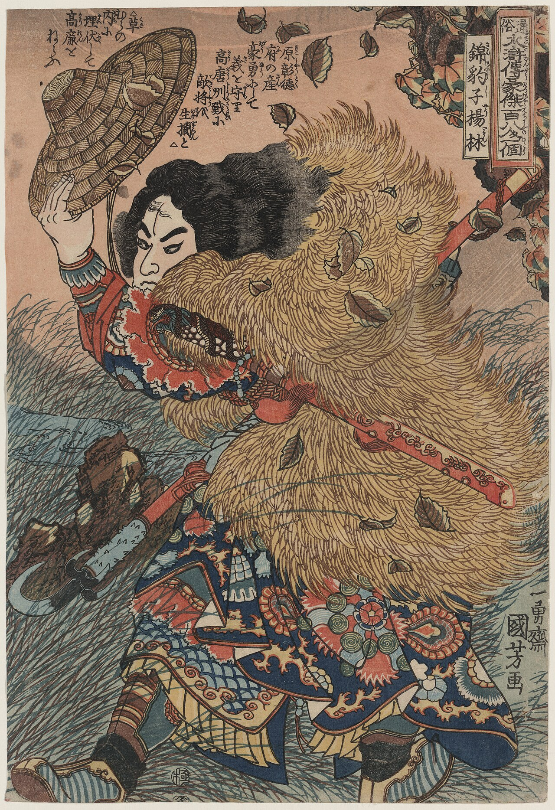

# Water Margin

Figure: A hero from Utagawa Kuniyoshi’s Suikoden print series; it is neither an illustration from a Ming edition of Water Margin nor a modern book cover. Image: Utagawa Kuniyoshi, Public domain, via Wikimedia Commons ([source page](https://commons.wikimedia.org/wiki/File:Suikoden.jpg)).

## Bibliographic note

Water Margin is a long Ming dynasty novel usually attributed to Shi Nai’an, though some traditions name Shi Nai’an and Luo Guanzhong as co-authors. Common versions include the 100-chapter, 120-chapter and 70-chapter editions; they differ in the amnesty, the campaign against Fang La and the ordering of the Liangshan heroes. English translations include Pearl S. Buck’s All Men Are Brothers and Sidney Shapiro’s Outlaws of the Marsh, with different approaches to names and chapter titles. A citation should specify the version, because “Water Margin” covers a family of texts.

The story is set in the late Northern Song, following Song Jiang and 108 heroes as they are driven to Liangshan, form a band, accept amnesty and campaign against Fang La. It is not a contemporary record of the Song; it grew out of storytelling, opera and literati editing over a long period. Wine appears in almost every chapter, but it is not background decoration. It drives plot, displays status, tests loyalty and creates reversals.

## Author and text

Very little is known about Shi Nai’an. Scholars disagree about whether he was the final writer, how he related to Luo Guanzhong and when the novel took shape. A cautious description is that Water Margin gradually formed in the late Yuan and early Ming, was repeatedly reworked by storytellers and writers, and appeared in several Ming editions. It is not a single “personal creation” but a product of “collective storytelling plus literati finalisation.” That process explains the layered language: storyteller formulas, literati poetry, marketplace slang and official documents.

Using Water Margin as alcohol history requires acknowledging that it is fiction. Its “Song dynasty” is a Ming imagination of the Song; wine names, vessels, prices and drinking habits may include Ming market experience. It can help us understand how people imagined the wine of the jianghu, but it cannot alone prove the technique of a particular Song wine. It must be read alongside the Song History, Song notebooks, wine-tax documents and excavated vessels.

## Where wine sits

Wine performs at least five functions. First, brotherhood: heroes meet, join, swear oaths and drink; wine marks “one of us.” Second, courage: Wu Song fights the tiger and beats Jiang the Gate Guard after drinking; wine is written as a catalyst of heroic energy, but it also brings loss of control and danger. Third, trap: the “Cleverly Taking the Birthday Gifts” episode uses knockout drops in wine; wine becomes an instrument of deception and resistance. Fourth, hierarchy: the Liangshan seating order, banquet positions and order of toasts mirror the power structure. Fifth, turning point: many characters drink, speak too much, kill or reveal their identity, and end up on Liangshan.

The wine names matter. “Village wine,” “old wine,” “Tou Ping Xiang” and “Chu Men Dao” have echoes of real drinks but also of storyteller exaggeration. “Three bowls and you cannot cross the ridge” is the Jingyang Ridge tavern’s advertising line: the owner says the village wine is stronger than old wine, three bowls make a customer drunk and unable to cross the ridge. Wu Song insists on eighteen bowls. The number is literary exaggeration, not a precise measure. Researchers infer from Song wine types that such village wine was close to huangjiu, perhaps around 10 percent alcohol, but the novel cannot give an exact figure.

## Key scenes and characters

“Three Bowls and You Cannot Cross the Ridge” is the most famous wine scene. Its narrative function is not to prove Wu Song’s capacity but to create an underestimated hero: the more the tavern warns, the more he insists; the three-bowl limit is broken by eighteen bowls, and his courage and capacity are established together. The tiger fight then turns drunken courage into real combat. Wine is the passport: without it, Wu Song is only a passing customer; with it, he enters the legend of the tiger-killing hero.

“Drunk Beating Jiang the Gate Guard” makes the other side of wine more complex. Wu Song is not simply drunk and violent; he uses “drunkenness” as disguise, drinking and testing along the way before defeating Jiang in the Happy Forest. Wine is strategy: it makes the opponent underestimate him, and it lets the reader see that “drunk” can be performed. Wu Song’s line that “one part wine gives one part strength, five parts wine five parts strength” is both a boast and a narrative device: the author quantifies fighting power through wine, turning drinking into a calculable heroic capital.

“Cleverly Taking the Birthday Gifts” makes wine the vehicle of a swindle. Chao Gai, Wu Yong and their companions pose as date merchants and meet Yang Zhi’s convoy at Yellow Mud Ridge. They first drink from one barrel to show it is safe, then create confusion by “stealing a ladle,” and put knockout drops into the other barrel. Yang Zhi is cautious and refuses to let his men buy wine, but heat, thirst and his companions’ urging finally make him drink. Wine here is not a symbol of loyalty but a tool of power: whoever controls the wine controls the situation. The episode also shows that wine in the novel is never only heroic drinking; it can be drug, bait and weapon.

## Historical value and limits

As a literary text, its value is in preserving the jianghu imagination of wine. Taverns, wine banners, vessels, dishes, drinking games, persuasion phrases and drunken behaviour help readers understand how Ming people imagined Song urban drinking. It can be checked against Dongjing Menghua Lu, Along the River During the Qingming Festival and Song wine-tax documents: tavern locations, banner writing and the relation between licensed and petty wine houses often echo one another.

There are four limits. First, it is fiction; plot and characters involve invention, exaggeration and typology, and “eighteen bowls” is not an average Song drinking capacity. Second, editions differ; chapter titles, poems and episodes may vary, so citations need the version. Third, alcohol strength and wine names cannot be measured from the novel; “village wine close to huangjiu, about 10 percent” is a researcher’s inference, not data in the text. Fourth, the perspective is that of heroic outlaws, with limited coverage of women, ordinary people and officials; it cannot represent Song society as a whole.

## Common misreadings

The most common misreading takes Song “baijiu” to mean today’s baijiu. In Song texts, “baijiu” sometimes means a clear rice wine or huangjiu, not a distilled spirit; imagining Wu Song’s capacity through today’s strong baijiu leads to completely wrong conclusions. A second misreading converts “eighteen bowls” into eighteen modern bottles; bowl size, alcohol strength and drinking style all differ. A third misreading treats “three bowls and you cannot cross the ridge” as a real tavern rule; it is an advertising line and narrative device. A fourth misreading treats Water Margin as direct evidence of Song alcohol history; it reflects Ming imagination and the publishing market more than Song reality. A fifth misreading treats wine only as “brotherhood background”; in the novel it is often used for deception, violence and power, and loyalty is only one side.

## See also

- [Huangjiu](ref:yellow-wine): the grain-wine type that “village wine” and “old wine” may resemble.
- [Song wine tax: official service, private brewing and fiscal dependence](ref:song-tax): the institutional background of Song wine.
- [A history of taverns: from wine houses and inns to bars](ref:taverns): taverns, banners and jianghu space.
- [A history of Chinese wine: from grain fermentation to national famous wines](ref:chinese-wine): the long history behind the novel’s wine names.
- [Reading a city through a tavern](ref:pub-and-city): putting the novel’s “wine houses” into urban space.
