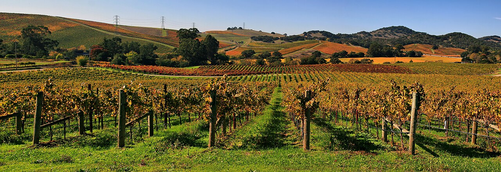

# The Wine Bible

Figure: Autumn vineyards in Napa Valley; The Wine Bible maps regions and varieties, and this is not the book cover. Image: Brocken Inaglory, CC BY-SA 3.0, via Wikimedia Commons ([source page](https://commons.wikimedia.org/wiki/File:Vineyards_in_Napa_Valley_7.jpg)).

## Bibliographic note

The Wine Bible was written by the American wine writer and educator Karen MacNeil and first published by Workman Publishing in New York in 2001. Publisher and author pages describe it as one of the best-selling wine books in the United States, with more than one million copies sold; the first edition took about ten years to write. A second edition appeared in 2015, and a third edition in 2022, again from Workman. The third edition is on the Society of Wine Educators’ 2024 recommended reading list for the Certified Wine Educator programme.

The differences between editions are not merely “updated years.” The second edition added new regions, grapes and climate material; the third continued that expansion and reworked parts of the organisation. The wine world changes quickly—climate, appellation rules, labelling terms and market fashions—so a 2001 book cannot describe the 2020s in full. Anyone citing a specific producer, vintage or price must check the latest edition or the publisher’s page, not treat the old text as current fact.

## Author and context

Karen MacNeil is a prominent American wine writer, educator and consultant. She has reported on wine for NBC’s Today Show, hosted the PBS series Wine, Food and Friends with Karen MacNeil, and won an Emmy. She was also a creator of the Rudd Center for Professional Wine Studies at the Culinary Institute of America, often described as the “Harvard” of wine education.

The book grew out of a problem MacNeil kept meeting in teaching and media work: wine knowledge is split into fragments—regions, grapes, regulations, tasting, food pairing, labels—and beginners struggle to connect them into a map. She wanted a book that could be read as a course and consulted as a reference: start with what wine is, how it is made and how it is tasted; move through the major regions and grapes; then return to the table and storage. That structure made it a common text in wine courses, sommelier study and home libraries.

## Structure

The book has four broad parts. The first is foundation: grapes, fermentation, oak, alcohol, acidity, tannin, sweetness, bubbles, fortified wines, and how to look, smell and taste. The second is regions: France, Italy, Spain, Germany, Portugal, the United States, Australia, New Zealand, South America, South Africa and others, presented through geography, history, regulations, grapes and styles. The third is grapes and wines: common white and red varieties and blends are discussed within their regional context rather than as isolated flavour lists. The fourth is practice: pairing, storage, opening, decanting, glassware, reading a wine list and buying.

The arrangement is close to a textbook, but the language is lighter. MacNeil uses metaphors and scenes to explain abstract ideas—acidity as the “backbone,” tannin as “sandpaper in the mouth.” These images help beginners build a vocabulary, but they have limits: they cannot replace chemical analysis or repeated sensory training. The maps, tables and label guides are tools, not decoration; the reader should ideally compare them with a real bottle, so that words become experience.

## Argument and influence

The central claim is that the taste of a wine is not a score but the joint result of place, grape, craft and time. To understand a bottle, you need to know where it comes from, which grapes it uses, how it was made and when it is being drunk; price and fame are variables, not the whole story. MacNeil makes “terroir” concrete: climate, soil, slope, sunlight, water, diurnal range, local law and market all shape the style.

A second claim is accessibility: wine should not be surrounded by jargon and ritual. She explains professional concepts in everyday language and encourages readers to start from their own senses—describe “what I taste” before learning the industry terms. This is beginner-friendly and aligns with modern wine education: perception first, terminology second.

The book’s influence is mainly in the education market. Many sommeliers, wine courses and exams use The Wine Bible as an introduction or revision text; it has also been cited in media and film, becoming a symbol of American popular wine culture. Its success shows that a wine reference does not have to be a dictionary; narrative and scene can connect knowledge.

## Limits as evidence

As a reference, its value is in connecting fragments into a system. It lets a reader quickly understand a region’s history, regulations, main grapes and representative wines, and helps with decisions on a wine list. The maps and tables are especially useful for building geographical sense; the book does not aim for academic footnote density, but for readability and lookup.

Its limits are clear. First, its perspective is the American market and English-language reader; in some European regions it is less detailed than local textbooks. Second, the wine world changes quickly—producers, vintages, prices, regulations and climate—so specific recommendations go out of date. Third, it covers a lot of ground but cannot be research-depth in every region; a regional study still requires local laws and specialist literature. Fourth, metaphors and personification help beginners but can understate the chemical complexity of wine. Fifth, it is a book, not a database; for the latest information on a wine, go to the producer, the regional association and reliable data sources.

## Common misreadings

The most common misreading treats “Bible” as unquestionable authority. The title is a publisher’s marketing choice, not religious truth; wine knowledge changes, and readers should keep checking. A second misreading treats the book as “only for beginners”; it is beginner-friendly, but the density of its regional chapters makes it useful to professionals too. A third misreading treats the vintages, prices and producer recommendations as current; those details age, so check the latest edition or official page. A fourth misreading reduces “terroir” to “soil decides everything”; terroir also includes climate, topography, water, viticulture and regulation, and soil is only one part. A fifth misreading equates “best-selling” with “academically authoritative”; sales show market acceptance, not research-level accuracy in every region.

## See also

- [Wine](ref:wine): definitions, types and basic winemaking.
- [Napa Valley](ref:napa): a New World region discussed in the book.
- [Terroir](ref:terroir): the history and disputes around “a taste of place.”
- [Choosing your first wine](ref:first-wine): applying the book to a first purchase and tasting.
- [Wine grading systems](ref:grading): geographical indications, national tiers and estate classifications.

Start with the author and edition. From there, consider what the book covers, then what it is cited for here. That is how a practical judgment about The Wine Bible is built.

Start with [Wine](ref:wine) for author, then read [Terroir](ref:terroir) for edition. Seeing both keeps The Wine Bible from being confused with a neighbouring idea.
