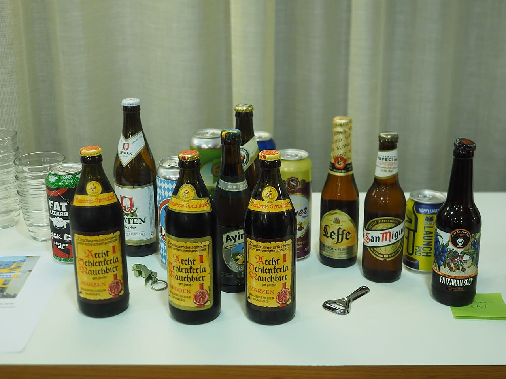

# The World Atlas of Beer

Figure: Beers from several countries on a festival tasting table; The World Atlas of Beer maps regions and styles, and this is not the book cover. Image: JIP, CC BY-SA 4.0, via Wikimedia Commons ([source page](https://commons.wikimedia.org/wiki/File:German-style_beers_at_Oktoberfest_beer_tasting.jpg)).

## Bibliographic note

The World Atlas of Beer was written by the British beer writer Tim Webb and the Canadian beer writer Stephen Beaumont. It was first published in 2012, followed by a revised edition in 2016 and a third edition by Mitchell Beazley in 2021, with 272 pages. Publisher material says the first two editions sold about 120,000 copies; the third edition is described as “fully updated,” with new sections on beer and food, pouring, craft-beer trends and emerging regions.

The title can make the book look like a complete world directory of breweries. It is better understood as a “geography of beer”: maps, regions, styles and history explain why beer tastes different in different places. The third edition’s bibliographic details can be checked in Hachette catalogues and WorldCat. Anyone citing a specific brewery or beer should give the edition, because the industry changes faster than wine: openings, closures, ownership changes and recipe revisions are common.

## Authors and context

Tim Webb is a major figure in British beer writing and consumer activism. He served six years on the board of CAMRA (the Campaign for Real Ale), ran Britain’s national beer festival and co-founded CAMRA’s publishing company. He has written the Good Beer Guide Belgium since 1992 and has won beer-writing awards in several countries. His perspective is that of a drinker: he cares how a beer is kept, served and enjoyed in a pub, not only about technical specifications.

Stephen Beaumont is a Canadian beer writer, editor and consultant. He has written for beer publications, judged international competitions and worked across North America, Europe and Asia. His writing treats beer as food, to be understood alongside the table, the season and local habits. The division of labour is roughly Webb for Europe and pub culture, Beaumont for North America and global trends, which gives the book both old-world detail and new-world range.

The book appeared in 2012, when global craft beer was expanding rapidly. Microbreweries were opening across the United States, Britain, Canada, Australia and Scandinavia, and local craft brands were appearing in Asia. Older beer atlases centred on Belgium, Germany, Britain and Czechia; this book tried to extend the map to the Americas, Asia and emerging markets while retaining European historical depth.

## Structure

The book has four broad parts. The first is foundation: raw materials, mashing, fermentation, hops, yeast, water, alcohol, bitterness, colour and foam. The second is style: British ales, German lagers, Belgian sour beers, American IPA, abbey beers, wheat beers and regional styles, explained through history and place. The third is geography: country and regional maps, breweries, bars, drinking habits and representative beers. The fourth is practice: pouring, pairing, storage, tasting and beer travel.

Maps are the skeleton. They do not simply mark brewery locations; they bring language, religion, war, migration, trade and agriculture into the picture. Why are Belgian abbeys concentrated in a small area? Why did Czech Pilsner become the global lager template? Why is British “real ale” tied to pub cellaring? Why did American IPA become more bitter on the West Coast? A reader who only reads the style chapters learns “what beer types exist”; reading the maps and styles together explains “why this type appeared here.”

## Argument and influence

The central argument is that beer styles are not a fixed checklist but products of local history, raw materials, taxation, religion and consumer taste. British ale’s soft bitterness is connected to water, malt and pub cellaring; Belgian sourness to wild yeast, wood and blending; American IPA’s high bitterness and citrus aroma to American hop varieties, cold chains and the craft market. The maps put these variables side by side.

A second argument is that beer deserves serious treatment. The authors place beer on the same cultural level as wine and food: it has place, vintage, maker, service and a tasting language. This attitude shaped beer writing and bar menus after the 2010s, making “beer pairing,” “beer travel” and “beer education” more common.

The book’s influence is mainly in travel, hospitality and introductory education. Readers use it to plan beer trips; restaurants use it for pairing; beer courses use it to build a “style–region–history” framework. Its maps and photography also shape how readers imagine the “beer world,” but images and maps cannot be copied without permission.

## Limits as evidence

As a reference, its value is in putting style back into place. The brewery histories, pub culture, drinking habits and pairing advice can be checked against local records, industry reports and brewery websites. It also helps readers see how beer tax, the Reformation, migration and war shaped beer: the survival of abbey beers, the Czech lager tradition and the British pub system are not isolated “flavour stories.”

There are four limits. First, the industry changes very fast; brewery recommendations, beers and prices go out of date, and even the third edition only covers the world up to 2021. Second, global coverage is uneven, with Europe receiving far more space than Africa, South Asia or the Middle East. Third, the book is a geography and style survey, not a brewing manual; if you want want recipes and process need technical books. Fourth, tasting and pairing advice reflects author preferences, not universal laws; the same beer behaves differently at different temperatures and with different dishes.

## Common misreadings

The most common misreading treats the “world atlas” as a complete brewery directory. It selects representative, accessible and verifiable breweries and bars, not a census. A second misreading treats beer styles as permanent categories; styles change with raw materials, law, markets and taste, and the book is a snapshot. A third misreading equates “Belgian beer” with “abbey beer”; Belgium also has sour beers, farmhouse ales, wheat beers and many non-abbey styles. A fourth misreading treats “craft beer” as a synonym for “small” or “expensive”; craft is more about ownership, scale and attitude than a single number. A fifth misreading treats pairing advice as a rule; pairing is about balancing taste, not “this beer can only go with this dish.”

## See also

- [Beer](ref:beer): raw materials, fermentation and styles.
- [Craft beer](ref:craft-beer): the definition debate and market position.
- [Beer tasting introduction](ref:beer-tasting): applying the style knowledge to a tasting.
- [Belgium](ref:belgium): a major old-world region in the book.
- [Barbecue and beer](ref:pairing): a concrete pairing scenario.

The World Atlas of Beer is best read by starting with the author and edition, moving to what the book covers, and ending with what it is cited for here.