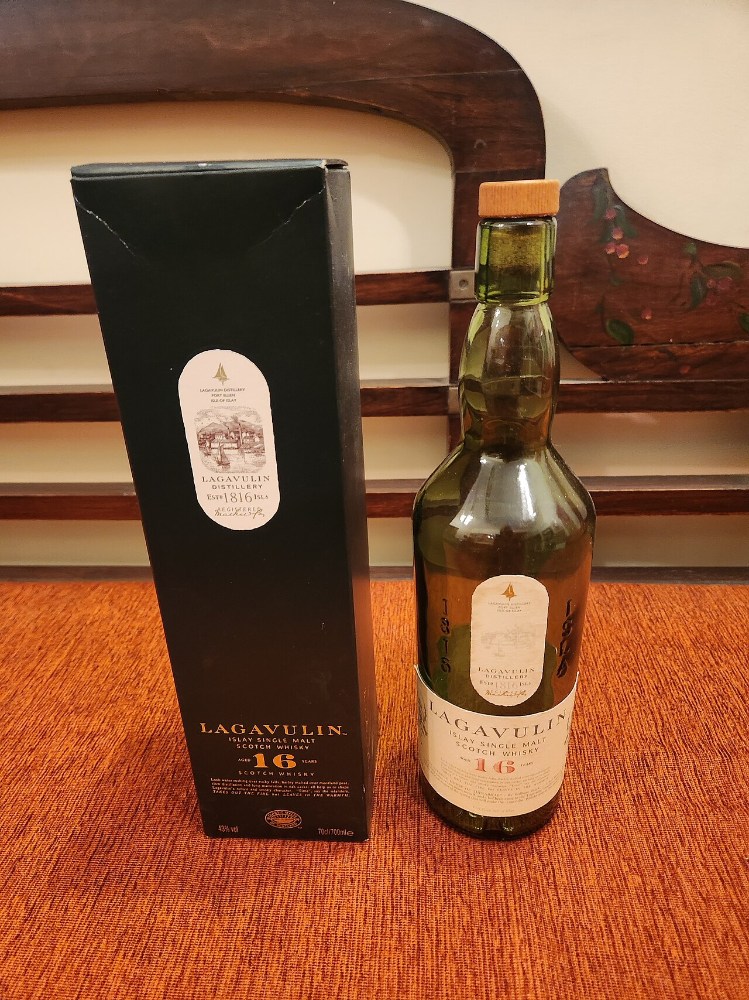

# The World Atlas of Whisky

Figure: A bottle of Lagavulin 16-year-old single malt; The World Atlas of Whisky maps distilleries and flavours, and this is not the book cover. Image: Amitbalani, CC0, via Wikimedia Commons ([source page](https://commons.wikimedia.org/wiki/File:Lagavulin_Single_Malt_Scotch_Whisky_Aged_16_Years.jpg)).

## Bibliographic note

The World Atlas of Whisky was written by the British whisky writer Dave Broom and first published in London by Mitchell Beazley, an imprint of Octopus Publishing Group, in 2010. A “fully revised and updated” second edition appeared in 2014; page counts differ between print and digital versions. The publisher describes it as covering more than 200 distilleries and 750 expressions, and as plotting whiskies by style through six “Flavor Camps.” A third edition followed with new distilleries and updated data. Citations should specify the 2010 first edition, the 2014 revision or the third edition rather than mixing their figures.

The “atlas” is not only a set of geographical maps. It layers Scottish regions, distillery locations, roads, coastlines and flavour characteristics, then extends the same logic to Ireland, Japan, the United States, Canada and other parts of the world. For a reader, the map is an entry point: see where a distillery is, then understand why it produces a certain style. For a researcher, the map is an argument: place, raw material, stills and casks are presented spatially.

## Author and context

Dave Broom is a long-established British whisky writer and taster. He has contributed to whisky magazines, newspapers and industry publications, and has been involved in whisky education, competition judging and distillery consulting. His writing is less about scoring and more about why a bottle tastes the way it does: raw material, distillation, oak, climate and the choices of the distillery. Earlier directories and tasting guides gave him the distillery visits and sample records that made the atlas possible.

The book appeared in 2010, when the global whisky market was expanding quickly. Scotch single malt was moving from niche to mainstream, Japanese whisky was gaining international attention, and American craft distilling and Irish whisky were reviving. Older whisky atlases were Scotland-centred; Broom wanted a global frame while keeping Scottish detail dense. That “global frame plus Scottish deep description” is the book’s clearest editorial strategy.

## Structure

The book has three layers. The first is general: the definition of whisky, raw materials, malting, mashing, fermentation, distillation, oak, maturation, blending, tasting and flavour language. The second is regions and distilleries: Scotland is divided into regions, then each distillery is described through history, equipment, capacity, style and representative expressions; Ireland, Japan, the United States, Canada and other regions have their own chapters. The third is flavour and bottles: the “Flavor Camps” group whiskies by aroma, palate and finish, followed by tasting notes and recommendations.

The Flavor Camps are the most memorable device. They sort whiskies into malty, fragrant, oaky dried fruit, oaky soft fruit, peaty and waxy style groups, so a reader can choose by “what I want to taste” before knowing the distillery name. The classification is an editorial tool, not a scientific taxonomy; one whisky can belong to several groups, and later editions may adjust the groupings. It should be used as a “map for finding a bottle,” not as a biology of whisky.

## Argument and influence

The central argument is that whisky flavour is the product of place, process and time, not a mysterious gift of one distillery. Place affects water, climate and barley varieties; process affects body, aroma and finish; oak and maturation time affect colour, tannin and sweetness. Broom separates this chain with maps and distillery entries, letting the reader see the concrete choices behind “flavour.”

A second argument is the global view: whisky is not a synonym for Scotland. Irish pot still, American bourbon and rye, Japanese precision, Canadian blending—each has its own history and style. Putting them in one book is not a ranking exercise but a comparison: the same raw materials and oak can become different drinks under different rules and markets.

The book’s influence is mainly in buying and travel. Readers use it to plan distillery visits or to choose a bottle by flavour; bars and restaurants use it as a menu reference; whisky courses use it to build a regional framework. It has won whisky-writing and publishing awards and is treated as a working reference by many in the trade. Its maps and distillery photographs have become visual references for websites and courses, but copyright prevents direct copying.

## Limits as evidence

As a reference, its value is in putting scattered distillery information into a comparable frame. The histories, equipment types, capacities, water sources, cask policies and representative bottles help a reader understand a distillery’s style choices. It can be checked against distillery websites, regional association data and legal texts rather than treated as the sole evidence for a distillery’s history.

There are five limits. First, tasting notes are subjective records, not chemical analysis; the same whisky changes with time, glass and condition. Second, distilleries and bottles change quickly—capacity, ownership, limited editions and prices—so 2014 data cannot be treated as 2026 fact. Third, the “world” coverage is uneven: Scotland receives far more space than Africa, South Asia or South America. Fourth, the sourcing and tasting conditions of the samples are not fully disclosed, so a reader cannot reproduce every tasting. Fifth, the Flavor Camps are an editorial classification, not an industry standard; distillers and critics will divide styles differently.

## Common misreadings

The most common misreading treats “world atlas” as a complete directory of every distillery. It covers distilleries the author considered representative and verifiable, not a census. A second misreading treats the Flavor Camps as scientific categories; they are buying tools, not standards of chemistry or sensory science. A third misreading treats tasting notes as objective scores; they describe the author’s experience under specific conditions and should be read as guidance, not verdicts. A fourth misreading treats the non-Scottish chapters as supplements; Ireland, Japan and the United States have independent histories and cannot be measured only by “how Scottish they are.” A fifth misreading uses old edition data to judge the present; distilleries close, change hands, expand and release new products, so check the latest edition or official information.

## See also

- [Whisky](ref:whisky): raw materials, distillation, oak and regions.
- [Scotch whisky](ref:scotch): the largest regional section in the book.
- [Scotland](ref:scotland): geography, regulation and distillery distribution.
- [Whisky introduction](ref:whisky-intro): applying the regional knowledge to a first tasting.
- [Single malt](ref:single-malt): the difference between one distillery and a blend.

**Short definition:** Dave Broom’s The World Atlas of Whisky, first published in 2010 and fully revised in 2014, uses maps, more than 200 distilleries and 750 expressions to build a framework of place, process and flavour. This article covers its editions, author, structure, arguments, limits and common misreadings. 
