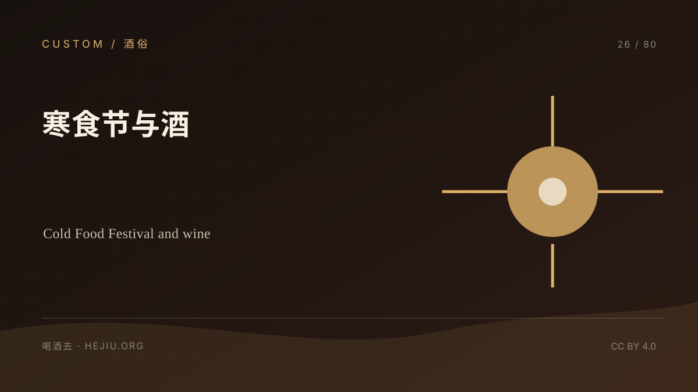

# Cold Food Festival and wine

The Cold Food Festival is a holiday built around fire: for a day, no fire is lit, cold food is eaten in advance, tombs are visited and the first spring outings are made. Wine is not always the main character. It appears more often as a libation at the grave, a drink at the family meal and a seasonal word in poetry. To understand it, wine has to be put back into the context of the fire ban.

Figure: thematic illustration for Cold Food Festival and wine. Image: AI-assisted illustration generated with Doubao Seedream 5.0 (project-owned); not a photograph of the subject.

## Time and place

By the old reckoning the festival falls one or two days before Qingming, and some accounts place it 105 days after the winter solstice. Because the two dates are so close, Cold Food and Qingming gradually merged in everyday practice from the Tang and Song onward. In most places today, tomb-sweeping and spring outings happen around Qingming, and Cold Food as an independent holiday has become faint.

Regional differences are mainly about how much survives. In the Jiexiu area of Shanxi, the story of Jie Zitui keeps the memory of Cold Food alive; some northern areas still prepare cold food in advance; in the south, spring foods such as qingtuan and aiban are more often linked to Qingming. Dates, foods and tomb rites are not uniform, and no single locality should be taken as “the tradition”.

## Historical sources

The early origin of Cold Food is often traced to the pre-Qin custom of renewing fire: fire was changed with the seasons, and the interval of the change involved a ban on lighting fires. Later, the ban was linked to the story of Jie Zitui, who was said to have refused reward and died in a fire; people were said to eat cold food to remember him. The story travelled widely, but it is an explanatory legend, not reliable history.

Between the Han and Tang, Cold Food had become a substantial local observance in the Bingzhou region, with records of extended periods of cold food. In the Tang and Song, tomb visits, willow branches, swings and ball games entered urban life, and note-books such as Dongjing Meng Hua Lu describe the bustle of the capital around Qingming. Three layers should be kept apart: the old fire-renewal custom, the Jie Zitui legend, and the formed seasonal life of the Tang and Song. They overlap, but they are not the same origin.

## Procedure and vessels

Common actions include preparing food in advance, extinguishing fires, visiting tombs, hanging willow, walking in the country, swinging and eating cold food. At the grave, wine is usually an offering: it is poured into a cup or directly onto the ground as an invitation and a farewell. At the family meal it accompanies cold dishes in small quantities, as a seasonal gesture rather than a feast.

Because no fire is lit, warming wine is inconvenient. It is either warmed beforehand and kept in an insulated container, or drunk at room temperature. In the traditional repertoire, a hu pot holds the wine, a zhan cup is used for drinking, and a ewer with a warming bowl is used to heat it; the fire ban removes the warming step, which helps explain why records of drinking at Cold Food are thinner than at other festivals. Modern families have no fire ban, and bottles and glasses replace the old vessels; the sense of ritual survives mainly in the offering table and the act of pouring.

## Wine and food

Cold Food food is mostly cold: cold porridge, cold noodles, steamed “Jie Zitui swallows” made of dough, cold tossed noodles, and in various places qingtuan, aiban and sanzi. These foods tend to be cold, dry or sweet, and wine is there to accompany and warm the mouth rather than to cut richness. Yellow wine and rice wine, being mild and lower in alcohol, suit cold dishes; baijiu may appear at the grave, but usually only as a libation, not for drinking in quantity.

It should be said plainly that there is no nationwide “Cold Food wine” recipe in the sources. The term is mostly a general name for wine drunk during the festival, or a seasonal word used for parallel effect in poetry. Claims that a particular herb or flower formula is the “ancient method” lack reliable support.

## Change and contemporary practice

Today Cold Food is largely absorbed into Qingming. In cities, families visit graves around Qingming with wine, fruit and cakes, then eat together, and wine returns to the table. Some rural areas still steam food in advance and hang willow at the door. Recent years have also brought online memorials, paid grave-visiting services and flowers instead of paper money; wine in these new forms is often reduced to a single offering cup or a few words.

Another change is tourism. The Qingming holiday encourages outings, flower-viewing and short trips, and the historical content of Cold Food is compressed into “a spring festival”. This need not be regretted, but it is worth remembering that tomb-visiting and outing are different moods, and wine is used differently in each: quiet and sparing at the grave, closer to ordinary social drinking on the trip.

## Disputes and health boundaries

First, cold food and the stomach. The Cold Food tradition rests on a fire ban, not on health advice. Older people, children and anyone with a sensitive digestion should not eat large amounts of cold food, and should certainly not use wine to “warm the stomach”. Alcohol irritates the gastric lining, and drinking on an empty stomach with cold food is a poor combination.

Second, wine and tomb visits. Anyone driving after a grave visit should not drink; roads around cemeteries are often narrow and busy, and “just a little” is not a safe rule.

Third, fire bans and fire safety. The old fire ban was a ritual gesture; modern forest-fire rules are law. Incense, paper money, cigarettes and firecrackers can all start fires, and many places now prohibit them. A wine libation can be kept, but tradition is no excuse for breaking fire regulations.

Fourth, urging others to drink. A seasonal meal can easily turn “being in the spirit” into an obligation. Mild wine or alcohol-free drinks, with something for everyone, are a better way to include non-drinkers.

## Common misreadings

First, treating Cold Food and Qingming as the same thing. They are adjacent and later merged, but Cold Food centres on the fire ban and cold food, while Qingming centres on tomb visits and outings.

Second, making the Jie Zitui legend the only origin. Fire renewal, local taboos and later storytelling all shaped the festival.

Third, assuming one must drink at Cold Food. Records are uneven, and wine is mostly a companion to the grave visit and the family meal.

Fourth, believing in a fixed “ancient Cold Food wine” recipe. The surviving evidence does not support it.

Fifth, treating cold food as modern dietary advice. It was a practical arrangement under specific historical conditions, not a nutritional conclusion.

## Related entries

- [China](ref:china): regional differences in Cold Food and Qingming.
- [Wine and festivals](ref:festivals): the wider structure of seasonal drinking.
- [Wine and ritual](ref:ritual): ritual background of sacrifice and libation.
- [Zhongyuan Festival and wine](ref:zhongyuan): another ancestor festival in the same season.
- [Bai Juyi, Asking Liu Shijiu](ref:asking-liu): a poem of a spring-night gathering and an invitation.
- [Yellow wine](ref:yellow-wine): a mild drink for cold dishes.
