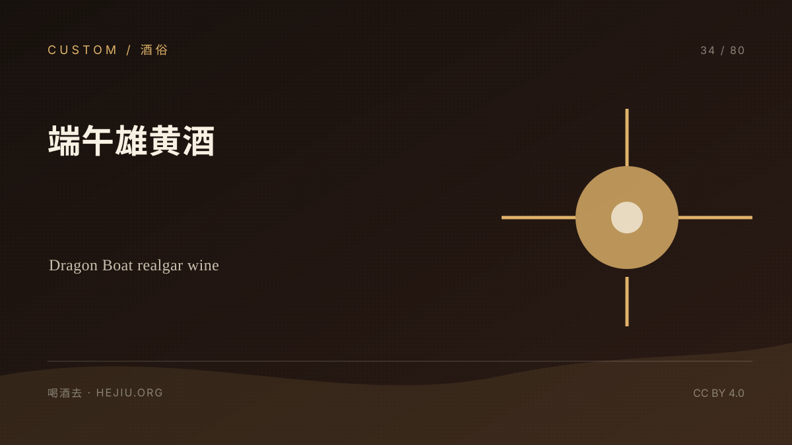

# Dragon Boat realgar wine

The Dragon Boat Festival falls on the fifth day of the fifth lunar month. Customs include gathering mugwort, hanging calamus, tying five-coloured cords, wearing scented pouches, and drinking realgar wine, sprinkling realgar water and painting the character for “king” on a child's forehead. The aim is to drive off insects, ward off evil and prevent illness; wine is only one carrier.

The conclusion belongs at the start: realgar is mainly arsenic tetrasulfide, an arsenic-bearing mineral, and taking it internally carries a risk of poisoning. Heating or long storage can also produce arsenic trioxide, commonly known as white arsenic. Today realgar wine can be understood as a historical custom, but it should not be drunk, and children should not be exposed to it.

Figure: thematic illustration for Dragon Boat realgar wine. Image: AI-assisted illustration generated with Doubao Seedream 5.0 (project-owned); not a photograph of the subject.

## Time and place

The date is fixed at the fifth day of the fifth lunar month, at the start of summer, when insects and disease are more likely. People called the fifth month the “evil month” and the fifth day the “evil day”, and developed a set of protective practices centred on medicinal herbs, pouches, bathing and wine.

The realgar custom is widespread among Han communities, but local records differ in detail. In Jiangsu and Zhejiang, people may drink a sip, sprinkle the wine in corners and paint “king” on a child's forehead. In parts of Hunan and Jiangxi, realgar is used together with mugwort and calamus. In parts of the north, five-coloured cords and scented pouches matter more, and realgar wine is only one item. Many regions drink calamus wine or ordinary yellow wine without realgar. Treating “every Dragon Boat must drink realgar wine” as a national rule magnifies a local practice into a standard.

## Sequence and vessels

There are usually three steps. The first is preparation: grind realgar and mix it into yellow wine or spirits. The second is use: drink a small amount, dip a finger and paint “king” on a child's forehead, sprinkle it in corners, under the bed or behind the door, or apply it around the ears, nose and navel. The third is disposal: some places discard the residue or bury it outdoors.

The common thread is using wine as a medium to carry a medicinal substance onto a space or a body. Wine is both solvent and ritual cleanser. The vessels are simple: a small cup, a brush or finger, a spray bottle, alongside mugwort, calamus, pouches and five-coloured cords. The other Dragon Boat objects belong to the dragon boat and the rice dumpling, a separate set that should not be merged with realgar wine.

## Symbolic meaning

First, insect control. In early summer, mosquitoes and insects multiply, and the smell of realgar, mugwort and calamus was used to repel them. Second, protection from evil. The character for “king” borrows the tiger's authority, painted on the forehead as an extra layer of protection for a child; realgar is “yang” and stands against the yin of the “evil month”. Third, purification. The combination of wine and herbs served as spatial disinfection and bodily cleansing. Fourth, narrative. The White Snake legend gave realgar wine the meaning of “revealing the truth”, a cup that becomes a switch for exposing identity.

These four layers often overlap in folk practice. Practical function, symbolic protection and literary revelation reinforce one another, making realgar wine one of the most dramatic objects of the festival.

## Historical change

The idea of the fifth month as an “evil month” is old. Zong Lin's Jingchu Suishi Ji, from the Liang dynasty, records gathering mugwort, tying protective cords and drinking medicinal preparations on the fifth day, showing that the protective complex had taken shape in the Northern and Southern Dynasties. Realgar entered the materia medica tradition as a mineral drug credited with killing insects and resolving toxicity; in the Ming, Li Shizhen's [Bencao Gangmu](ref:bencao) affirmed its medicinal use while also noting its toxicity and warning against careless use.

The two lines met at the Dragon Boat Festival and formed the realgar wine custom. It should be noted that “drinking medicine” in old texts does not necessarily mean “drinking realgar wine”, and recipes and uses differ between sources. Tracing the later fixed practice directly to the Han lacks sufficient evidence. A safer statement is that Dragon Boat protective customs are old, while the specific form of realgar wine was fixed over a long process of transmission.

The White Snake story gives another time marker. The episode in which Bai Niangniang drinks realgar wine at the Dragon Boat Festival and reveals her true form was fixed in the Qing dynasty play Leifeng Pagoda, and then spread through storytelling, local opera, film and television. It is a literary and stage product, not a historical source for the custom's origin.

In 2006 the Dragon Boat Festival was listed in the first national intangible cultural heritage catalogue; in 2009 the Chinese festival was inscribed on UNESCO's Representative List of the Intangible Cultural Heritage of Humanity. Heritage protection covers the whole complex of dragon boats, rice dumplings, mugwort and pouches; it does not encourage drinking an arsenic-bearing medicinal wine.

## Contemporary disputes

First, internal use. Realgar contains arsenic, and long-term or excessive intake can damage the skin, nerves and digestive system and can be life-threatening. “People drank it in the past” is not evidence of safety; past lifespans and poisoning records do not support the analogy. Second, external use. Broken skin, accidental ingestion by children and licking by pets must be avoided; paint should be washed off promptly. Third, heating. Heating realgar oxidises it to arsenic trioxide, so “warming it makes it safer” is exactly backwards.

Fourth, substitutes. Ordinary yellow wine or rice wine can replace realgar wine and keep the form of festival drinking; food-grade colouring can replace realgar for forehead painting and keep the parent-child activity. But cinnabar should not be used instead: it is mainly mercury sulfide and is also toxic. Fifth, children and alcohol. Even with ordinary yellow wine, children should not be encouraged to drink. Sixth, narrative confusion. The White Snake legend is literature, not history; treating it as origin misleads understanding.

If a family keeps the custom, the safest form is symbolic only, with no internal use: sprinkle a little ordinary wine at the door, explain the origin and the risk, and keep children away from realgar.

## Common misreadings

First, equating realgar wine with yellow wine. Realgar wine is wine with realgar added; the two are not the same.

Second, believing heating makes it safer. Heating promotes the conversion of realgar to the more toxic arsenic trioxide.

Third, treating the White Snake legend as history. The story was fixed in Qing drama, later than the protective customs.

Fourth, believing realgar effectively repels snakes. The folk saying is widespread, but experimental observation does not support “snakes fear realgar”; smell and alcohol may have a mild deterrent effect, but it is not a protective measure.

Fifth, assuming everyone drank realgar wine at the Dragon Boat Festival. Calamus wine, mugwort wine, ordinary yellow wine and no drinking at all are equally common.

Sixth, believing a small amount is harmless. Arsenic accumulates in the body, and there is no safe “small amount”.

## See also

- [China](ref:china): the regional background of Dragon Boat customs.
- [Wine and festivals](ref:festivals): the overall structure of seasonal wine.
- [New Year tusu wine](ref:new-year-wine): another medicinal festival wine.
- [Mid-Autumn moon wine](ref:mid-autumn-wine): autumn drinking practice.
- [Bencao Gangmu](ref:bencao): the traditional pharmacy on realgar.

For Dragon Boat realgar wine, begin with what it is, then where it comes from, and finish with how it is used; that order keeps the account grounded.

Put [China](ref:china)'s region next to [New Year Drinking: Pepper-and-Cypress Wine and Tusu Wine](ref:new-year-wine)'s occasion; the difference marks the boundary.
