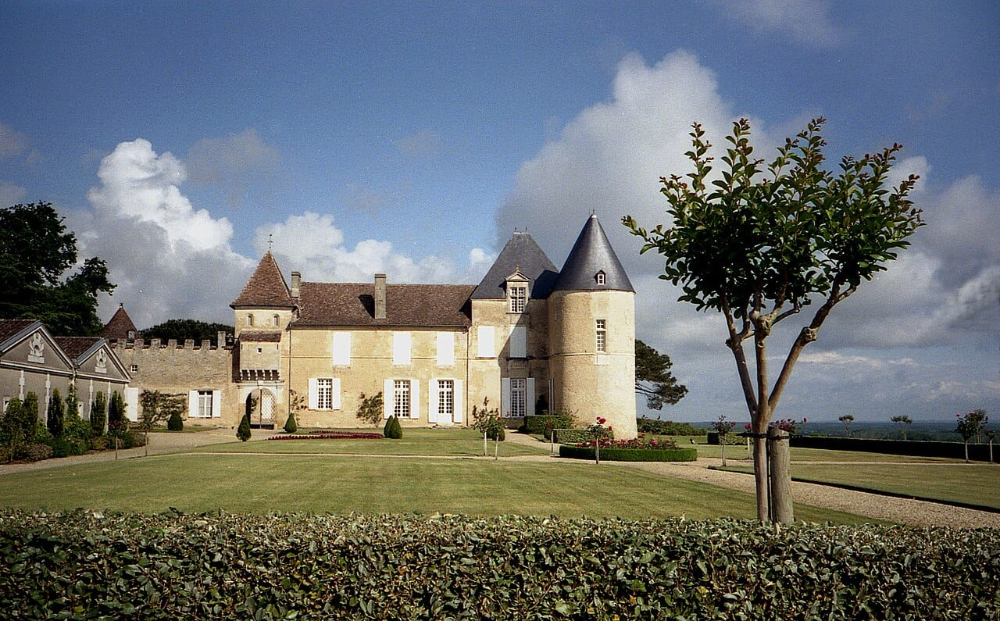
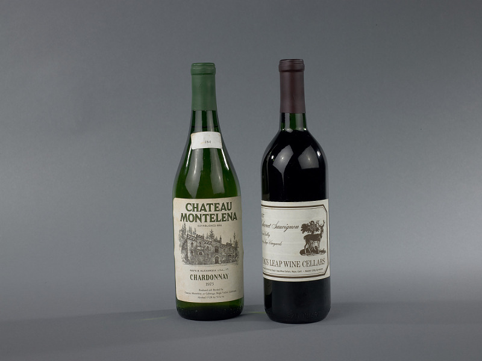

# 1976 Judgment of Paris: California wine beats French estates

On 24 May 1976 a blind tasting took place in Paris. The organisers were the British wine merchant Steven Spurrier and Patricia Gallagher, and the judges were professionals from the French wine world. Twenty wines were poured, 10 from California and 10 from France. California wines took the top score in both the red and white groups. The event, later called the Judgment of Paris, changed how many people imagined the hierarchy of wine origins and turned cross-region blind tasting into a public subject.

Figure: "1976 Judgment of Paris: California wine beats French estates". Photograph: File:Château d'Yquem.jpg. Credit: Benjamin Zingg, Switzerland, CC BY-SA 2.5 ([source page](https://commons.wikimedia.org/wiki/File:Ch%C3%A2teau_d%27Yquem.jpg)). Category image; not a claim that it shows the exact product, site or event.

## Background

In the 1970s French wine was still treated as the world standard. The leading estates of [Bordeaux](ref:bordeaux) and Burgundy rested on the 1855 classification, the appellation system and long-established auction prices, forming an apparently stable hierarchy. California wine, by contrast, had restarted only after Prohibition. After the Second World War, Napa Valley plantings expanded, the University of California at Davis taught modern winemaking, and a new generation of growers experimented in the vineyard. Quality rose quickly, but the region had almost no voice in the European market.

Spurrier ran a wine school in Paris, sold French wine and also introduced California wine to clients. He and Gallagher planned the comparison as a public-relations event, close to the mood of the American bicentennial, rather than as an attempt to overturn the standing of French wine.

## Course and timeline

The tasting took place in Paris. Samples were stripped of labels and presented by code. The red group comprised 6 California Cabernet Sauvignons and 4 Bordeaux, the white group 6 California Chardonnays and 4 Burgundies. There were 11 tasters, and the scores of 9 French wine professionals counted: restaurant owners, wine writers, sommeliers and officials of the appellation authority. They scored appearance, aroma, palate and overall impression.

The white group was won by the 1973 Chateau Montelena Chardonnay and the red group by the 1973 Stag's Leap Wine Cellars S.L.V. Cabernet Sauvignon. The only journalist present was George Taber of Time, whose report appeared in June 1976 and brought the event to public attention.

The timeline runs as follows: 24 May 1976, the tasting; June 1976, the Time report; 1981, Napa Valley is approved as an American Viticultural Area; 2006, the U.S. Congress passes a resolution marking the 30th anniversary.

## Key people and institutions

Spurrier was the organiser and the person who brought California wine into Parisian social networks; Gallagher handled preparation and contacts. Among the nine scoring judges, Odette Kahn represented wine writing, Aubert de Villaine came from a great Burgundy estate, Raymond Oliver and Jean-Claude Vrinat represented top restaurants, Christian Vanneque was a sommelier, Pierre Tari represented a Bordeaux estate, and Pierre Brejoux and Claude Dubois-Millot came from the appellation authority.

In institutional terms, Spurrier's wine school supplied the venue and credibility, Time supplied reach, and the U.S. Congress and Napa Valley trade bodies later turned a commercial tasting into a national narrative. Research at the University of California at Davis, experimental plots in Napa Valley, and the adoption of French oak and temperature-controlled fermentation in the 1970s formed the technical background that allowed California wine to enter the comparison.

## Concrete changes for the industry

First, price and reputation. After the tasting, California wine became more visible on restaurant lists, at auction and in press reviews, and land prices in Napa Valley rose as investment arrived. Second, regional institutions. In 1981 Napa Valley was approved as an American Viticultural Area, and identity began to be built around sub-regions and single vineyards. Third, market structure. The number of California wineries continued to grow in the late 1970s, and exports moved from scattered trial shipments to organised promotion. Fourth, tasting culture. Cross-region blind tastings became a common method for media, merchants and schools, and the nationality and preferences of judges were openly discussed. Fifth, the narrative industry. Documentaries, bestsellers and anniversaries fixed the tasting as the story of the New World defeating the Old World, which in turn shaped pricing and marketing.

## Disputes and later assessments

First, sample and representativeness. Twenty wines, particular vintages and particular estates cannot stand for two whole regions. Second, a single result and long-term quality. Transport, storage, decanting and serving order all affect scores, and later re-runs did not produce identical results. Third, the panel. All nine scoring judges were French, familiar with Bordeaux and Burgundy but inexperienced with California wine; this could depress California scores or, conversely, lend novelty value. Fourth, media amplification. Time chose a dramatic frame, and later research asks readers to separate the record from the retelling. Fifth, commercial myth. The Judgment of Paris became brand capital for California wine and obscured the technical renewal that French estates were also undergoing in the 1970s.

## Common misreadings

One: "California wine defeated French wine across the board." What happened was a ranking of 20 wines in two groups; California won both groups, but there was no region-level verdict. Two: "The French wines were chosen at random." The four Bordeaux and four Burgundies were representative estates of the time, even if vintage and condition were not always ideal. Three: "The judges were bribed or cheated." No evidence supports this; the dispute concerns method and representativeness. Four: "The tasting caused the decline of French wine." French prices and exports kept growing in the late 1970s; the tasting changed the boundary of perception, not the foundation of French wine. Five: "California wine was only recognised after 1976." It already had a domestic market; the tasting accelerated international recognition.

## Advanced judgment

Figure: Winning bottles from the 1976 Judgment of Paris, a watershed in how California and French wines were evaluated. Image: Unknown author Unknown author, Public domain, via Wikimedia Commons ([source page](https://commons.wikimedia.org/wiki/File:Judgment_of_Paris_1976_Winners_NMAH-2006-7043.jpg)).

| Dimension | What happened in 1976 | Later effect |
| --- | --- | --- |
| Judging | Blind tasting in Paris with French judges | California entered the comparison |
| Result | California won red and white | Rematches and dispute continued |
| Industry | California's reputation rose | New World narratives changed |
| Evidence | Winning bottles survived | They became museum objects |

**Did California win every category?** No. The 1976 tasting is often summarised as a California victory, but the red and white flights had their own rankings; it was not every French estate losing to every California wine.

**Has the tasting been repeated?** There have been rematches and anniversary events, with different results. One blind tasting is an event, not a permanent quality verdict; vintage, storage and judges all change the outcome.

**Are the winning bottles authentic?** Museum bottles have provenance and authentication records, but the market also contains fakes and story-driven bottles. Buy historic wine on provenance, auction records and expert authentication.

Further reading: [Lafite](ref:lafite) and [wine](ref:wine).

## See also

- [Bordeaux](ref:bordeaux): the framework of left-bank and right-bank regions and the main source of the red entries.
- [France](ref:france): the appellation system and main regions, useful for understanding the judges.
- [Chateau Lafite Rothschild](ref:lafite): a famous-estate sample from the 1855 classification, representing the hierarchy that was challenged.
- [Wine](ref:wine): the definition, craft and classification of wine.
- [Choosing your first wine](ref:first-wine): a beginner path from region and variety to price.

**Short definition:** On 24 May 1976 the British wine merchant Steven Spurrier organised a blind tasting in Paris; 20 wines were poured, 10 from California and 10 from France, and California wines took the top score in both the red and white groups. The event later called the Judgment of Paris changed the international standing of California wine and became a classic case of cross-region comparison.

1976 Judgment of Paris is best read by starting with the date and setting, moving to the documented consequences, and ending with how later accounts treat it.

**Key facts.**

| Item | Detail |
| --- | --- |
| In one line | On 24 May 1976 the British wine merchant Steven Spurrier organised a blind tasting in Paris; 20 wines were poured, 10 from California and 10 from France, and California wines took the top score in both the red and white … |
| Date | 24 May 1976 |
| Place | France |
| Calendar | Gregorian |
