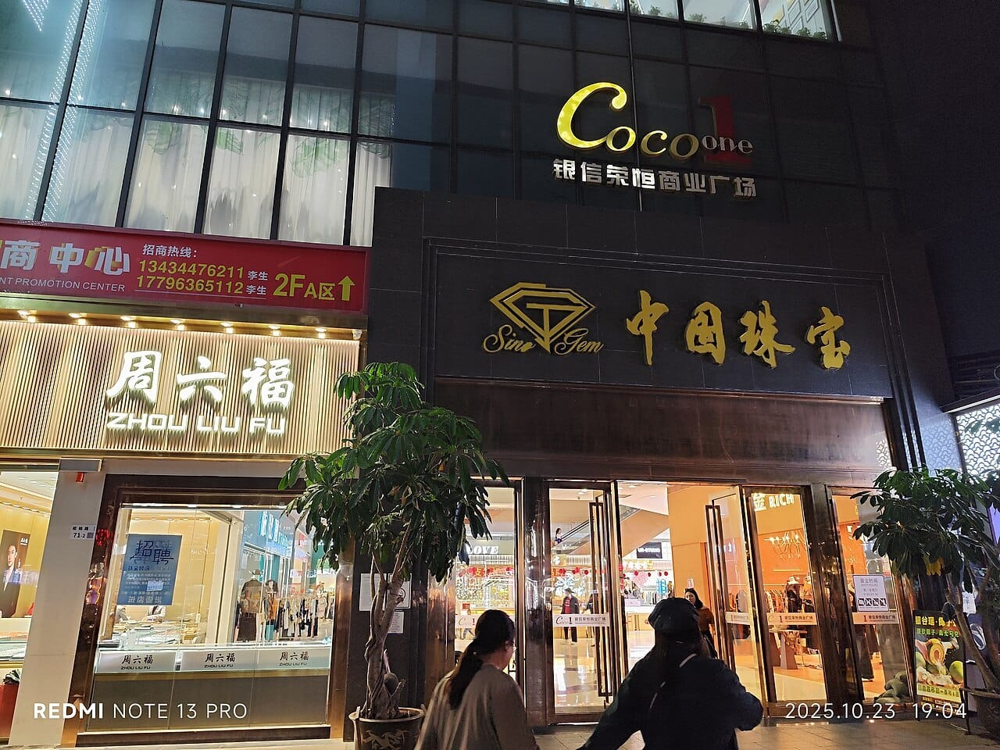

# The 1979 third national wine evaluation: blind judging and aroma groups

In 1979 the third national wine evaluation was held in Dalian, Liaoning. What matters about this meeting is less the list than the method: samples were coded, judges did not know their origin, judging was grouped by aroma type, and assessors had to pass an examination first. Chinese baijiu judging became closer to a controlled comparison.

Figure: "The 1979 third national wine evaluation: blind judging and aroma groups". Photograph: File:ShaoxingXianheng.jpg. Credit: Jiong Sheng, CC BY-SA 2.0 ([source page](https://commons.wikimedia.org/wiki/File:ShaoxingXianheng.jpg)). Category image; not a claim that it shows the exact product, site or event.

## Background

After 1978 alcohol production recovered, the number of plants and output rose, and a price gap appeared between famous and ordinary wines. The open judging used at the previous meeting was vulnerable to brand preconceptions, and the industry wanted a more objective procedure to reduce disputes. Research on aroma types was also advancing: the Moutai trial, the Fenjiu trial and work on Luzhou Laojiao pit mud made sauce, strong, light and rice aroma a common language.

A second factor was the professionalisation of the judging corps. Earlier panels were recommended by regions and standards varied. Technologists such as [Zhou Henggang](ref:zhou-henggang) argued that "wines should be selected only after the people are tested", meaning that assessors should first pass a sensory examination. The idea became institutional at this meeting and continued in 1984 and 1989.

## Course and timeline

Samples were coded uniformly, and judges saw only the code and the category, not the producer. Assessment was grouped by aroma type, comparing aroma, mouthfeel, finish and typicality within the group; grouping also considered saccharifying agent and alcohol strength. Assessors took a sensory examination before the meeting and could score only after qualifying. Scoring used a 100-point scale.

The meeting selected 18 national famous wines, including 8 baijiu, and 47 national quality wines. The eight baijiu were Moutai, Fenjiu, Wuliangye, Jiannanchun, Gujing Gongjiu, Yanghe Daqu, Dongjiu and Luzhou Laojiao Tequ. Compared with the eight of 1963, Quanxing Daqu and Xifeng dropped out, while Yanghe Daqu and Jiannanchun entered. A common explanation is that Xifeng was grouped with light-aroma wines and did not stand out; other sources attribute the result to sample batches and the composition of the panel.

The timeline runs as follows: 1978, production order recovers; 1979, the Dalian meeting introduces coded samples and examiner qualification; the same year, 18 famous wines and 47 quality wines are announced; 1984, the fourth meeting keeps blind judging and expands to 26 famous wines; 1989, the fifth meeting selects seventeen famous wines.

## Key people and institutions

[Zhou Henggang](ref:zhou-henggang) was one of the technical leaders of this meeting, had long worked on baijiu technology and aroma, and promoted examiner qualification, aroma grouping and 100-point scoring. The new national judges produced by the examination included Shen Yifang, Gao Yueming, Liang Bangchang and Xiong Zishu. The hosts were still the Ministry of Light Industry and the commercial system.

The Ministry of Light Industry focused on production technology, the Ministry of Commerce on distribution, and testing bodies provided chemical analysis. The organisation reflected a transitional character: quota allocation and local recommendation remained, while coded samples, examinations and grouping introduced reviewable procedures.

## Concrete changes for the industry

First, blind judging became routine. The 1984 and 1989 meetings continued with coded samples, bringing the procedure closer to modern blind tasting. Second, aroma type became a common industry classification, shaping market understanding of concepts such as [strong aroma](ref:strong-aroma). Third, the assessor corps became professional. Examinations turned judging from the experience of old masters into a trainable, certifiable skill. Fourth, the commercial value of the list rose. Inclusion began to affect pricing and distribution, and famous-wine firms gained an incentive to expand capacity. Fifth, the method spread to local evaluations and in-house quality control.

There were limits: blind judging reduces brand bias but cannot remove differences in individual standards; grouping by aroma type makes comparison across types difficult, turning "which tastes best" into "which is most typical of its group"; and firms still chose their own samples, with no independent check that the sample matched the product on sale.

## Disputes and later assessments

First, the correspondence of sequence and year: 1952, 1963 and 1979 are often called the first three meetings, but months and host cities differ. Second, the counts: 18 famous wines and 47 quality wines is the common account, yet some sources mix numbers from different meetings. Third, the reasons for dropping out: later commentary often explains a famous wine's loss as a decline in quality, when sample batches, aroma grouping or the composition of the panel may also have played a part. Fourth, Xifeng's aroma classification: placing it among light-aroma wines is a common later explanation, but whether that was the official grouping of the year still requires the original documents. Fifth, method: blind judging improved fairness, but it remained sensory evaluation and was not equivalent to chemical testing.

## Common misreadings

One: "1979 was the first national wine evaluation." The first was held in 1952; 1979 was the third. Two: "Blind judging means complete objectivity." Coding hides the brand, but judges' preferences and fatigue still affect scores. Three: "The eight famous wines were eight new brands chosen in 1979." Most had already been selected in 1963. Four: "A famous wine that dropped out must have fallen in quality." Sample batch and grouping rules may explain the result better than a change in quality.

## See also

- [China](ref:china): the host country.
- [Baijiu](ref:baijiu): the main subject of blind judging.
- [Strong-aroma baijiu](ref:strong-aroma): a competitive aroma group.
- [Luzhou Laojiao Group](ref:luzhou): a repeatedly included enterprise.
- [Zhou Henggang](ref:zhou-henggang): promoter of examiner qualification.
- [The 1963 second national wine evaluation](ref:evaluation-1963): the previous meeting.
- [The 1952 national wine evaluation](ref:evaluation-1952): the origin of the system.

**Short definition:** The third national wine evaluation, held in Dalian, Liaoning, in 1979, introduced coded blind judging, examiner qualification and comparison by aroma type, saccharifying agent and alcohol strength, and selected 18 national famous wines. This essay explains the methodological turning point and its effect on the famous-wine list.

It is tempting to treat The as 1979 third national wine evaluation: blind judging and aroma groups a commemorative event. Its identity and use are separate questions.

**Key facts.**

| Item | Detail |
| --- | --- |
| In one line | The third national wine evaluation, held in Dalian, Liaoning, in 1979, introduced coded blind judging, examiner qualification and comparison by aroma type, saccharifying agent and alcohol strength, and selected 18 nation… |
| Date | 1979 |
| Place | China |
| Calendar | Gregorian |

**Sources and limits.** The key claims about The 1979 third national wine evaluation: blind judging and aroma groups are checked against the following sources: Xinhua (Used to check the date, venue and blind-judging method of the third evaluation), China News Service (Used to check changes in the 1979 baijiu list; only short phrases are quoted; Used to check the category composition of the 18 famous wines of 1979; only short phrases are quoted), China Alcoholic Drinks Association (Used to check examiner qualification, aroma grouping and the number of quality wines) and 8 sources in total. Prices, batches and status change; the body is project-written and does not reproduce source text.

## Related images

Image: SZ 深圳 Shenzhen 龍崗 Longgang 松柏路 Songbai Road 橫崗街道 Henggang Streets 銀信榮恒商業廣場 YinXin Rong Heng Shopping Mall CoCo One shop China Jewellery n Zhou Liu Fu October 2025 N13P 09. Credit: HSeqao MLSGA, CC0, via Wikimedia Commons.. Credit: HSeqao MLSGA, CC0, via Wikimedia Commons ([source page](https://commons.wikimedia.org/w/index.php?curid=177355500)). Related image for The 1979 third national wine evaluation: blind judging and aroma groups.
