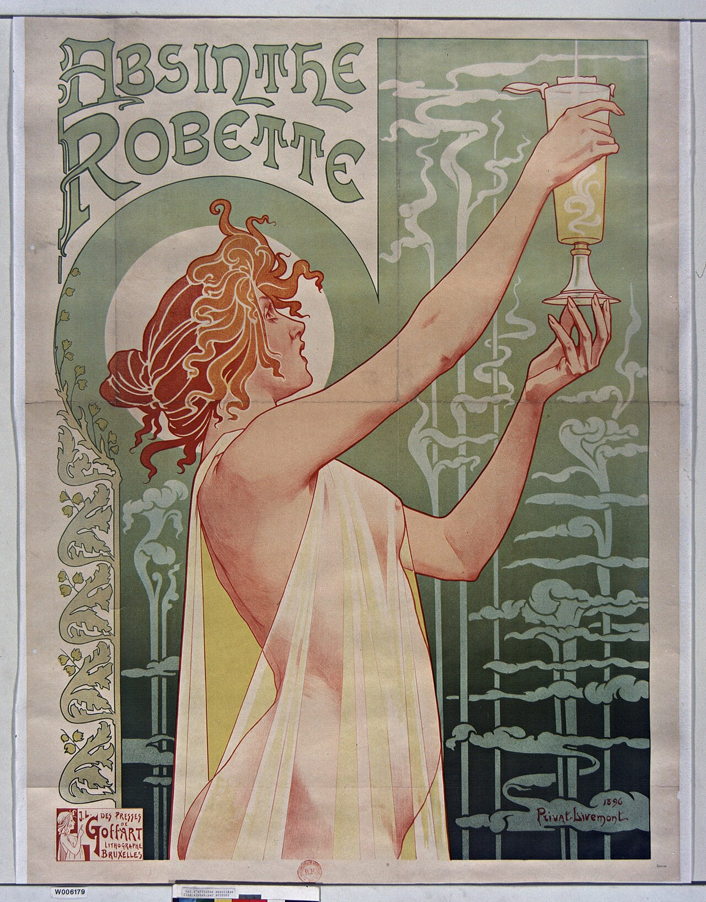
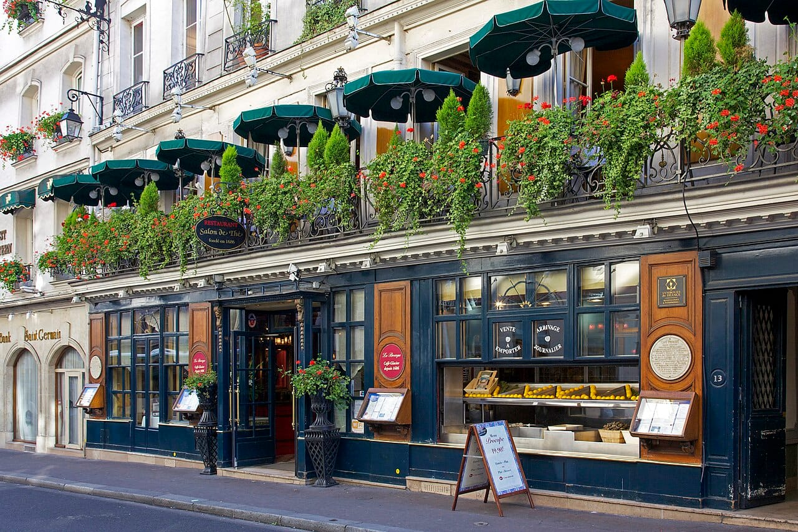

# The French Absinthe Ban of 1915: Science, War and the Wine Industry

On 16 March 1915 France formally prohibited the production, circulation and sale of absinthe and similar liqueurs. Today the ban is often reduced to a scientific verdict: absinthe makes people mad. The history is far more complicated. The First World War, nationalism, an economic crisis in the wine industry, the temperance movement and medical fear of thujone all pushed the ban. Absinthe was not convicted by a single compound. It was turned into a symbol of national decline in a particular political and economic environment.

Figure: Privat-Livemont's 1896 advertising poster for Absinthe Robette, a sample of pre-ban absinthe culture. Image: Privat-Livemont, Public domain, via Wikimedia Commons ([source page](https://commons.wikimedia.org/wiki/File:Absinthe_Robette_affiche%2C_Privat-Livemont_1896.jpg)).

## Background

In the late nineteenth century absinthe spread quickly through French cities. A high-strength herbal infusion, flavoured with anise, wormwood and other botanicals, it was usually diluted with water. It was cheaper than many wines and had a market in cafés, bars and artistic circles. After the 1880s, the French wine industry suffered from phylloxera, volatile output and import competition; some wine producers saw absinthe as a rival for the same consumers.

At the same time, the temperance movement and the medical profession began to frame absinthe as a problem. Doctors described "absinthism", said to cause hallucinations, epilepsy, crime and racial degeneration. Thujone was named as the culprit. In the early twentieth century Switzerland, Belgium, the United States and other countries restricted or banned absinthe. In France, a nationalist narrative appeared: absinthe was a foreign poison, while wine was the healthy French drink. After the war began, that narrative gained much stronger national-mobilisation force.

## Course and timeline

In August 1914 the First World War began and France entered a state of emergency. On 16 August the interior ministry banned nationwide sales of absinthe; the Paris police had already acted. On 14 January 1915 a bill restricting absinthe went to the Chamber of Deputies; the Senate passed it on 12 February; the Chamber voted on 4 March; and on 16 March the law entered into force, prohibiting the production, circulation and sale of absinthe and similar liqueurs.

The ban did not remove absinthe from French life overnight. Underground production and cross-border trade continued, and brands such as Pernod Fils moved part of their production to Tarragona in Spain. Anise-based pastis developed within the regulatory framework and became a substitute in southern France. Only in 2011 did France formally lift the ban on the name "absinthe"; before that, wormwood-based drinks could be sold as "plant infusions" but not directly as absinthe.

## Key people and institutions

The French Senate, Chamber of Deputies and interior ministry were the institutional drivers. The medical profession and temperance groups supplied the public-health language; the wine industry supplied the economic motive. Pernod Fils and other absinthe producers were the direct targets and moved to Spain and other markets after the French ban. Artists and writers made absinthe a symbol of modern life, bohemia and decadence; Édouard Manet's 1859 painting The Absinthe Drinker is an early example, but the painting was not the cause of the ban.

It is important to separate cultural image from legal evidence. Paintings by Manet, Degas and others made absinthe a visual symbol of modern urban life, but the ban was driven by wartime politics, industry interests and medical argument. Blaming a painting turns a complex policy process into a single artistic cause.

## Concrete changes for the industry

First, absinthe production moved abroad. French brands continued in Spain and elsewhere, while the domestic market went underground or relabelled. Second, anise spirits rose. Pastis and similar drinks filled the market space left by absinthe and later became important in southern France. Third, a thujone regulatory framework formed. The European Union later set limits for thujone in food and herbal products, and the "hallucinogen" narrative was re-examined scientifically. Fourth, the wine industry gained a competitive advantage. The ban reduced direct competition between absinthe and wine in the lower-price market, though it is too simple to say the wine industry "destroyed" absinthe. Fifth, a cultural revival followed. From the 1990s, several European countries relaxed restrictions, and absinthe returned as a "retro", "bohemian" and high-strength product.

## Disputes and sources

First, thujone toxicity was exaggerated. Modern analysis suggests that nineteenth-century absinthe usually contained too little thujone to produce the severe hallucinations described at the time; "absinthe madness" was more a result of alcohol abuse, adulteration and social prejudice. Second, the motives were not single. Medicine, temperance, the wine industry, nationalism and wartime mobilisation all played a part; it cannot be reduced to a "scientific discovery". Third, the scope of the ban is misread. It targeted the name and formula "absinthe", not every drink containing wormwood; similar products continued under other names. Fourth, the timeline differs. The administrative ban of 1914 and the statutory ban of 1915 are two different things: the first was an emergency wartime measure, the second formal legislation. Fifth, the date of repeal is often ignored. France lifted the ban on the name "absinthe" only in 2011; absinthe was not completely illegal throughout the twentieth century.

## Common misreadings

One: "Absinthe contains thujone, so it causes hallucinations." Thujone is toxic at high doses, but traditional absinthe usually contained too little to explain the hallucination legend. Two: "The ban was the result of science proving absinthe was dangerous." Scientific argument was one thread; political and economic motives mattered too. Three: "France was the only country to ban absinthe." Switzerland, the United States, Belgium and others had their own restrictions, with different dates and methods. Four: "Manet's painting caused the ban." The painting shaped public imagination, but the ban was 1915 legislation and wartime policy, not an art event. Five: "The 2011 repeal means absinthe is completely free." After repeal, alcohol content, thujone limits and food labelling still apply; absinthe is not an unregulated commodity.

## See also

- [Absinthe](ref:absinthe): the definition, ingredients and drinking practices of absinthe.
- [France](ref:france): the background of the wine industry, temperance and alcohol legislation.
- [The 1935 appellation system](ref:aoc): another path in French alcohol regulation, from prohibition to origin protection.
- [Gin](ref:gin): another cheap spirit that was moralised and taxed.
- [American Prohibition](ref:prohibition): a comparison between total national prohibition and a partial ban.

[Absinthe](ref:absinthe) and [The French AOC System (1935): The Birth of Controlled Appellation of Origin](ref:aoc) are the two useful reference points for The French Absinthe Ban of 1915. [Absinthe](ref:absinthe) sets out date; [The French AOC System (1935): The Birth of Controlled Appellation of Origin](ref:aoc) brings in place. Read them together.

**Key facts.**

| Item | Detail |
| --- | --- |
| In one line | In the early years of the First World War the Paris police banned the sale of absinthe, and on 16 March 1915 a French law prohibited the production, circulation and sale of absinthe and similar liqueurs. The ban is often… |
| Date | August 1914–16 March 1915 |
| Place | France |
| Calendar | Gregorian |

## Related images

Image: Category image for "The French AOC System (1935): The Birth of Controlled Appellation of Origin". Credit: Jean-Marie Hullot from France, CC BY-SA 2.0, via Wikimedia Commons ([source page](https://commons.wikimedia.org/wiki/File:Le_Procope_1,_Paris_2010.jpg)). Related image for The French Absinthe Ban of 1915: Science, War and the Wine Industry.
