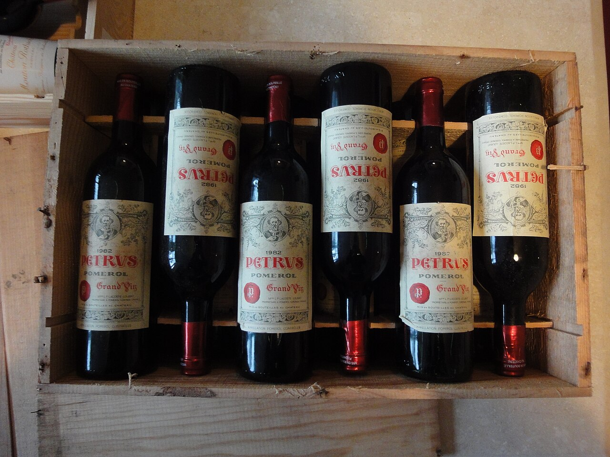
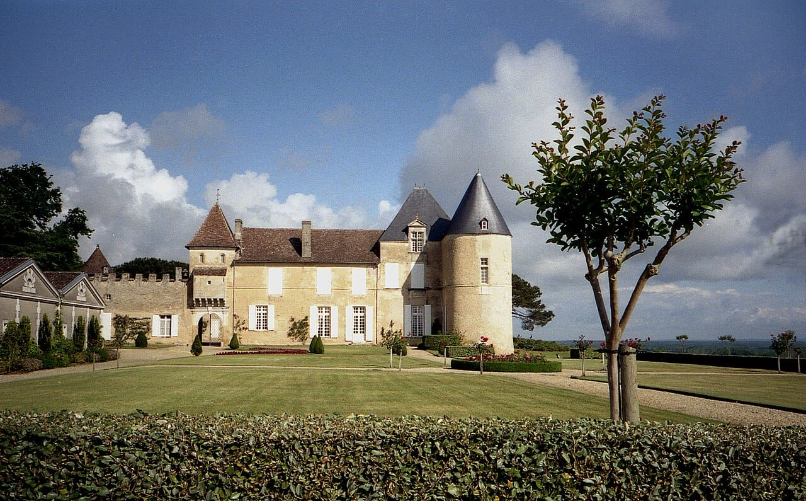

# The 1982 Bordeaux Vintage: How a Year Became a Turning Point in the Modern Wine Market

The 1982 Bordeaux vintage was shaped by climate, criticism and markets together. It had a warm winter, early budbreak, a hot July and a dry September. The grapes reached high ripeness, the wines were rich and full, with abundant fruit. For those who liked that style, it was the beginning of "modern Bordeaux"; for those who preferred acidity and restraint, it seemed overripe. The argument over 1982 ultimately changed not only the price of one vintage but the place of wine criticism in the modern market.

Figure: A case of 1982 Pétrus; the vintage became part of the modern narrative of the Bordeaux market. Image: Andrew Phillips, CC BY 2.0, via Wikimedia Commons ([source page](https://commons.wikimedia.org/wiki/File:Several_bottles_of_1982_Petrus.jpg)).

## The vintage and its weather

The 1982 growing season began earlier than usual. Mouton's records show an exceptionally mild winter and even budbreak around 30 March; a warm April and May, moderate rain in June; flowering at the end of May and beginning of June, nearly two weeks early. July was hot and dry, with a severe thunderstorm on 30 July. August was not excessively hot, and rain in the first week helped the vines. September was dry, and the grapes ripened under ideal conditions. Mouton harvested from 15 to 24 September; Latour from 16 to 30 September; Lafite recorded early ripening, July heat and storms, and a cooler August that produced uneven ripening. Differences in microclimate and varietal mix meant that wines from the same year were not identical in style.

This weather gave the grapes high sugar and thick skins, and it created a technical problem: acidity fell. High ripeness raised alcohol and lowered relative acidity. For traditionalists, this meant the wines might lack the backbone for long ageing. For new consumers, the rich fruit and supple texture were the attraction. The 1982 argument was, from the start, an argument about ripeness and balance.

## Market and criticism

The 1982 vintage did not immediately set the market alight. Some American critics, including Robert Finigan and The New York Times' Terry Robards, thought the wines were too ripe and low in acidity and doubted their ability to age. Robert Parker Jr., then a relatively young critic, championed 1982 in The Wine Advocate, arguing that its fruit and structure could support long ageing. As the wines developed in bottle, Parker's judgment came closer to what the market and consumers experienced; his reputation and subscriptions rose sharply, and in 1984 he left the law to become a full-time wine critic.

1982 also coincided with a turning point in the Bordeaux en primeur market. After the economic malaise of the 1970s, the oil shocks of 1973–1974 and the 1976 Judgment of Paris, Bordeaux needed a new market narrative. The generous style of 1982, the interest of American collectors, a strong dollar and the en primeur mechanism together drove prices and attention. Parker did not "create" the vintage alone, but he became its most important public interpreter.

## Key people and institutions

Parker is the most controversial and enduring name in the 1982 story. The Wine Advocate was subscription-based, refused advertising and positioned itself as independent criticism; the success of 1982 gave that model market credibility. Against him were more traditional American critics such as Robert Finigan and The New York Times' Terry Robards, who valued acidity and ageing potential and remained reserved about 1982. On the estate side, Mouton, Latour, Lafite, Pétrus and Cheval Blanc represented different styles and together formed the "sample set" of 1982; without their long-term performance, criticism alone could not have built the vintage's reputation.

Institutionally, the 1855 classification, the Bordeaux en primeur system, American auction houses and the wine press amplified 1982. The 1855 hierarchy supplied a rank structure; en primeur turned "future wine" into a tradable commodity; auction houses and the media turned the vintage story into price. 1982 was not the cause of these institutions but their concentration in one year.

## Concrete changes for the industry

First, the centre of critical authority shifted. Parker's success gave independent, subscription-based, consumer-oriented wine criticism unprecedented market power and made it public that a critic could move prices. Second, the en primeur market expanded. After 1982, Bordeaux en primeur entered the American and Asian markets more systematically, and vintage narrative became part of pricing. Third, the style debate became public. The tension between ripeness, acidity, fruit and ageing potential became a continuing argument among estates, critics and consumers. Fourth, estates internationalised. The success of 1982 attracted American and Asian buyers to Bordeaux and changed ownership, marketing and price structures. Fifth, a vintage myth formed. 1982 was repeatedly described as a "vintage of the century", but estates and plots performed very differently; the myth drove the market while obscuring detail.

## Disputes and sources

First, "1982 was a perfect vintage" is too broad. The top estates performed brilliantly, but not every wine was equally successful; high ripeness and low acidity meant that some wines aged unevenly. Second, Parker's role has been mythologised. He did champion 1982 and was later vindicated, but the market also depended on the dollar, en primeur, estate marketing and collector demand. Third, the other critics were not simply wrong. Finigan's and Robards' concerns about acidity and ageing potential were borne out in some wines; 1982 was not "right versus wrong" but a clash of two aesthetic and judgment standards. Fourth, climate explanations are simplified. The weather favoured ripeness, but rainfall, soils and picking dates differed across appellations; vintage performance cannot be reduced to weather. Fifth, price and quality are not identical. The price of 1982 includes scarcity, brand, criticism and market mood and cannot be read as a pure quality ranking.

## Common misreadings

One: "All 1982 Bordeaux was great." The vintage was broadly successful, but estate, plot and picking decisions made a large difference. Two: "Parker alone created the 1982 market." He supplied key criticism, but the market also depended on en primeur, the dollar, auctions and estate promotion. Three: "Everyone who disagreed with Parker was wrong." Reservations about acidity and ageing potential were valid for some wines; this was a style debate, not a simple factual dispute. Four: "1982 is the greatest vintage." Greatness depends on preference, wine and stage of ageing; 1982 is iconic, not the only standard. Five: "1982 proves that the riper the wine, the better." It proved the market appeal of a ripe style and also exposed the risks of low acidity and poor balance; later vintages did not all copy it.

## See also

- [Bordeaux](ref:bordeaux): the framework of Left Bank and Right Bank appellations, classifications and styles.
- [France](ref:france): the background of appellations, estates and the wine market.
- [Wine](ref:wine): the basic framework from grapes and fermentation to ageing.
- [The 1855 Bordeaux classification](ref:classification): the historical background for understanding 1982 estate ranks and prices.
- [The 1976 Judgment of Paris](ref:paris): another cross-region comparison that changed the Bordeaux market narrative.

[Bordeaux](ref:bordeaux) and [Wine](ref:wine) are the two useful reference points for The 1982 Bordeaux Vintage. [Bordeaux](ref:bordeaux) sets out date; [Wine](ref:wine) brings in place. Read them together.

## Related images

Image: Category image for "1976 Judgment of Paris: California wine beats French estates". Credit: Benjamin Zingg, Switzerland, CC BY-SA 2.5, via Wikimedia Commons ([source page](https://commons.wikimedia.org/wiki/File:Ch%C3%A2teau_d%27Yquem.jpg)). Related image for The 1982 Bordeaux Vintage: How a Year Became a Turning Point in the Modern Wine Market.
