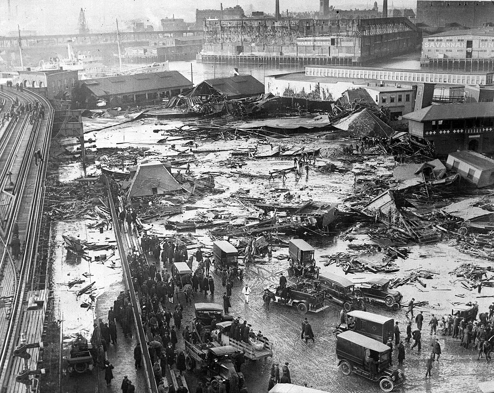

# The Boston Molasses Flood of 1919: An Industrial-Alcohol Disaster

At midday on 15 January 1919, residents of Boston's North End heard a low rumble and thought an elevated train was passing. Minutes later a steel tank about 50 feet high split open, and roughly 2.3 million gallons of molasses poured into the streets like a wall. Molasses is not water. It is viscous and heavy; it could lift houses, tear up rail tracks and trap people in debris. The disaster killed 21 people and injured 150, making it one of the most famous industrial catastrophes in American history.

Figure: Wreckage beneath the elevated railway in Boston's North End after the molasses flood of 15 January 1919. Image: BPL, Public domain, via Wikimedia Commons ([source page](https://commons.wikimedia.org/wiki/File:BostonMolassesDisaster.jpg)).

## Background

Molasses is a by-product of sugar refining and an important raw material for industrial alcohol. During the First World War, the munitions industry needed large quantities of alcohol to make smokeless powder, and molasses became a strategic material. United States Industrial Alcohol (USIA), through its subsidiary Purity Distilling, built a tank near Boston Harbour to store molasses shipped from the Caribbean and send it by pipeline and rail to distilleries.

The tank stood near Commercial Street, beside an elevated railway, the waterfront and dense housing. After it was built in 1915, residents noticed leaks at the seams; children could catch escaping molasses in containers. The company did not repair the tank thoroughly but painted it brown to hide the stains. Wartime haste, a supervisor without engineering experience and inadequate testing laid the ground for the rupture.

## Course and timeline

On the afternoon of 15 January 1919, the tank burst after being filled with a new shipment of molasses. Pieces of the tank and the molasses surged out together. The wave was estimated at 35 miles per hour, tore a section of the elevated railway, swept away houses, carriages and pedestrians, and pushed a fire station off its foundations. Rescuers included Boston police, cadets from nearby ships and Red Cross workers. Molasses is more viscous in cold weather, making rescue and cleanup extremely difficult; cleanup was estimated at 87,000 worker-hours.

After the disaster, victims' families brought a class action. USIA briefly blamed "anarchist sabotage", but investigation and litigation lasted six years, with more than 3,000 witnesses. The court-appointed auditor Hugh Ogden found defective construction and held the company liable for about $1 million. The disaster also pushed Boston and other American cities to strengthen permits and inspections for tanks, buildings and industrial facilities.

## Key people and institutions

Purity Distilling and its parent USIA built and operated the tank. Company treasurer Arthur Jell supervised construction despite having no engineering background and did not adequately test the tank for leaks. Boston city government, police and fire services handled the rescue; the Massachusetts courts and the auditor handled liability. The dead included dockworkers, a teamster, two ten-year-old children and a firefighter, showing that the disaster affected the whole neighbourhood, not just the plant.

In the wider supply chain, molasses linked Caribbean sugar plantations, Boston harbour, the American munitions industry and the [rum](ref:rum) distilling tradition. Molasses was both a rum raw material and an industrial-alcohol feedstock; the same shipment could enter the munitions supply chain in wartime and the distillery trade in peacetime. That dual use made the Boston tank a node in the Atlantic sugar and alcohol economy.

## Concrete changes for the industry

First, safety standards for industrial storage improved. Tank design, welding, testing and periodic inspection became important issues in engineering and insurance. Second, urban zoning and industrial-facility regulation drew attention. A giant tank beside dense housing exposed the conflict between land use and industrial risk. Third, the fragility of the molasses supply chain became visible. Accidents in molasses pricing, transport and storage could affect rum and industrial-alcohol production. Fourth, the memory entered popular culture. Bostonians long claimed they could still smell molasses on summer streets, and the disaster became a classic case in engineering ethics and urban history. Fifth, it created an irony in time. The day after the tank burst, the Eighteenth Amendment to the U.S. Constitution was ratified; a year later Prohibition took effect, redrawing the boundary between industrial and drinking alcohol.

## Disputes and sources

First, death counts and causes differ. The official record is 21 deaths, but some victims died weeks or months later from injuries, infection or pneumonia, so the list and the immediate death toll do not fully overlap. Second, the cause was not single. Thin tank walls, poor welding, inadequate testing, gas from molasses fermentation and a sudden temperature rise may all have contributed; reducing it to one factor oversimplifies. Third, company responsibility and the "sabotage" claim. USIA tried to blame anarchists, but the court and engineering investigations did not support that. Fourth, the shape of the wave has been exaggerated. It was not an instantaneous "explosion" but a tank rupture followed by a fast surge of viscous liquid and subsequent flooding. Fifth, the link to Prohibition is often misread. Prohibition did not cause the disaster; the tank was built mainly for wartime industrial alcohol, but the proximity in time makes the two events often narrated together.

## Common misreadings

One: "The molasses came at people like water." Molasses is denser and more viscous, with a different impact and flooding pattern, and rescue was harder. Two: "The tank suddenly exploded." More accurately, its structure failed and the wall ruptured, releasing molasses under pressure. Three: "All 21 died on the spot." Some victims died later of injuries or infection. Four: "Prohibition caused this." The disaster happened a year before Prohibition took effect, and the tank was built for industrial alcohol; Prohibition is background, not direct cause. Five: "This is just a curiosity." It is also a history of industrial safety, city planning, immigrant labour and wartime supply chains, and should not be reduced to an oddity.

## See also

- [Rum](ref:rum): the spirits tradition that uses molasses as a raw material.
- [United States](ref:usa): the background of industrial alcohol, Prohibition and urban alcohol regulation.
- [Barbados](ref:barbados): a key Caribbean source of molasses and rum.
- [Cuban rum nationalisation](ref:cuba): another history where molasses, sugar cane and state power intersect.
- [American Prohibition](ref:prohibition): the alcohol-control turning point adjacent in time to the disaster.

For The Boston Molasses Flood of 1919, begin with the date and setting, then the documented consequences, and finish with how later accounts treat it; that order keeps the account grounded.

Start with [Rum](ref:rum) for date, then read [Barbados](ref:barbados) for place. Seeing both keeps The Boston Molasses Flood of 1919 from being confused with a neighbouring idea.

**Key facts.**

| Item | Detail |
| --- | --- |
| In one line | On 15 January 1919 a storage tank holding about 2.3 million gallons of molasses burst in Boston's North End. The molasses moved into the streets at an estimated 35 mph, killing 21 people and injuring 150. The tank belong… |
| Date | 15 January 1919 |
| Place | United States |
| Calendar | Gregorian |

## Related images

Image: During Prohibition in the United States, officials pour barrels of liquor into a sewer.. Credit: Unknown author, Public domain, via Wikimedia Commons ([source page](https://commons.wikimedia.org/wiki/File:5_Prohibition_Disposal(9).jpg)). Related image for The Boston Molasses Flood of 1919: An Industrial-Alcohol Disaster.
