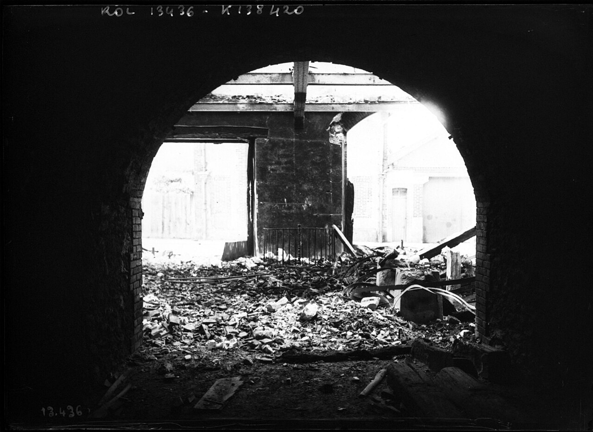

# The 1927 Champagne Delimitation: Names, Parcels and a Boundary War

On 22 July 1927 France passed a law formally delimiting the Champagne vineyard. It was based on the Marne and Aisne communes fixed by the 1908 decree, plus three communes in the Aube and those that had claimed the 'Champagne' name in harvest declarations from 1919 to 1924, making 407 communes in all. The key was not the departmental boundary but the parcel: only land already planted, or planted before the phylloxera crisis, had the right to use the Champagne name.

Figure: Cellar ruins at Ay after the April 1911 looting, the conflict that preceded the 1927 delimitation. Photograph: Agence Rol, Public domain, via Wikimedia Commons ([source page](https://commons.wikimedia.org/wiki/File:Apr%C3%A8s_le_pillage_d%27Ay,_avril_1911_-_btv1b69160215.jpg)). This is not a photograph of the 1927 law signing.

## Date and place

The core area lies in the Marne, Aisne and Aube departments of north-eastern France, involving the commune clusters of Reims, Épernay, Châlons, Vitry-le-François and Troyes. The 1927 law gave 407 communes: 272 in the Marne, 70 in the Aube, 2 in the Haute-Marne and 5 in Seine-et-Marne.

The timeline falls into three stages: the 1905 anti-fraud law and the 1908 decree prepared the delimitation; the 1911 winegrower revolt brought the conflict to a head; the 1927 law completed the legal delimitation, and the decree of 29 June 1936 formally created the Champagne controlled appellation (AOC).

## Background: the 1905 law and the Champagne crisis

Champagne's boundary question was not isolated. The phylloxera crisis at the end of the nineteenth century destroyed large areas of vineyard, and reconstruction brought overproduction, adulteration and price swings; cheap wine from the south further depressed prices. The anti-fraud law of 1 August 1905 was France's first attempt to define by law which vineyard areas could claim an origin name, but it gave principles, not an enforceable parcel list.

The 1908 decree began the concrete delimitation but sharpened the conflict: communes inside the line wanted to keep the name, while those outside felt robbed of a historical right. In 1911 Champagne winegrowers rose in revolt against the delimitation; troops intervened and the clashes caused casualties. Delimitation was from then on not only a technical question but a local political one.

## Course: the law of 22 July 1927

The law of 22 July 1927 offered an enforceable scheme: the Marne and Aisne communes fixed by the 1908 decree, plus three communes in the Aube; for other communes of the old province of Champagne and the Bar-sur-Seine district, only those that had claimed the Champagne name in harvest declarations from 1919 to 1924 were included.

The law also provided that, within the communes concerned, only land 'already planted with vines when the law was promulgated' or 'used for vines before the phylloxera invasion' could give its wine the right to the Champagne name. This wrote a 'historical planting right' into law: not all land in an included commune qualified automatically, only parcels with a planting history counted.

The design solved two problems: it turned a departmental dispute into a parcel dispute, reducing confrontation across whole provinces and counties; and it used harvest declarations as evidence, so historical claims could be tested against administrative records. But it created new problems: the declarations were incomplete, and local commissions interpreted the law with varying strictness.

## Delimitation standard: parcels, not departments

The 1927 standard can be summarised in three layers.

The first is administrative: decide which communes belong to the delimited zone. The second is the parcel: within a commune, only land with a planting history is recognised; planted at promulgation or planted before phylloxera are two verifiable time thresholds. The third is the production area: even inside the zone, a parcel must meet soil, subsoil, aspect and microclimate conditions to be listed as able to produce Champagne.

These three layers separate the place name from administrative divisions and turn it into a set of rights registered parcel by parcel. They also gave the later AOC system its template: a place name is not a signboard but a set of verifiable parcels and rules.

## Revision: over-registration in 1928 and the 1951 review

After the 1927 law, local commissions registered parcels. The 1928 result was clearly too broad: more than 46,000 hectares were listed as able to produce Champagne, some of which had historically made only table wine.

Faced with this deviation, the Champagne industry secured a law in 1951 allowing INAO to review the existing registrations after hearing the general syndicate of Champagne winegrowers. The review lasted about 25 years, checking parcel by parcel the 'historical planting right' and the technical conditions of soil, subsoil, aspect and microclimate. The result was a sharp contraction: plantable area fell from about 46,000 to about 34,000 hectares, and the communes actually enjoying the name fell from 407 to 302, with another 105 suspended — still legally inside the zone but barred from the name and from new planting.

This revision history shows that delimitation is not a one-off legislative act but long administrative and technical work. The 1927 law set the framework, the 1928 registration produced a draft, and the 1951 review produced the correction; together they make today's Champagne region.

## Influence and disputes

First, it established the 'name, parcel, rules' triangle. Later French AOC and EU origin protection both follow this structure: define the area, then the parcels, then the production rules.

Second, it made Champagne a high-threshold scarce asset. Area contraction and planting limits built price and reputation on supply constraint; for growers, inclusion or exclusion meant a huge difference in asset value.

Third, it left long-running disputes. The 105 suspended communes remain inside the zone but cannot use the name; the memory of the 1911 revolt and the 1928 over-registration is still part of Champagne's local history.

Fourth, its delimitation logic can be compared with other regions. Bordeaux's 1855 classification ranks châteaux, Burgundy's ranks parcels, and Champagne's 1927 law uses a composite standard of 'commune, parcel, planting history'; all answer 'who may use the place name', but with different answers.

Fifth, the map question needs stating. This essay draws no map of the Champagne region: the 1927 parcel lists and today's boundaries need specialised geographic data and sources, and an invented boundary map would mislead readers.

## Timeline

- 1905: the anti-fraud law of 1 August, the first attempt to define vineyard areas able to claim an origin name.
- 1908: a decree begins concrete delimitation.
- 1911: Champagne winegrowers revolt over delimitation.
- 1919–1924: communes claim the Champagne name in harvest declarations.
- 1927: the law of 22 July delimits 407 communes and sets the planting-history threshold for parcels.
- 1928: local commissions register more than 46,000 hectares, an over-broad delimitation.
- 1936: the decree of 29 June formally creates the Champagne AOC.
- 1951: a law allows INAO to review the registrations.
- 1970: the first European wine regulations take effect, bringing Champagne into the European framework.

**Short definition:** On 22 July 1927 France passed a law formally delimiting the Champagne vineyard: 407 communes, based on the Marne and Aisne communes fixed by the 1908 decree, plus three communes in the Aube and those that had claimed the Champagne name in harvest declarations from 1919 to 1924. The law recognised only land already planted, or planted before the phylloxera crisis, turning a departmental dispute into a parcel dispute. Over-registration in 1928 and a review from 1951 eventually cut the area to about 34,000 hectares and 302 communes.

## Further reading

- [The French AOC system (1935)](ref:aoc-1935): the national system that followed Champagne's delimitation.
- [Comité Champagne](ref:champagne): the trade organisation and current introduction to the region.
- [France](ref:france): French wine regions and institutions.
- [History of world wine](ref:world-wine-history): global wine trade before origin systems.

Further reading: [The 1855 Bordeaux Classification: A List Produced for a World's Fair](ref:c-extra-1). Bordeaux ranked estates; Champagne's 1927 law ranked communes and parcels, a useful contrast in how place names become property.
