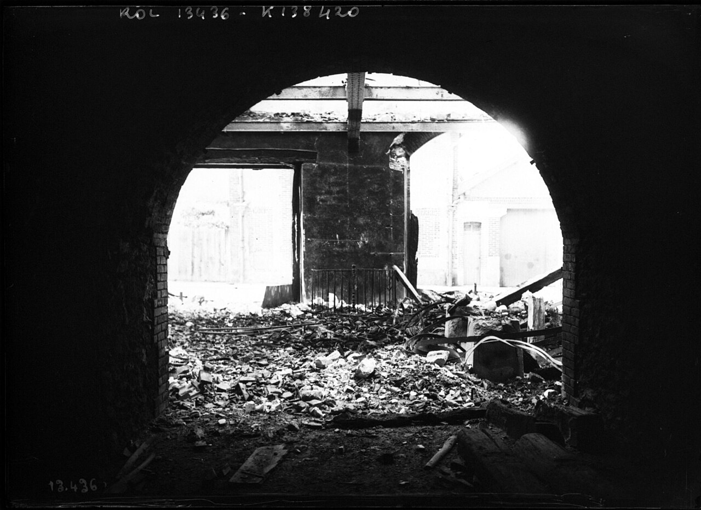

# The Champagne Riots of 1911: Appellation Boundaries, Grape Prices and the Identity of Champagne

The Champagne riots of 1911 were not an argument about which wine tasted better. They were a conflict over land, prices and the right to use a name. The administrative delimitation of 1908 excluded most of the Aube department's vineyards from the Champagne appellation, and local growers saw it as a denial of their historical identity and market income. In January 1911 Aube growers organised protests; in April growers in the Marne attacked merchants suspected of buying Aube grapes. Violence, strikes and arson turned Champagne from a luxury product into a national political question.

Figure: Cellar ruins at Ay after the April 1911 looting, photographed by Agence Rol. Image: Agence Rol, Public domain, via Wikimedia Commons ([source page](https://commons.wikimedia.org/wiki/File:Apr%C3%A8s_le_pillage_d%27Ay%2C_avril_1911_-_btv1b69160215.jpg)).

## Background

Early twentieth-century Champagne was under multiple pressures. After the phylloxera crisis, replanting was expensive and disease and weather risk remained. In the late 1900s the market fluctuated, grape prices fell and growers accumulated debt. At the same time, the imbalance between the Champagne houses and the growers deepened: the houses controlled brands, ageing and sales networks, while growers depended on annual grape sales for cash. The boundary was therefore not merely a geographical question. It determined who could call a wine Champagne and who shared in the high-price market.

The Aube lies south of the Marne and historically belonged to the province of Champagne; its capital, Troyes, was part of Champagne's history. But the 1908 delimitation centred on the Marne and excluded most Aube vineyards. Supporters stressed soil, climate and historical sales networks; opponents saw a political victory for Marne houses and growers. Whatever the merits, the line drove Aube growers into protest.

## Course and timeline

On 29 January 1911 Aube growers met at Bar-sur-Aube and founded their own federation. In February and March the protest escalated into tax resistance, demonstrations and resignations from municipal councils; many communes briefly had no functioning municipal government. In mid-March the government upheld the original boundary, and Aube growers continued to demonstrate in Troyes and elsewhere. On 11 April violence broke out on a larger scale in the Marne: growers who believed merchants were buying Aube grapes attacked and burned firms and cellars suspected of using outside fruit. Cellars at Ay and elsewhere were looted, and photographs recorded the ruins.

To restore order, the government kept the administrative boundary and on 7 June 1911 created a "second Champagne zone" (Champagne deuxième zone), incorporating part of the Aube into a secondary appellation. The scheme did not satisfy the Aube, because it implied second-class Champagne, while the Marne retained the main Champagne area. The First World War interrupted the argument but did not resolve it. The law of 1919, arbitration in 1925 and the final delimitation of 22 July 1927 gradually brought the Aube into the Champagne system.

## Key people and institutions

The central Aube figure was Gaston Cheq, who organised growers, petitions and demonstrations and turned local grievance into national news. In the Marne, the Union des Maisons de Champagne and local growers' organisations formed a temporary alliance of interests, demanding protection of the Champagne name and restrictions on outside grapes. The French government, Senate and agriculture ministry mediated, trying to calm the conflict through delimitation, a secondary zone and enforcement.

At the institutional level, the crisis exposed the dual governance of Champagne: on one side the houses' and growers' trade bodies, on the other the state's administrative boundary and law. Champagne's name was shaped by the market, royal tradition, geography and state decree together, and no single party could decide it alone. The 1911 riots were the product of that multi-layered system failing under pressure.

## Concrete changes for the industry

First, the appellation boundary became political. Champagne was no longer only a historical place name but a legally defined, enforceable and exclusionary appellation. Second, growers' organisations gained power. Aube and Marne growers entered national politics through federations, strikes and petitions, no longer merely supplying the houses. Third, the house-grower relationship was renegotiated. Grape prices, purchasing rules and appellation identity became core industry issues. Fourth, the "second Champagne zone" was an institutional experiment. It tried to balance the parties through a subordinate appellation but exposed the politics of naming hierarchies. Fifth, the 1927 delimitation. The Aube was brought into Champagne, but arguments over which villages could use the name did not disappear and became part of the later AOC system.

## Disputes and sources

First, the scale of violence and responsibility are disputed. Sources differ on attacks, arson and casualties, and participants were not only growers but merchants, workers and local politicians. Second, both Aube and Marne positions have been simplified. The Aube did not speak only of "historical rights", and the Marne did not speak only of "soil quality"; prices, debt, market networks and political alliances mattered too. Third, the "Champagne riots" were not a single day. There were several rounds of protest and conflict from January to June 1911, with 11 April the most famous. Fourth, the 1927 delimitation was not a direct result of the riots. It followed the 1919 law, arbitration in 1925 and long negotiation; the riots only accelerated the issue onto the national agenda. Fifth, the identity narrative has been commercialised. Today Champagne brands often reduce the 1911 conflict to a story of "protecting tradition", ignoring growers' economic distress and inequality within the region.

## Common misreadings

One: "This was a fight between Champagne houses and farmers." The camps were not monolithic: Marne growers sometimes allied with the houses, and the Aube had its own divisions. Two: "The riots happened because Champagne quality had fallen." The core was boundaries, grape prices and naming rights, not a pure quality dispute. Three: "The 1911 line decided today's Champagne boundary." 1911 produced a temporary arrangement; a more stable delimitation came in 1927. Four: "The Aube was never part of Champagne." The Aube historically belonged to the province of Champagne; the 1908 administrative line excluded it. Historical identity and administrative boundary did not coincide. Five: "The riots were only local news." They reached the French Senate and national press and became a landmark of early twentieth-century French agricultural crisis.

## See also

- [Champagne](ref:champagne): the framework and main villages of the French Champagne region.
- [France](ref:france): the background of appellation rules and agricultural politics.
- [Champagne wine](ref:drink): the craft, styles and market position of Champagne.
- [The 1927 Champagne delimitation](ref:delim): the institutional outcome after the 1911 conflict.
- [The phylloxera epidemic](ref:phylloxera): the ecological background of the late nineteenth-century Champagne vineyard crisis.

**In brief:** In 1911 Champagne was shaken by large-scale protest over appellation boundaries and grape prices. The 1908 administrative delimitation excluded most of the Aube from Champagne, angering local growers; in April 1911 growers in the Marne attacked merchants suspected of buying Aube grapes. The riots produced a temporary "second Champagne zone" and helped shape the 1927 delimitation.

## Related images

Image: Champagne. Credit: bgvjpe, CC BY 2.0, via Wikimedia Commons ([source page](https://commons.wikimedia.org/wiki/File:Glass_of_champagne.jpg)). Related image for The Champagne Riots of 1911: Appellation Boundaries, Grape Prices and the Identity of Champagne.
