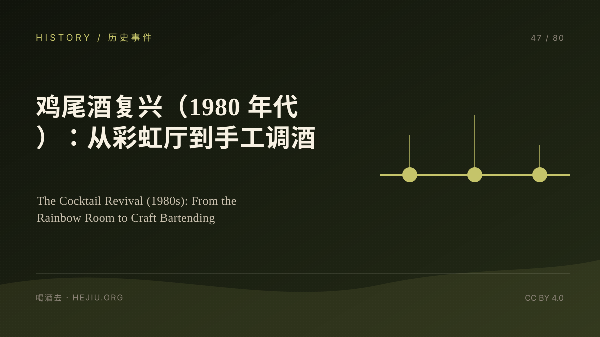
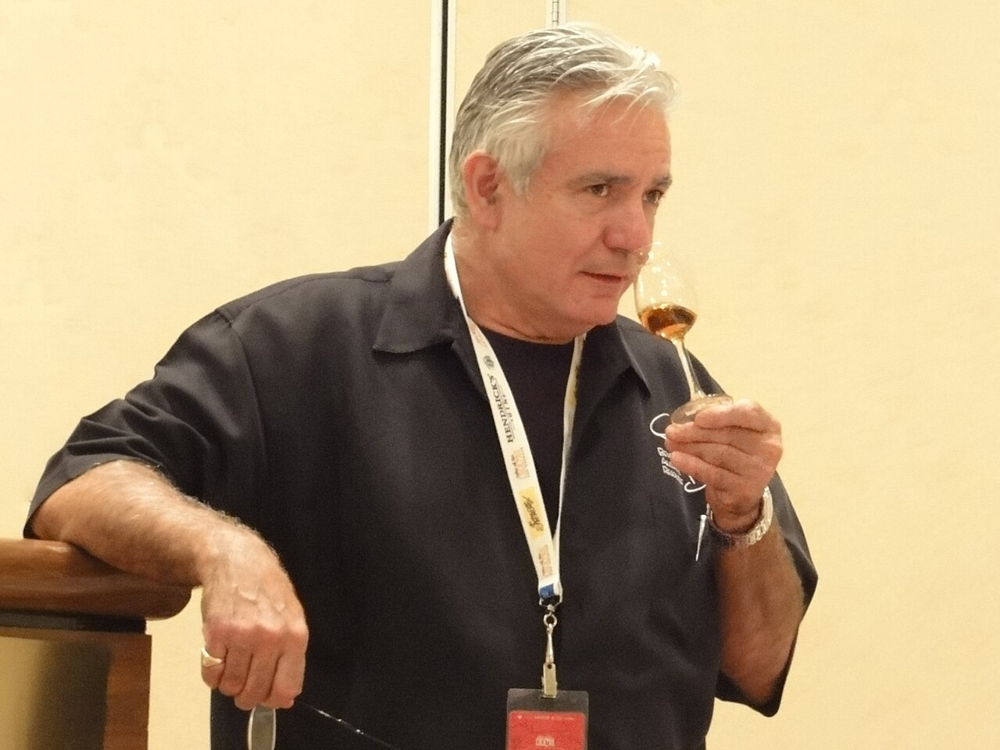

# The Cocktail Revival (1980s): From the Rainbow Room to Craft Bartending

In the 1970s sweet pre-mixes and disco culture pushed classic recipes into the background. In 1987, when the Rainbow Room reopened in New York, Dale DeGroff returned to Jerry Thomas's 1862 approach: fresh juice, house-made syrup, large ice and a restrained menu. That revival, framed as getting the classics right, grew into the craft cocktail movement of the 1990s.

Figure: The Cocktail Revival (1980s): From the Rainbow Room to Craft Bartending. Project-generated or category illustration used for bar and drinks context; not a photograph of the subject.

## Background

Bars in the 1970s prized speed and spectacle: bottled sour mix, coloured liqueurs, syrups and juice powders were used widely, and the cocktail became a cold, sweet, fast drink. Classic recipes still circulated in print but were rarely followed strictly; ice was crushed or small, dilution came quickly and flavour layers were flattened. At the same time disco culture turned bars into music and social venues, performance behind the bar increased and technical standards fell. By the 1980s, as restaurants upgraded, imported spirits increased and consumer interest in quality returned, a group of bartenders began reading old manuals again in search of forgotten recipes and methods.

## Course and timeline

- 1862: Jerry Thomas publishes How to Mix Drinks, an important source for classic cocktail recipes.
- 1951: the International Bartenders Association (IBA) is founded and gradually builds a cross-border competition and education network.
- 1970s: sweet pre-mixes, coloured liqueurs and disco drinks dominate, and classic recipes move to the background.
- 1987: the Rainbow Room on the 65th floor of 30 Rock in New York reopens; DeGroff, under restaurateur Joe Baum, runs the Rainbow Promenade bar and revives forgotten classic cocktails.
- Late 1980s to the 1990s: fresh juice, house-made syrup, a bitters collection, handmade ice and speakeasy-style interiors spread from individual bars into a method.
- 1999: Sasha Petraske opens Milk & Honey in New York, influencing later craft bars through reservations, quiet rooms and strict execution.
- 2002: DeGroff publishes The Craft of the Cocktail, writing these practices into a teachable framework.
- After the 2000s: craft bartending reaches more cities, while rising prices, stylistic sameness and misuse of the "craft" label appear.

## Key people and institutions

DeGroff is the most frequently cited figure of the revival: he entered the trade in the 1970s, practised at the Rainbow Room in the late 1980s, and later promoted craft bartending as an author, teacher and competition judge. Joe Baum drove the Rainbow Room relaunch and asked DeGroff to study Jerry Thomas's 1862 manual, which gave him an entry point for rebuilding recipes. Jerry Thomas is the symbolic source of classic recipes; Sasha Petraske systematised the space and service model of the speakeasy. On the institutional side, the Rainbow Room and Rockefeller Center provided a highly visible stage, the IBA provided cross-border competitions and an official list, and publishing and restaurant investment spread the method to more cities.

## Concrete changes for the industry

First, recipe knowledge returned. Jerry Thomas's 1862 manual was cited again, and classic recipes became a standard open to discussion rather than decorative names on a menu. Second, ingredient standards rose. Fresh juice, house-made syrup and ice quality became measures of a bar, while pre-mixed products moved to the background. Third, the professional identity changed. Bartenders began to appear as authors, teachers and competitors, and bartending became a craft that could be demonstrated. Fourth, nightlife and interior design changed. Speakeasy-style bars brought a whole aesthetic of lighting, furniture, menus and music. Fifth, the spirits market shifted. Craft bartending demanded better whiskey, gin, rum and bitters, encouraging imports and premium products. Sixth, price and consumption stratified. Craft cocktails cost noticeably more than ordinary mixed drinks and created a clientele centred on urban middle-class and tourist customers.

## Disputes and later assessments

First, "the revival of the 1980s" is a summary. Cities started at different times; the Rainbow Room has a fairly clear year, while London and other European cities need their own dating, and one year cannot cover them all. Second, DeGroff's personal story has been amplified by the media. Both the venue interview and the bartending school profile stress his role, but the revival also depended on imported spirits, bar investment, publishing and competitions; no single person did it alone. Third, who first restored classic recipes is hard to settle. The IBA's official list was also organising classics in the later 20th century, and bars in Europe and Japan had their own lineages; crediting one bar with the start oversimplifies. Fourth, dates and titles need separating. Public reporting dates the Rainbow Room relaunch to 1987, while "King Cocktail" is a later media title, not an identity he held in 1987. Fifth, later assessments diverge: some argue the revival raised technical and ingredient standards, while others criticise it for selling nostalgia, raising prices and misusing the "craft" label.

## Common misreadings

First, the revival did not invent new cocktails; it remade existing classics, including the [Old Fashioned](ref:old-fashioned), the [Dry Martini](ref:dry-martini) and the [Margarita](ref:margarita). Second, DeGroff did not accomplish the revival alone; he was a highly visible practitioner and communicator. Third, 1987 was not the only starting point; London, San Francisco and Tokyo had their own timelines. Fourth, craft bartending does not mean "the more complex the better"; a restrained menu and consistent execution matter just as much. Fifth, the speakeasy style is an imaginative reconstruction of the Prohibition era, not a direct restoration of historical spaces.

## See also

- [Founding of the International Bartenders Association (1951)](ref:iba): the source of the cross-border network and official list.
- [Dale DeGroff](ref:degroff): the central figure of the revival.
- [Jerry Thomas](ref:jerry-thomas): the 1862 manual and the starting point of classic recipes.
- [Old Fashioned](ref:old-fashioned), [Dry Martini](ref:dry-martini), [Margarita](ref:margarita): the drinks most often remade in the revival.
- [United States](ref:usa), [United Kingdom](ref:uk): the main urban settings.
- [History of taverns](ref:taverns): long-term change in bar spaces.

Read The Cocktail Revival (1980s) through the date and setting, then the documented consequences, and finally how later accounts treat it. The sequence matters.

[United States](ref:usa) and [Founding of the International Bartenders Association (1951): A Round Table of Seven Guilds](ref:iba) are the two useful reference points for The Cocktail Revival (1980s). [United States](ref:usa) sets out date; [Founding of the International Bartenders Association (1951): A Round Table of Seven Guilds](ref:iba) brings in place. Read them together.

**Sources and limits.** The key claims about The Cocktail Revival (1980s): From the Rainbow Room to Craft Bartending are checked against the following sources: Rockefeller Center, European Bartender School, Dale DeGroff (Used to check the author's identity, books and teaching; no recipes are reproduced) and 6 sources in total. Prices, batches and status change; the body is project-written and does not reproduce source text.

## Related images

Image: Dale DeGroff. Credit: Editor B, CC BY 2.0, via Wikimedia Commons ([source page](https://commons.wikimedia.org/wiki/File:D%C3%A9gustation_d%27Armagnac_aux_USA.jpg)). Related image for The Cocktail Revival (1980s): From the Rainbow Room to Craft Bartending.
