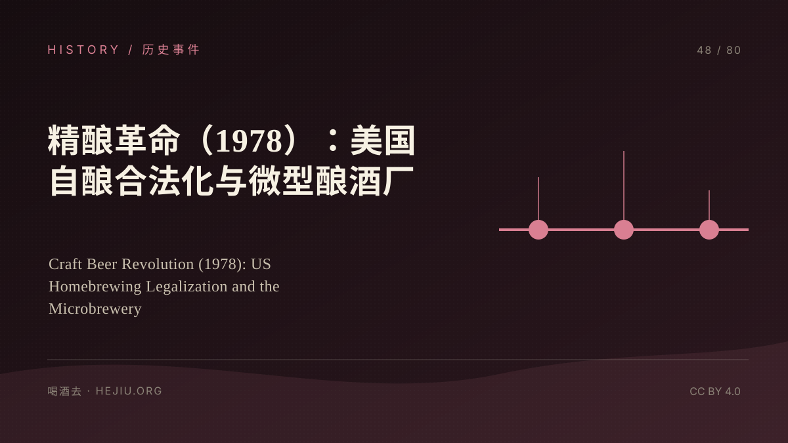

# Craft Beer Revolution (1978): US Homebrewing Legalization and the Microbrewery

On 14 October 1978 President Jimmy Carter signed the tax bill H.R. 1337. The bulk of the bill concerned excise taxes on commercial vehicles and public transport, but it carried an amendment that removed the federal excise tax on beer brewed at home; the provision took effect on 1 February 1979. Homebrewing then became a lawful personal activity again in the United States, and homebrewers, supply shops and small breweries fed one another in what is usually called the craft beer revolution.

Figure: Craft Beer Revolution (1978): US Homebrewing Legalization and the Microbrewery. Project-generated or category illustration used for beer context; not a photograph of the subject.

## Date and place

The bill was signed at the White House, and the federal effective date was 1 February 1979. Federal legality did not mean legality everywhere: alcohol regulation in the United States sits mainly with the states, and many kept their own restrictions for decades. Homebrewing became lawful in all 50 states only when Alabama and Mississippi changed their laws in 2013. In industrial geography, the early examples clustered around San Francisco and the northern California towns of Sonoma and Chico: the San Francisco steam brewery was revived in 1965, the first from-the-ground-up microbrewery opened in Sonoma in 1976, and Sierra Nevada Brewing Co. opened in Chico in 1980.

## Background: the home brewing left out after Prohibition

In 1919 the 18th Amendment was ratified and Prohibition followed: making, selling and transporting alcoholic drinks were banned, home-brewed beer included. The 21st Amendment repealed Prohibition in 1933 and commercial brewing resumed, but the legislation left room for homemade wine and did not give homemade beer the same tax exemption. Home brewing therefore sat in an odd position for decades: it was not necessarily prosecuted, yet it lacked a clear federal tax exemption, and the flow of equipment and ingredients was restricted.

In the 1960s and 1970s the American beer market was highly concentrated and increasingly uniform in taste. In 1965 Fritz Maytag bought 51% of a failing steam brewery in San Francisco, later Anchor Brewing, and improved its sanitation, equipment and process until its steam beer was consistent again. In 1976 Jack McAuliffe, who had worked in naval nuclear engineering, opened New Albion in Sonoma; the Smithsonian's collection notes describe it as the first from-the-ground-up microbrewery in the United States. Meanwhile homebrewers exchanged recipes in basements, and supply shops and clubs began to appear.

## Course: H.R. 1337 and the Cranston-Steiger amendment

The political drivers were Senator Alan Cranston of California and Representative William Steiger of Wisconsin. They attached an amendment to H.R. 1337 asking that home-brewed beer be treated like homemade wine. The core of the amendment was not permission to brew but exemption from federal excise tax: adults brewing for personal or family use would no longer be treated as taxable producers.

The federal exemption came with limits: 100 gallons (about 379 litres) per person per year, and 200 gallons (about 757 litres) per household per year. On 7 December 1978 Charlie Papazian and Charlie Matzen founded the American Homebrewers Association (AHA) in Boulder, Colorado, and published the first issue of Zymurgy. The association became the organisational node linking homebrewers, equipment sellers and small breweries.

## Impact and institutions

First, knowledge spread. Home brewing turned recipes, temperature control, sanitation and bottling into routines that could be run at home; supply shops broke factory-scale ingredients and equipment into small packages. The AHA's publications and competitions turned scattered practitioners into a community.

Second, a template for small breweries. New Albion lasted only a few years, but it proved that a small, independently owned brewery focused on flavour rather than volume could work. In 1980 Ken Grossman assembled a brewhouse in Chico from salvaged dairy equipment and founded Sierra Nevada Brewing Co. In his book Beyond the Pale he describes 1980 as the low point of the American brewing industry, with only about 40 legacy breweries left.

Third, state-level catch-up. Federal tax exemption was only a first step, and states could still ban or restrict home brewing. The AHA made state legalisation a long-running task and pushed state by state; Alabama and Mississippi completed the map in 2013.

Fourth, the structure of the industry turned. Homebrewers became small brewery owners, and small breweries in turn supported specialised markets for hops, malt, yeast and packaging. By the 21st century craft beer was the fastest-growing segment of American brewing and influenced overseas markets, including China.

## Sources and disputes

First, "Carter legalised home brewing" is a simplification. Carter signed an omnibus tax bill, and the home-brewing provision was pushed by Cranston and Steiger; crediting the president alone hides the role of the congressional amendment.

Second, 1978 and 1979 are often mixed up. The signing was on 14 October 1978 and the federal effective date was 1 February 1979; both dates appear in the sources, but they refer to different things.

Third, the "first microbrewery" depends on the definition. New Albion is often called the first from-the-ground-up microbrewery, while Anchor was an older brewery that was revived. Treating the two as the same case produces a different "first".

Fourth, the causal link between home brewing and craft beer is overstated. Legal home brewing did provide people and knowledge, but the rise of craft beer also depended on state law, taxation, equipment supply chains and changing tastes, and cannot be attributed to one bill.

Fifth, many sources are industry associations and companies. The AHA and breweries have an interest in promoting their own history; details of the 1978 legislation are best cross-checked against congressional records and tax law.

## Timeline

- 1919: the 18th Amendment is ratified and Prohibition begins; home brewing is banned.
- 1933: the 21st Amendment repeals Prohibition; commercial brewing resumes, but home-brewed beer still lacks a federal exemption.
- 1965: Fritz Maytag buys 51% of the San Francisco steam brewery.
- 1976: New Albion opens in Sonoma, regarded as the first from-the-ground-up microbrewery.
- 1978: H.R. 1337 is signed on 14 October; the AHA is founded on 7 December.
- 1979: the federal home-brewing exemption takes effect on 1 February.
- 1980: Sierra Nevada Brewing Co. opens in Chico.
- 2013: Alabama and Mississippi complete state legalisation, so all 50 states have home-brewing laws.

For Craft Beer Revolution (1978), begin with the date and setting. Then look at the documented consequences, and finally ask how later accounts treat it. The answers point to different choices, not to a single score.

### Key dates and figures

- 1920: Prohibition began in 1920 and remained in force until 1933, shaping the later home-brewing revival.

## Further reading

- [US Prohibition](ref:prohibition): why home brewing lost its legal space for most of the 20th century.
- [The rise of craft beer in China around 2015](ref:craft-cn): the same "small scale, flavour first" logic in another market.
- [Beer](ref:beer): the stylistic background from industrial lager to craft beer.
- [United States](ref:usa): the federal and state layers of alcohol regulation.
- [History of taverns](ref:taverns): the long-term change in spaces of beer consumption.
