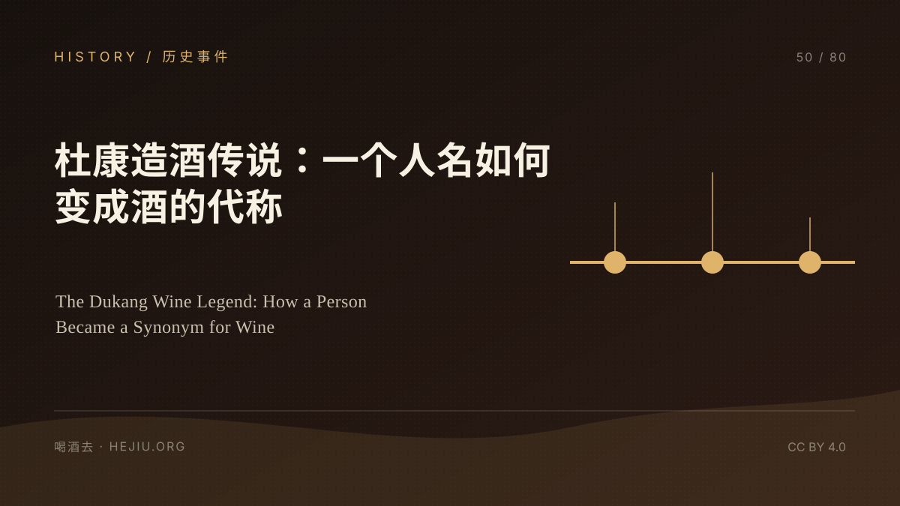
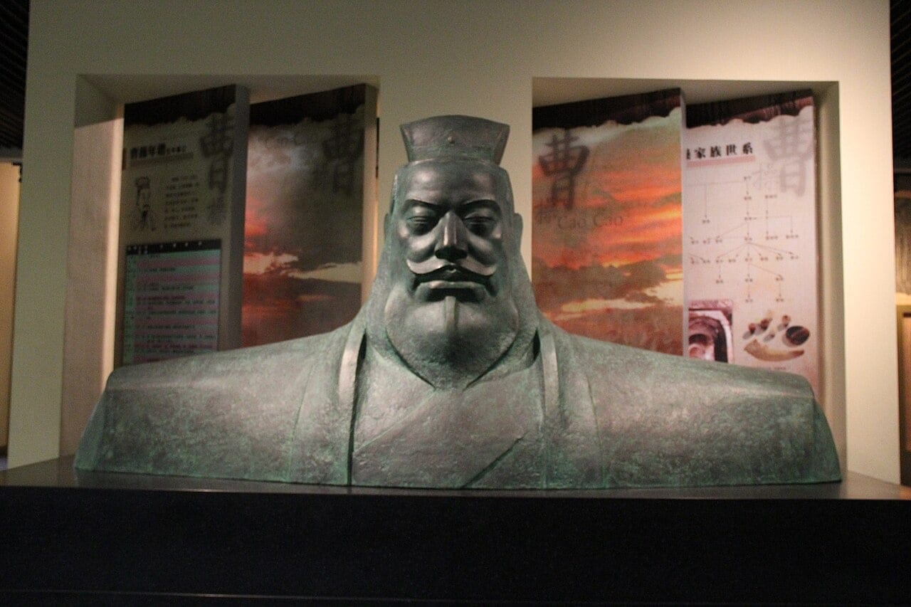

# The Dukang Wine Legend: How a Person Became a Synonym for Wine

Dukang is the central figure of another legend about the origin of brewing. The Eastern Han Shuowen Jiezi says he 'made shu wine' and adds that 'Shaokang is Dukang'; Cao Cao's Short Song, with the line 'what relieves sorrow? Only Dukang', turned the name into a synonym for wine. Yet who Dukang was, when he lived and where he brewed have never had a single answer, from the Han dynasty to today. The legend supplies the figure of a wine ancestor, not a datable biography.

Figure: The Dukang Wine Legend: How a Person Became a Synonym for Wine. Project-generated or category illustration used for Chinese alcohol culture context; not a photograph of the subject.

## Date and place

At least four accounts of Dukang's era circulate: the official in charge of the kitchens under the Yellow Emperor, Shaokang of the Xia dynasty, a man of the Eastern Zhou, and a Han administrator of Jiuquan. A review article in a Luoyang local newspaper sets the four side by side and notes that the 'Yellow Emperor's kitchen officer' account appears late and was already criticised by Duan Yucai in the Qing dynasty as 'a joke, not a serious record'. The most influential account identifies Dukang with Shaokang, on the strength of one line in the Shuowen Jiezi: 'Shaokang is Dukang.'

Place is equally divided. A local tradition around Ruyang in Henan puts Dukang's brewing site beside the Dukang river at Dukang village, citing the 'Kang river' in the Commentary on the Water Classic and the Dukang Temple in the Great Yuan Unified Gazetteer; the tradition in Baishui, Shaanxi, calls Dukang a Han-period man with the courtesy name Zhongning, on the authority of a stele dated the 48th year of the Qianlong reign (1783). Both rest on late local documents and neither can confirm the other. This essay therefore calls the place a 'legendary site' and gives no coordinates.

## Background: shu wine and the 'wine ancestor'

Shu is a sticky grain, usually identified in old texts as sticky millet and sometimes as sticky sorghum; the exact referent is itself disputed. Shu wine is a drink made from such grain, a cereal wine rather than a fruit wine. Starch in grain must first be saccharified and then fermented, a more complex process than the natural fermentation of fruit juice, which is why 'first to make shu wine' stands out in ancient lists of inventions.

The Shiben says 'Shaokang made shu wine', and the Shuowen Jiezi says 'Dukang made shu wine'; both place the achievement with the same figure. The Shuowen Jiezi goes further: 'In ancient times Shaokang first made dustpans, brooms and shu wine. Shaokang is Dukang,' merging the two names. That merger dates from the Eastern Han, long after the Xia, and is a later historical interpretation rather than a contemporaneous record.

## Dukang in the texts

| Text | Date | Wording | What it shows |
| --- | --- | --- | --- |
| Shiben, 'Making Things' | Late Warring States to early Han; original lost | 'Shaokang made shu wine' | Attributes shu wine to Shaokang |
| Shuowen Jiezi, wine radical | Eastern Han | 'Dukang made shu wine' | Uses the name Dukang directly |
| Shuowen Jiezi, broom radical | Eastern Han | 'Shaokang is Dukang' | Merges the two names |
| Short Song | Late Han | 'What relieves sorrow? Only Dukang' | Uses a person's name for wine |
| Jiugao | Jin dynasty | 'Some say Yi Di, others say Dukang' | Two accounts coexist |

The table shows that much of Dukang's fame comes from literature. Cao Cao's poem made 'Dukang' a synonym for wine, and later readers remembered the name first and looked for his era afterwards. Literary transmission and historical verification are two separate lines here and cannot replace each other.

## Influence: from wine ancestor to place names and brands

Later generations honoured Dukang as the 'wine ancestor', and distilleries and trade guilds worshipped him as a patron. Zhu Yizhong's Beishan Jiujing in the Song dynasty still wrote 'Yi Di made jiu lao, Dukang made shu wine', showing that the pairing persisted in the wine literature.

In modern times Dukang has also become a local cultural resource. Dukang wine in Baishui, Shaanxi, resumed production in 1975, and the locality combined legend, stele and brewing craft into a single local narrative; the Ruyang and Yichuan area of Henan also claims to be Dukang's home. Such narratives help local industry, but their historical parts have to be checked separately, and brand stories cannot be treated as documentary evidence.

Cao Cao's poem offers another kind of influence. The entries on [the Short Song](ref:duan-ge-xing) and [Cao Cao](ref:cao-cao) show how wine carries both solace and the search for talent; once 'Dukang' was used for wine, the person and the drink could no longer be separated.

## Sources and disputes

First, the identification of Dukang with Shaokang rests on a single merger in the Eastern Han Shuowen Jiezi. Pre-Qin material mentions only that 'Shaokang made shu wine' and never names Dukang; equating the two is a Han-period arrangement.

Second, the chronology is visibly contradictory. The Shuowen Jiezi points to the Xia dynasty, while the Baishui stele calls Dukang a 'Han-period man', a gap of more than a thousand years. A Qing-dynasty stele belongs to a later reconstruction and cannot correct an Eastern Han dictionary.

Third, the brewing site cannot be determined. The Ruyang account relies on quotations from the Commentary on the Water Classic and the Great Yuan Gazetteer, the Baishui account on a Qing stele; both are late. The rivers, villages and temples can be visited, but 'Dukang brewed here' remains a legend.

Fourth, the archaeological evidence does not support a single inventor of cereal wine. Pottery from the Jiahu site, excavated from 1984 to 2001 and analysed for residues from 1999, was identified in a 2004 paper as a mixed fermented beverage of rice, honey and fruit around 7000 BCE. The Erlitou culture of the Xia period already had wine vessels and wine ritual, but that was the result of long accumulation, not a single invention.

Fifth, the modern technical explanation of 'Dukang used qu' is an inference. One article argues that Dukang's greatest contribution was mastering the cultivation of qu, but moving from a legendary figure to a specific technical invention lacks a chain of objects and texts.

## Timeline

- Around 7000 BCE: a mixed fermented beverage appears at Jiahu.
- The legendary Xia period: Shaokang, identified by some with Dukang, is recorded as making shu wine.
- Late Warring States to early Han: the Shiben records that 'Shaokang made shu wine'.
- Eastern Han: the Shuowen Jiezi writes 'Dukang made shu wine' and 'Shaokang is Dukang'.
- Late Han: Cao Cao's Short Song uses 'Dukang' for wine.
- Jin dynasty: Jiang Tong's Jiugao places Yi Di and Dukang side by side.
- 1783: the Baishui stele calls Dukang a Han-period man with the courtesy name Zhongning.
- 1975: Dukang wine production resumes in Baishui, Shaanxi.
- 1984 to 2001: excavation of the Jiahu site; residue analysis from 1999, with the paper published in 2004.

For The Dukang Wine Legend, begin with the date and setting. Then look at the documented consequences, and finally ask how later accounts treat it. The answers point to different choices, not to a single score.

[China](ref:china) and [Duan Ge Xing: Cao Cao Turns Wine into the Anxiety of Seeking Talent](ref:duan-ge-xing) answer different questions about The Dukang Wine Legend: date and place. Read them as a pair, not as alternatives.

## Further reading

- [The Yi Di wine legend](ref:yi-di): the other origin legend, recorded earlier in texts.
- [The Short Song](ref:duan-ge-xing): Cao Cao turns 'Dukang' into a synonym for wine.
- [Cao Cao](ref:cao-cao): the poet and the late Han political background.
- [Yellow wine](ref:yellow-wine): the technical category of cereal wine.
- [China](ref:china): background on regions and categories.

## Related images

Image: The bronze statue of Cao Cao in Xuchang Museum, with exhibition panels on his life and family genealogy behind it.. Credit: Gary Todd, CC0, via Wikimedia Commons ([source page](https://commons.wikimedia.org/wiki/File:Statue_of_Cao_Cao.jpg)). Related image for The Dukang Wine Legend: How a Person Became a Synonym for Wine.
