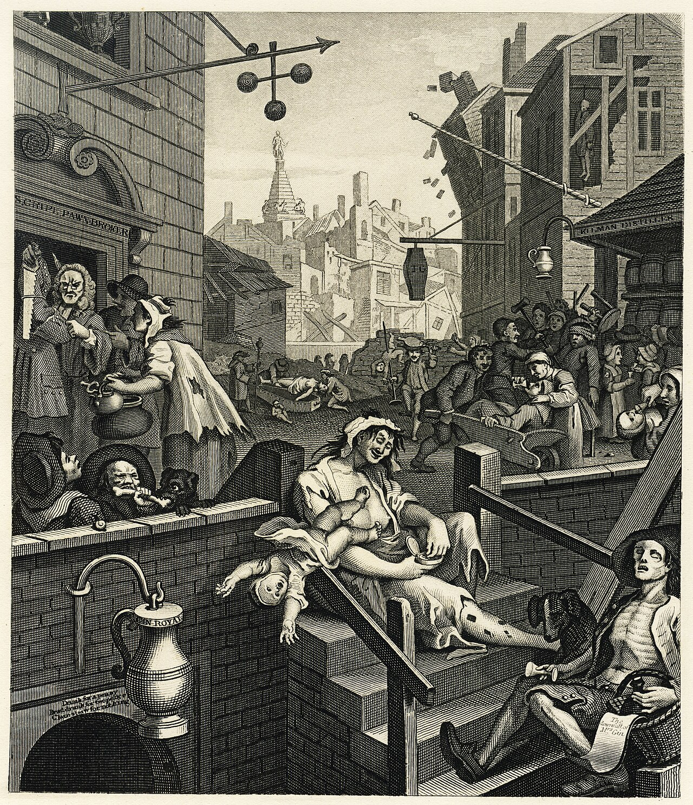

# The Gin Craze and the Gin Act: Britain's Eighteenth-Century Spirits Crisis

In the first half of the eighteenth century, cheap gin spread through London's poor districts with remarkable speed. It was stronger than beer, cheaper than imported spirits, and easy for small workshops to produce. In a city shaped by war finance, grain prices, rapid population growth and weak poor relief, gin became more than a drink: it became a symbol of social crisis. The so-called Gin Craze was a public issue produced by taxation, urbanisation, poverty and moral campaigning at the same time. The legislation of 1736 and 1751 was the British state's two great attempts to bring cheap spirits under control.

Figure: William Hogarth's 1751 print Gin Lane, published as a pair with Beer Street in the year of the Gin Act. Image: William Hogarth, Public domain, via Wikimedia Commons ([source page](https://commons.wikimedia.org/wiki/File:William_Hogarth_-_Gin_Lane.jpg)).

## Background

Gin's rise in England was tied to the political economy after the Glorious Revolution of 1688. Britain was at war with France for much of the period, and imports of French wine and spirits were restricted. The government wanted to increase revenue and reduce dependence on imported drink, so grain distillation at home received policy space. By the 1720s and 1730s, London had a dense network of taverns, groceries and street sellers dealing in gin. Its customers were not mainly the wine-drinking elite but dockworkers, artisans, the poor and migrants.

This pattern interacted with the social structure of the capital. London's population was growing quickly, housing in poor districts was crowded, clean water was scarce and poor relief was thin. Gin offered a cheap, fast form of anaesthesia. High mortality, crime and family breakdown were then blamed on drinking. Gin turned from a commodity into a symbol of the social problem. It is important to add that "gin" then did not mean today's strictly defined [London dry gin](ref:london-dry). It referred more broadly to a cheap grain spirit flavoured with juniper and other botanicals, of variable and sometimes adulterated quality.

## Course and timeline

The peak of the Gin Craze ran roughly from the 1720s to 1751. In 1729 Parliament began taxing distilled spirits and trying to restrict retail. In 1736 it passed a much harsher Gin Act, hoping that high licence fees and a minimum sale quantity would drive small gin shops out of business. The scheme failed quickly: legal retail shrank, illicit sale and smuggling expanded, and street disturbances occurred. Around 1743 the government had to adjust the tax burden, and by the late 1740s consumption was still not under effective control.

The 1751 Gin Act, formally the Sale of Spirits Act 1750, changed the approach. Instead of relying mainly on a single heavy duty, it used a more systematic set of licensing and sales restrictions to channel the trade into manageable outlets: distillers could no longer sell directly to consumers, and retail licences and premises were more tightly controlled. In the same year William Hogarth published Beer Street and Gin Lane as a pair, supporting the legislation. The first showed healthy, prosperous beer drinkers; the second turned the gin district into a world of poverty, pawnshops, coffins, abandoned children and drunken neglect. After 1751 gin consumption gradually fell, and the London spirits market moved from near-uncontrolled competition to a more licensed order.

## Key people and institutions

Hogarth was the most influential visual author of the campaign. Gin Lane was not a documentary record. It compressed the slum, the pawnbroker, the coffin, the neglected infant and the drunken mother into a moral allegory. Its power came from propaganda, not statistics. Parliament and the Treasury were the institutional drivers. They cared about revenue, public order and grain policy; moral reformers cared about poverty and the family. Around 1751 the two formed a temporary alliance.

On the industry side, London distillers and small tavern keepers formed a complicated web of interests. Large distillers hoped licensing would squeeze out small workshops; small operators survived through illicit trade, adulteration and flexible selling. The effect of the Gin Act therefore cannot be credited to a single statute. It changed the tax structure, the retail network and the style of enforcement at the same time. Gin remained part of British urban culture after 1751, but its production and sale were no longer as uncontrolled as in the 1730s.

## Concrete changes for the industry

First, licensing became the main tool of spirits governance. The state no longer relied only on duty; it managed the market through premises, licences and permitted customers. Second, distilling became more concentrated. Small, unlicensed distillers were squeezed out, while larger distilleries with capital and compliance capacity gained. Third, retail changed. Gin moved from street sellers and grocers selling loose spirit towards licensed taverns and specialist outlets. Fourth, gin styles diverged. The cheap grain spirit of the eighteenth century was not the same product as later [Old Tom gin](ref:old-tom) or London dry gin; regulation and the market together pushed recipes, sweetness and flavour towards standardisation. Fifth, a public narrative formed. The Gin Craze became a classic case in British social reform debate and shaped later discussions of spirits, poverty and public health.

## Disputes and sources

First, consumption data are incomplete. Eighteenth-century output, retail and smuggling are hard to measure precisely, and the figures used today often come from tax records or contemporary estimates rather than exact consumption. Second, the causal chain has been simplified. Gin drinking was certainly connected to poverty, crime and mortality, but urbanisation, food prices, housing and medical conditions were also causes. Blaming a single drink for a social crisis was the framework of contemporary campaigners. Third, 1736 and 1751 are often confused. The first was a failed experiment in heavy taxation; the second was a more effective licensing reform. Fourth, Hogarth's print is often used as a historical photograph. It is a clearly partisan propaganda image, with details selected and exaggerated. Fifth, the Gin Craze was not uniquely British. Ireland, the North American colonies and continental Europe also had problems with cheap spirits, but London's scale and Britain's legislative response made this the most frequently cited case.

## Common misreadings

One: "The 1751 Gin Act banned gin." It did not prohibit gin outright; it restricted cheap gin through licensing and sales rules. Two: "The Gin Craze happened because gin was more dangerous than other drinks." The core issue was the availability of cheap, strong drink in a poor urban environment, not a particular flavouring compound. Three: "Hogarth painted everyday London." The print is moral propaganda, not social documentary photography. Four: "Once the Act passed, the problem disappeared." Consumption fell gradually, and illicit markets, adulteration and enforcement problems persisted. Five: "The Gin Craze was only about gin." It also involved grain policy, colonial trade, taxation and the governance of urban poverty, which makes it a window on eighteenth-century British state capacity.

## See also

- [Gin](ref:gin): the lineage from Dutch genever to modern gin.
- [London dry gin](ref:london-dry): the most representative contemporary gin style.
- [Old Tom gin](ref:old-tom): the sweet British gin tradition of the eighteenth and nineteenth centuries.
- [United Kingdom](ref:uk): the regional background for parliamentary legislation and urban tavern culture.
- [Scotch whisky excise](ref:scotch): another British case of spirits, taxation and smuggling.
