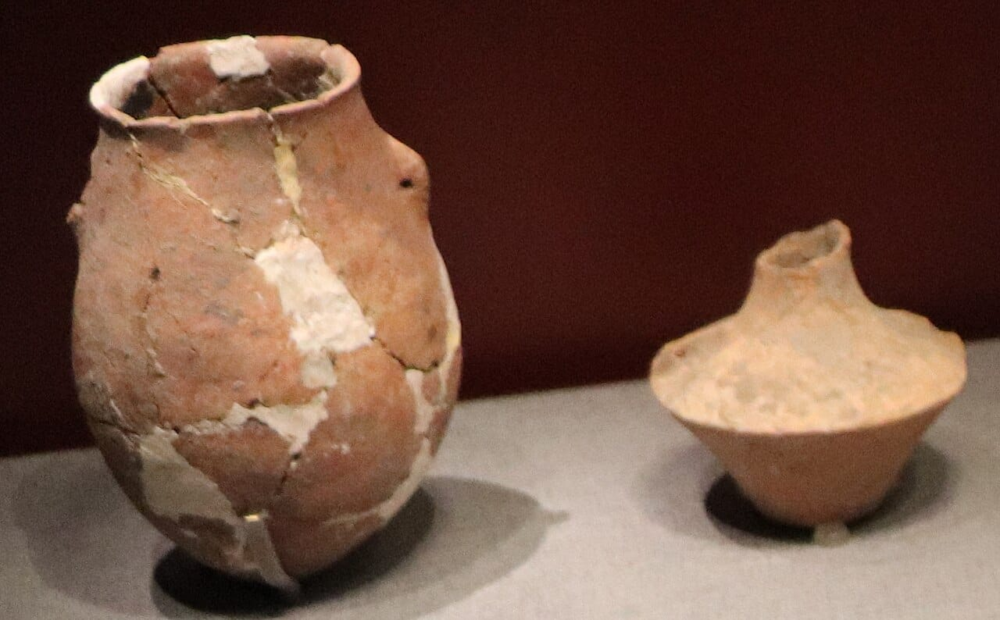
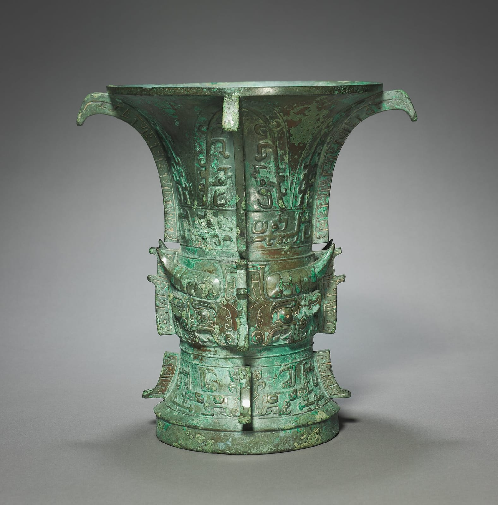

# The Jiahu Alcohol Residues of c. 7000 BCE: The Earliest Chemical Evidence of a Fermented Beverage in China

At Jiahu village in Wuyang, Henan, archaeologists found an early Neolithic settlement, rice remains, bone flutes and large quantities of pottery. In 2004 a joint Chinese-American team published a paper in the Proceedings of the National Academy of Sciences. From residues on the inner walls of Jiahu pottery they detected chemical signatures of rice, honey and hawthorn or grape-like fruit, and argued that the vessels had held a mixed fermented beverage dated as early as the seventh millennium BCE. It is one of the earliest direct chemical pieces of evidence in China and changed the imagined starting point of Chinese alcohol history.

Figure: Peiligang-culture pottery jars from Jiahu; residue analysis provided evidence of an early fermented beverage. Image: Furius, CC0, via Wikimedia Commons ([source page](https://commons.wikimedia.org/wiki/File:Pots%2C_Peiligang_Culture_(6200-5500_BC)%2C_Jiahu_site%2C_Wuyang%2C_Henan.jpg)).

## Archaeological background

Jiahu lies on the upper reaches of the Huai River and dates to roughly 9000–7800 BP. Its cultural character is closely related to the Peiligang culture. The site has produced rice remains, domestic pig bones, turtle shells, bone flutes and large amounts of pottery, indicating settled agriculture, ritual activity and complex craft production. The pottery includes small-mouthed double-handled jars, deep-bellied jars and bowls, some of which may have been used for storage, fermentation or drinking.

Neolithic fermentation did not require modern yeast. After rice was cooked, starch could be converted to sugar by moulds or yeasts and then fermented into alcohol; honey supplied fermentable sugar; hawthorn and grape-like fruit added fruit sugar and flavour and may have carried wild yeast. Mixed together, these ingredients could produce a sweet-sour, low-alcohol drink. It was closer to today's rice wine, fruit wine or a mixed fermented beverage than to distilled spirits.

## Discovery and analysis

Jiahu has been excavated in several campaigns since the 1980s. Researchers collected samples from pottery fragments and inner-wall residues and used gas chromatography, mass spectrometry, infrared spectroscopy and microscopy to look for alcohol-related marker molecules. The 2004 paper reported evidence of rice, honey and fruit and proposed the interpretation of a "mixed fermented beverage". The authors included the archaeological chemist Patrick E. McGovern, the archaeologist Zhang Juzhong and the scientist Wang Changsui.

The key to the research was not "finding a drop of 9000-year-old wine" but reconstructing what a vessel once held from its chemical residues. Pottery is porous and absorbs organic molecules from liquids; even after the liquid has disappeared, molecules may remain in the walls. The team also compared the Jiahu samples with liquids from Shang and Zhou bronze vessels and with ancient recipes, trying to build a genealogy of early Chinese fermented drinks.

## Key people and institutions

Patrick McGovern is an archaeological chemist at the University of Pennsylvania Museum of Archaeology and Anthropology and a long-time researcher of ancient alcoholic drinks. Zhang Juzhong led the excavation at Jiahu at the Institute of Archaeology, Chinese Academy of Social Sciences. Wang Changsui, Zhao Zhijun and other scholars contributed to the analysis of pottery, rice and residues. Institutionally, the Jiahu Site Museum, Henan Museum, the Institute for the History of Natural Sciences of the Chinese Academy of Sciences and the Penn Museum formed a network of research, display and communication.

The research could not have been done by one discipline. Archaeology supplied stratigraphy and vessel context; chemistry supplied molecular evidence; botany and agronomy helped identify rice, hawthorn and grape; instrumental analysis detected the residues. That is why the Jiahu conclusion is more concrete than a textual record and more testable than a legend.

## Significance for alcohol history

First, the starting point moved earlier. Chinese alcohol history had often begun with Shang and Zhou oracle bones, bronze vessels or Han documents; Jiahu pushed direct chemical evidence back to the early Neolithic. Second, brewing methods were diverse. Jiahu was not a single-grain brew but a mixed fermentation of rice, honey and fruit, showing that early brewers already used different sugar sources and flavouring materials. Third, alcohol and ritual were connected. Pottery, bone flutes, turtle shells and rice remains appear together, suggesting that fermented drinks may have been used in sacrifice, feasting or community ritual, not only for daily thirst. Fourth, technology was transmitted. After Jiahu, grain brewing continued through the Yangshao, Longshan and Shang-Zhou periods; liquids in bronze vessels and oracle-bone references to wine sacrifice form the later part of the chain. Fifth, Jiahu gives Chinese alcohol a place in world history. It is roughly contemporary with barley beer in the Middle East and grape wine in the Caucasus, showing that early fermented drinks were not the invention of one civilisation but a technology developed in several agricultural societies in parallel.

## Disputes and sources

First, dates differ. The site as a whole dates to roughly 9000–7800 BP, but the specific pottery samples and fermentation evidence cover a narrower range; papers and museums may use "9000 years ago", "7000 BCE" or "8600 years ago" as different conventions. Second, residue interpretation is debated. Chemical markers can indicate ingredients but cannot fully reconstruct a recipe; the combination of honey, hawthorn, grape and rice may also be affected by preservation and contamination. Third, the word "wine" needs qualification. It was a fermented beverage, probably low in alcohol, not today's distilled baijiu; "wine" as a broad term is acceptable, but it should not be equated with a modern spirit. Fourth, vessel function is not unique. The same type of pottery may have been used for storage, fermentation, serving or drinking; residues only show that the vessel once contained such a liquid, not that every vessel was a wine vessel. Fifth, the geographic reach is limited. Jiahu is one of the most important early sites, but it does not prove that no earlier or contemporary fermentation existed elsewhere in China; archaeological evidence depends on preservation and excavation coverage.

## Common misreadings

One: "Jiahu found 9000-year-old grape wine." The residues include hawthorn or grape-like fruit, but the drink was a mixed fermentation, not modern grape wine. Two: "This is China's earliest beer." It was not based mainly on malted grain and is closer to a rice/fruit mixed drink; it should not be called beer directly. Three: "This is the origin of distilled baijiu." There was no distillation in the Neolithic, and the Jiahu drink had limited alcohol. Four: "One jar proves 9000 years of Chinese wine culture." It is important evidence, but the formation of a "wine culture" was a long process and cannot be summarised by one site. Five: "The residue recipe is today's rice wine." Raw materials, microbes and processes differ greatly; modern rice wine cannot be directly equated with the Jiahu drink.

## See also

- [China](ref:china): the geographical and archaeological background of Chinese alcohol history.
- [Rice wine](ref:rice): the tradition and craft of rice fermentation.
- [Huangjiu](ref:yellow): another major lineage of Chinese grain brewing.
- [Shang and Zhou wine ritual](ref:shang): after Jiahu, the institutionalisation of alcohol and bronze ritual vessels.
- [Han wine monopoly](ref:han): an early form of state monopoly and taxation on alcohol in China.

**Short definition:** Chemical analysis of residues in pottery from the Jiahu site in Wuyang, Henan, found features of a mixed fermentation of rice, honey and hawthorn or grape-like fruit, dated as early as about 7000 BCE. The finding pushed direct chemical evidence for Chinese fermented drinks back in time and showed that early brewing was not a single-grain process but a combination of sugar sources.

## Related images

Image: Related photograph of Shang and Zhou Wine Ritual: Bronze Vessels, the Wine Officer and the Jiugao. Credit: Wikimedia Commons contributor, CC0, via Wikimedia Commons ([source page](https://commons.wikimedia.org/wiki/File:Clevelandart_1951.151.jpg)). Related image for The Jiahu Alcohol Residues of c. 7000 BCE: The Earliest Chemical Evidence of a Fermented Beverage in China.
