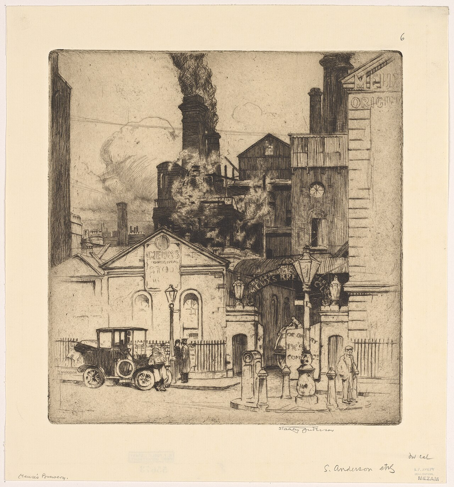
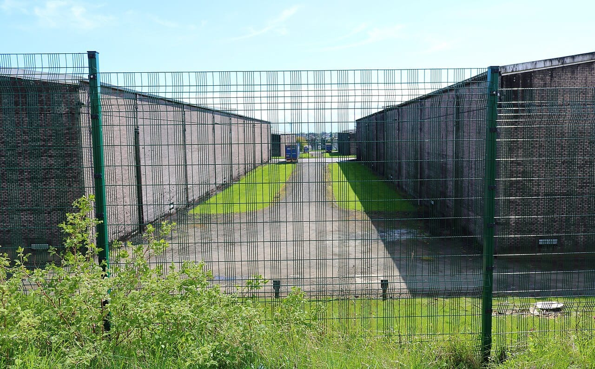

# The London Beer Flood of 1814: Giant Vats, Porter and the St Giles Slum

On the afternoon of 17 October 1814, a disaster that sounds almost absurd today struck Meux's Horse Shoe Brewery on Tottenham Court Road. A gigantic wooden vat filled with fermenting porter burst, the beer broke through the brewery's back wall and poured into the St Giles slum. Beer is not water. It carried malt residue, splintered wood and fermentation gas, and its impact was strong enough to bring down houses. The disaster killed several people and became one of the heaviest safety lessons of the nineteenth-century London brewing industry.

Figure: Meux's Horse Shoe Brewery in an early 20th-century etching; the 1814 beer flood began here. Image: Scan by NYPL, Public domain, via Wikimedia Commons ([source page](https://commons.wikimedia.org/wiki/File:Meux%27s_Brewery_(NYPL_Hades-1961280-2051850).jpg)).

## Background

Early nineteenth-century London was one of the world's largest beer-consuming cities, and porter was especially popular. Dark, medium-strength and relatively cheap, it suited urban workers' daily drinking. To meet enormous demand, breweries kept enlarging their fermentation and ageing vessels. Large wooden vats could be several metres high, assembled from staves and iron hoops, and hold more than a hundred thousand gallons. Breweries even competed over whose vat was larger, but engineering safety did not keep pace.

St Giles, the poor district next to the brewery, had dense housing and low cellars. Its residents were largely Irish immigrants and the urban poor. Only a wall separated the brewery from homes, and the risk was hidden by everyday crowding. There were no modern pressure-vessel standards or systematic structural inspections. Carbon dioxide from fermentation, ageing timber and failing iron hoops could accumulate without being noticed.

## Course and timeline

On the afternoon of 17 October 1814, a vat about 22 feet high and holding roughly 135,000 imperial gallons of porter burst. The beer broke through the staves, knocked over other vessels, and about 323,000 imperial gallons (roughly 1.47 million litres) poured out. The wave was about 15 feet high, broke the brewery's back wall and flooded the cellars and streets of St Giles. The wall of the Tavistock Arms tavern collapsed, burying the teenage servant Eleanor Cooper; in another cellar, an Irish family was holding a wake for a two-year-old boy, and five mourners were killed.

Contemporary newspapers reported the "dreadful accident" over several days. The coroner's jury returned a verdict of accidental death and did not hold the brewery responsible. The company was nearly ruined by the loss and survived partly through an excise rebate on the lost beer. Afterwards the brewing trade gradually moved away from enormous wooden fermentation vats towards more controllable vessels and structures. Meux's brewery moved in 1921, and the Dominion Theatre was later built on the site.

## Key people and institutions

Meux & Co operated the brewery, and the giant vat belonged to its Horse Shoe brewhouse. The owner Henry Meux, city officials, the coroner and the newspapers shaped the public side of the event. Most of the dead were ordinary people of St Giles: a servant, members of a mourning family and passers-by. No owner or senior manager was among the dead, and that distribution of casualties shows how industrial risk was transferred to the poor district.

At the institutional level, the British Excise was both the brewery's tax supervisor and the authority that decided the rebate after the disaster. The coroner's jury determined the cause of death and responsibility. Neither had a modern engineering-safety mandate, so the event was treated more as an accident than as a traceable industrial offence. Only later in the nineteenth century, with boiler, pressure-vessel and factory legislation, did Britain develop more systematic industrial-safety regulation.

## Concrete changes for the industry

First, vat size and construction were reconsidered. Maintenance, hoop replacement and fermentation-pressure control in enormous wooden vats became problems the trade had to face. Second, fermentation vessels changed material. Later in the nineteenth century, concrete-lined, iron and eventually stainless-steel vessels increasingly replaced giant wooden vats, improving safety and hygiene. Third, the relationship between breweries and cities was re-examined. The risk of a brewery next to dense housing pushed forward discussion of urban planning and industrial zoning. Fourth, insurance and liability awareness grew. The bankruptcy risk and rebate dispute after the disaster made breweries pay more attention to loss control and insurance. Fifth, the event became a memory point in beer history. It is treated both as a curiosity and as a classic example of nineteenth-century industrial risk by engineering and urban historians.

## Disputes and sources

First, there are two death-toll conventions. Most accounts give eight deaths; a Historic England archive note counts a ninth person who died the next day of alcohol poisoning. This essay uses "usually eight, nine in the archive note" rather than forcing the two figures into one. Second, the volume of beer varies. Different sources give a range from 128,000 to 323,000 imperial gallons, depending on whether beer from later vessel failures is included. Third, the cause was not single. Burst iron hoops, ageing timber, fermentation pressure and a chain reaction among vessels may all have played a part. Fourth, a coroner's verdict is not an engineering verdict. The jury ruled accidental death, but a modern engineering view would ask about design, maintenance and regulatory responsibility. Fifth, the "absurdity" of the event has obscured the victims. The dead were residents of a poor district, a servant and a mourning family; treating them as footnotes to a curiosity is a common later distortion.

## Common misreadings

One: "People went into the streets to drink free beer." The wave entered houses, cellars and taverns, mixed with debris and sewage; it was not a carnival. Two: "Nine people died on the spot." Most accounts give eight; the ninth died later of alcohol poisoning, and the two figures reflect different counting conventions. Three: "The brewery deliberately caused it." There is no evidence of sabotage; structural failure and missing safety are the better explanation. Four: "The brewery closed immediately." It was nearly bankrupt but survived through the rebate and adjusted operations, moving only in 1921. Five: "This is just a beer joke." It was an industrial disaster that exposed the industrial risks borne by a nineteenth-century poor district.

## See also

- [Beer](ref:beer): the overall framework of ingredients, fermentation and styles.
- [United Kingdom](ref:uk): the background of nineteenth-century London brewing and urban governance.
- [Ireland](ref:ireland): the cultural background of the St Giles Irish immigrant community and wakes.
- [Craft beer revolution](ref:craft): the later reaction against industrial standardisation in brewing.
- [Scotch whisky excise](ref:scotch): another history of British alcohol taxation, smuggling and enforcement.

Start with the date and setting. From there, consider the documented consequences, then how later accounts treat it. That is how a practical judgment about The London Beer Flood of 1814 is built.

## Related images

Image: Category image for "A Tax History of Scotch Whisky: From the 1644 Excise to the 1823 Excise Act". Credit: Bill Kasman, CC BY-SA 2.0, via Wikimedia Commons ([source page](https://commons.wikimedia.org/w/index.php?curid=150169452)). Related image for The London Beer Flood of 1814: Giant Vats, Porter and the St Giles Slum.
