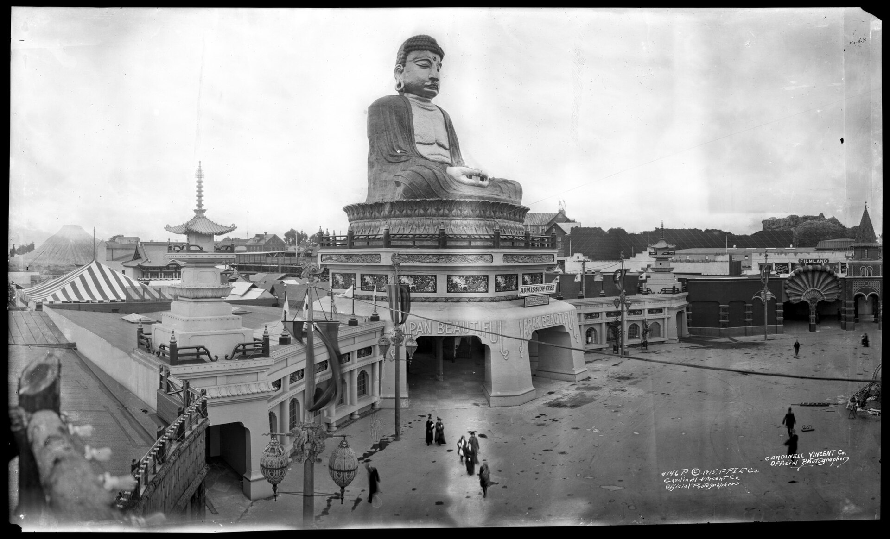

# The 1915 Panama-Pacific International Exposition

The Panama-Pacific International Exposition ran in San Francisco from 20 February to 4 December 1915, about 11 months in all. It nominally celebrated the opening of the Panama Canal, but in practice it was a large international fair for industry, agriculture and colonial goods. China took part with a national pavilion, and alcohol products entered international judging and press coverage.

Figure: Related photograph of The 1915 Panama-Pacific International Exposition. Image: Cardinell-Vincent Company, Public domain, via Wikimedia Commons ([source page](https://commons.wikimedia.org/wiki/File:Japan_Beautiful,_Panama-Pacific_International_Exposition,_San_Francisco,_1915.jpg)).

## Background

In the early twentieth century, Chinese goods reached international markets mainly as raw materials and handicrafts, with little branding or common standards. The Panama Canal opened to traffic in 1914, expectations of Pacific trade rose, and San Francisco wanted to announce its reconstruction after the 1906 earthquake.

On the Chinese side the Ministry of Agriculture and Commerce led preparations, set up a body to collect exhibits, and worked with provincial chambers of commerce and firms. Exhibits covered silk, tea, porcelain, agricultural produce and alcohol. For the Chinese drinks trade this was a rare overseas appearance: yellow wine and shaojiu were mostly made in local workshops, and packaging, labels and classification had not been organised for international judging.

## Course and timeline

In 1914 China began preparing the pavilion and catalogue. On 20 February 1915 the fair opened; the Chinese pavilion was open during the run, with displays grouped under agriculture, crafts and education. In the summer and autumn of 1915 the jury completed its awards, and on 4 December the fair closed.

The scale of judging can be seen in the official statistics: the fair made 25,527 awards in all and issued 20,344 medals. Chinese exhibits received 1,218 medals, including 62 grand prizes, 54 medals of honour and 250 gold medals, as well as silver, bronze and diplomas; another common statistic records China's total as 1,211 awards. The difference may come from counting medals rather than award entries. What is certain is that China was among the more successful participating countries.

For alcohol, Changyu's Special Fine Brandy, Red Rose Wine, Gewurztraminer vermouth and Riesling white wine received gold medals, an account repeated in company history and local gazetteers. Moutai from Guizhou was sent under the name "Moutai Distilling Company", combining samples from the Chengyi and Ronghe workshops; its award class is the most disputed point in later accounts. Products such as Luzhou Laojiao also entered the higher award lists.

## Key people and institutions

Chen Qi was the key figure in China's participation, responsible for preparation and on-site coordination. Zhang Bishi's Changyu company was the largest wine exhibitor, and its medals for brandy and wine later became a core passage in the brand's history. The Ministry of Agriculture and Commerce, the Chinese preparatory bureau for the Panama fair and provincial chambers of commerce formed the Chinese organisational system.

Grand prize, medal of honour, gold medal, silver medal and bronze medal formed a ladder, and Chinese reporting often called all of them "gold". Inconsistent translation changed how later readers judged a company's standing.

## Concrete changes for the industry

First, brand capital. Changyu, Luzhou Laojiao, Fenjiu and Moutai all wrote the 1915 awards into company history, and medal images and the word "Panama" entered packaging and advertising. Second, exports and channels. Contacts made during the fair offered routes into American and Southeast Asian markets, and "international award" became a sales phrase. Third, awareness of standards. Participation exposed weaknesses in packaging and classification and pushed chambers of commerce to discuss export standards. Fourth, the national-goods narrative. After 1915, "a Chinese product won abroad" entered the rhetoric of industrial salvation, and alcohol was an easy symbol to circulate. Fifth, historical echo. When the first national wine evaluation in 1952 shaped the genealogy of famous wines, it still drew on earlier international awards.

## Disputes and later assessments

First, the total number of awards. 1,218 medals and 1,211 awards coexist, and researchers need to state the basis of the count. Second, Moutai's award class. The company website and some local histories say gold; the Fenjiu side, citing documents of the period, says the wine sent by the Guizhou provincial government received a silver award equivalent to a fifth-class prize; other reporting says Moutai received a medal of honour, which was second class. The three accounts do not agree. Third, who won the grand prize. Some research states that the highest grand prizes for liquor went to three sorghum spirits from Shanxi, Zhili and Henan, that Fenjiu was the only one with a brand name, and that Sichuan and Shaanxi won no grand prize for alcohol. This account comes from material compiled by the Fenjiu side and still needs checking against the original list. Fourth, later inflation. When companies rewrote their histories after the 1980s, they tended to merge participation, award and gold medal into a single story.

## Common misreadings

One: "Moutai's gold medal at Panama in 1915 is undisputed." In fact the award class is disputed, with gold, silver and medal of honour all appearing in the record. Two: "The Panama exposition was the canal opening ceremony." The fair took the canal as its theme, but the two were not the same event. Three: "Taking part meant winning." Participation is an act; an award is the result of judging. Four: "A gold medal then equals an international gold medal today." The award ladder and judging standards in 1915 were different from modern competitions. Five: "An award proves quality today." A medal is a historical record, not a guarantee of quality today.

## See also

- [United States](ref:usa): the host country of the 1915 fair.
- [China](ref:china): the participating country and source of exhibits.
- [Baijiu](ref:baijiu): the drink most often mentioned in later award narratives.
- [Yellow wine](ref:yellow-wine): the traditional grain wine on display.
- [The 1952 national wine evaluation](ref:evaluation-1952): a later evaluation that invoked the 1915 story.

**Short definition:** The Panama-Pacific International Exposition, held in San Francisco in 1915, was a major international showcase for Chinese goods, and its wine exhibits and award claims entered the narrative of Chinese alcohol history. This essay sets out the dates, background, participation and award disputes, separating participation from the later gold-medal legend.

Read The 1915 Panama-Pacific International Exposition through the date and setting, then the documented consequences, and finally how later accounts treat it. The sequence matters.

[United States](ref:usa)'s date and [Baijiu](ref:baijiu)'s place form a useful pair: the contrast shows where one ends and the other begins.

**Key facts.**

| Item | Detail |
| --- | --- |
| In one line | The Panama-Pacific International Exposition, held in San Francisco in 1915, was a major international showcase for Chinese goods, and its wine exhibits and award claims entered the narrative of Chinese alcohol history. T… |
| Date | 20 February to 4 December 1915 |
| Place | United States |
| Calendar | Gregorian |

**Sources and limits.** The key claims about The 1915 Panama-Pacific International Exposition are checked against the following sources: Encyclopaedia Britannica (Used to check the dates, host city and background of the exposition), U.S. National Archives (Used to check federal participation and archival holdings), Xinhua (Used to check the link between the 1952 evaluation and earlier award narratives) and 6 sources in total. Prices, batches and status change; the body is project-written and does not reproduce source text.

## Related images

Image: Category image for "1952 National Wine Evaluation: the eight famous wines and the start of a system". Credit: M. Weitzel, CC BY-SA 2.5, via Wikimedia Commons ([source page](https://commons.wikimedia.org/wiki/File:Tsingdao_Brewery.jpg)). Related image for The 1915 Panama-Pacific International Exposition.
