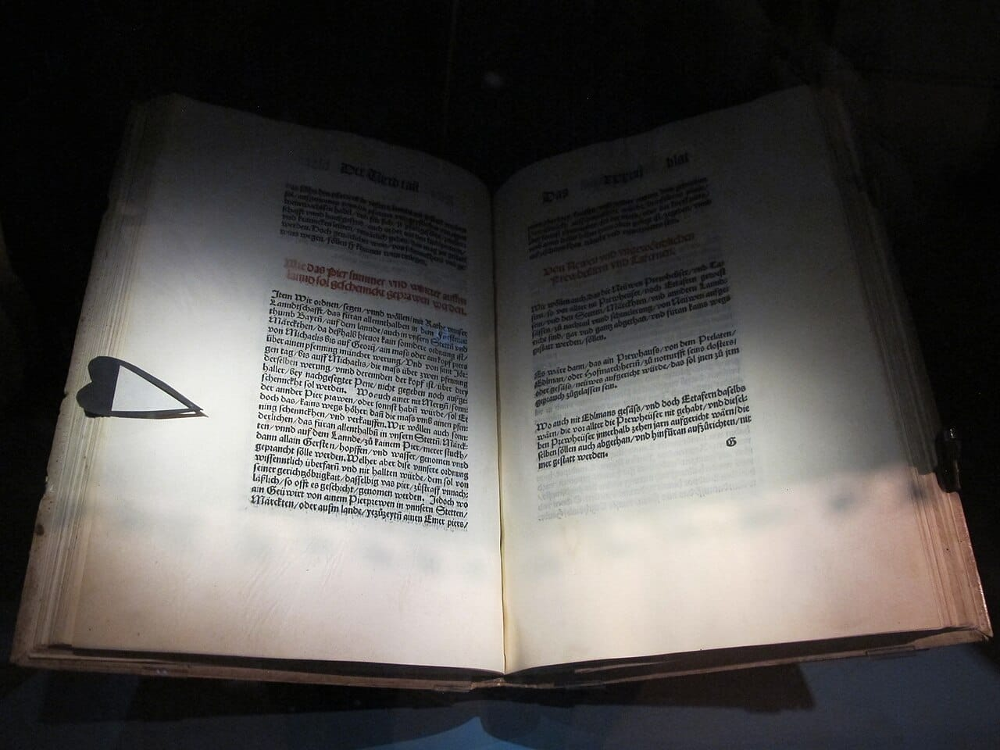

# The 1516 Bavarian Reinheitsgebot: How a Local Ordinance Became a National Symbol

On 23 April 1516, Duke Wilhelm IV of Bavaria and his brother Duke Ludwig X issued a Landesordnung at Ingolstadt. One clause laid down that, in Bavarian towns, markets and villages, beer was to be made only from barley, hops and water. The clause later became known as the Reinheitsgebot, the beer purity law. It was not a sudden "German beer constitution" but part of a local food and price ordinance. Over five centuries, however, it became the most famous identity label of German beer.

Figure: The beer-purity clause in the 1516 Bavarian Landesordnung, displayed at the 2016 Bavarian state exhibition. Image: Luidger, CC BY-SA 3.0, via Wikimedia Commons ([source page](https://commons.wikimedia.org/wiki/File:20160516-Aldersbach_Bayerische_Landesausstellung_2016_Bier_in_Bayern_(Reinheitsgebot).JPG)).

## Background

In the early sixteenth century, beer was part of the daily diet in Bavaria and an important source of revenue for towns and lords. There was no modern food chemistry and no unified industrial standard. Beer could be made from different grains, spices, herbs and sweeteners, with great variation in quality and keeping ability. The lords' motives were not only to make beer "pure". They also wanted to stabilise prices, protect grain supplies, prevent brewers from wasting scarce grain and maintain market order through licences and penalties.

The 1516 text therefore contained more than the three-ingredient rule. It also set seasonal beer prices, units of measure and penalties, and distinguished March beer (Märzen) from ordinary beer. The "purity" clause was one article in a price and market ordinance, not a standalone food-safety law. It applied initially only to the Duchy of Bavaria, not to the whole of modern Germany, and not to every type of beer.

## Course and timeline

The ordinance was issued at Ingolstadt on 23 April 1516. The original permitted ingredients were Gerste (barley), Hopffen (hops) and Wasser (water). Yeast was not listed, because the role of yeast in fermentation was not understood in modern microbiological terms. Brewers usually reused yeast from a previous batch or relied on yeasts present in the air; yeast was treated as part of the process rather than a recipe ingredient. Only later was yeast explicitly added to the official formulation, producing today's familiar list of water, malt, hops and yeast.

The ordinance began as a local Bavarian rule. In the course of nineteenth-century German unification, Bavaria pushed to have the beer-purity requirement incorporated into a wider legal framework. In 1906 it became applicable throughout Germany. In the late twentieth century, as European single-market and food rules were harmonised, Germany adjusted restrictions on imported beer, but the German brewing industry continued to treat the Reinheitsgebot as a voluntary commitment and a quality narrative. Today, 23 April is marked by the German brewing industry as German Beer Day, commemorating the 1516 promulgation.

## Key people and institutions

Wilhelm IV and Ludwig X were the promulgators. The two brothers governed Bavaria together, and Ingolstadt was an important court and administrative centre. The ordinance was not the invention of a scientist. It was a governing instrument promoted by lords, town councils, brewing guilds and tax officials. Its enforcement depended on local courts and market inspectors, not on a modern food-inspection agency.

In the twentieth century, the Bavarian state government, the German brewers' association and major breweries together turned the Reinheitsgebot into a national cultural symbol. After the 1950s, the German beer industry repeatedly invoked the year 1516 in advertising, festivals and export promotion, turning a local ordinance into a byname for "German beer tradition". The quincentenary in 2016 pushed the symbol further into international communication.

## Concrete changes for the industry

First, a recipe boundary. Barley, hops and water became the basic frame for Bavarian beer, pushing brewers to shape flavour through malt handling, mashing and fermentation rather than through other grains and additives. Second, style differentiation. Restriction did not mean monotony: through malt kilning, hop varieties, fermentation temperature and yeast selection, Germany developed pale, dark, wheat beer, Berliner Weisse and many other styles. Third, market order. Price, measurement and penalty clauses made beer a taxable, inspectable everyday commodity and strengthened urban control over brewing and sale. Fourth, a legal symbol. After the twentieth century, the Reinheitsgebot became a cultural selling point for German beer at home and abroad, and a way to distinguish "German beer" from "international industrial beer". Fifth, a space for dispute. It protected tradition but also limited innovation; after the rise of craft and flavoured beer, German industry and outsiders have continued to debate the boundary between "purity" and "diversity".

## Disputes and sources

First, the scope has been exaggerated. The 1516 text applied to Bavaria, not to all of Germany; nationwide application came with later legal integration in 1906. Second, the ingredient list has been read backwards. The original did not include yeast; the four-ingredient formulation is later. Describing the 1516 text as "water, malt, hops, yeast" is inaccurate. Third, exceptions are ignored. Bavarian history contains privileges and exceptions for wheat beer, monastic brewing and particular towns, so the Reinheitsgebot cannot be read as requiring barley-only beer everywhere from 1516. Fourth, the nature of the text is misread. It was first a price and market ordinance; food safety and consumer protection are later interpretive frames. Fifth, the claim of "oldest food law" needs qualification. The German brewers' association describes it as one of the world's oldest food regulations still in force, but "oldest" depends on which regions and statutes are compared and should not be treated as an uncontested absolute.

## Common misreadings

One: "Germany had the Reinheitsgebot in 1516." The 1516 rule was Bavarian; Germany as a unified state came much later. Two: "The law always specified four ingredients." Yeast was added to the official formulation later. Three: "The law banned wheat beer." The text names barley as the beer grain, but wheat beer had historical privileges and exceptions and cannot be swept into a single prohibition. Four: "The law guarantees better-tasting beer." It constrains recipes, not flavour; taste depends on raw-material quality, process and freshness. Five: "The Reinheitsgebot is only a marketing story." It is indeed a cultural symbol, but it also has a real legal history and a market-governance function; one cannot cancel the other.

## See also

- [Beer](ref:beer): the overall framework of ingredients, fermentation and styles.
- [Wheat beer](ref:wheat): another major Bavarian brewing tradition.
- [Germany](ref:germany): federalism, state law and the regional beer market.
- [Bavaria](ref:bavaria): the birthplace of the Reinheitsgebot and the core of German beer culture.
- [Weihenstephaner Hefe Weissbier](ref:weihenstephan): a reference point for Bavarian monastic and wheat-beer traditions.

**Short definition:** On 23 April 1516 Duke Wilhelm IV and Duke Ludwig X of Bavaria issued a Landesordnung at Ingolstadt requiring beer to be made from barley, hops and water. It was a Bavarian local ordinance, not a German national law, and yeast was not mentioned. Only in 1906 did its scope extend across Germany; it later became a powerful symbol of German brewing.

## Related images

Image: Related photograph of Weihenstephaner Hefe Weissbier. Credit: JIP, CC BY-SA 4.0, via Wikimedia Commons ([source page](https://commons.wikimedia.org/wiki/File:Weihenstephaner_Hefe_Weissbier_aboard_Viking_Mariella.jpg)). Related image for The 1516 Bavarian Reinheitsgebot: How a Local Ordinance Became a National Symbol.
