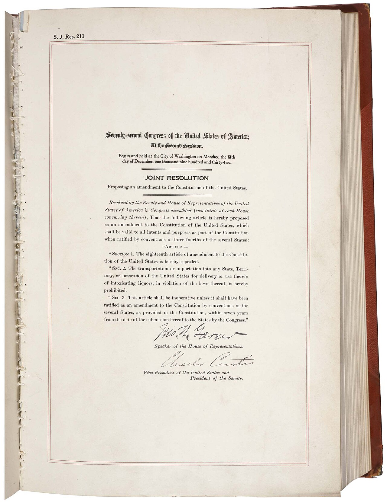
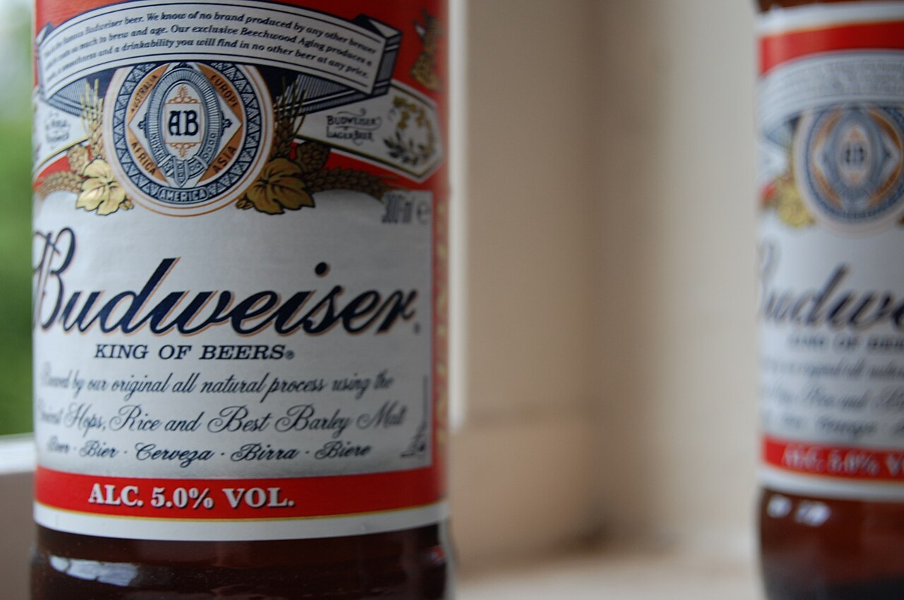

# The Repeal of Prohibition in 1933: The Twenty-first Amendment and the Rebuilding of American Alcohol Regulation

On 5 December 1933 Acting Secretary of State William Phillips certified that the Twenty-first Amendment had received enough state approvals. The amendment has only three sections; its core sentence is that the Eighteenth Amendment is "hereby repealed". It ended nearly fourteen years of national Prohibition and moved American alcohol regulation from federal prohibition to a complex system of federal taxation and state and local licensing. Repeal was not a one-night liberalisation but a years-long political, fiscal and institutional reconstruction.

Figure: First page of the joint resolution proposing the Twenty-first Amendment, 20 February 1933. Image: U.S. Government, Public domain, via Wikimedia Commons ([source page](https://commons.wikimedia.org/wiki/File:21st_Amendment_Pg1of1_AC.jpg)).

## Background

In 1919 the Eighteenth Amendment was ratified, prohibiting the manufacture, sale and transport of "intoxicating liquors". The Volstead Act of the following year set the threshold at 0.5% alcohol by volume. Prohibition did not eliminate drinking; it pushed the alcohol market underground. Illegal distillation, smuggling, speakeasies and organised crime expanded, while federal and state governments lost alcohol tax revenue and enforcement costs rose. By the Great Depression, restoring alcohol production and taxation had become an option for stimulating the economy and creating jobs.

In 1932 Democratic presidential candidate Franklin Roosevelt put repeal in his platform. In March 1933 he signed the Cullen-Harrison Act, allowing the sale of beer and light wine at no more than 3.2% alcohol. That law is often mistaken for the end of Prohibition; in fact it only relaxed low-alcohol drinks. National repeal still required the Twenty-first Amendment.

## Course and timeline

On 20 February 1933 Congress passed the joint resolution proposing the Twenty-first Amendment. Unlike earlier amendments, it specified ratification by state conventions rather than state legislatures, a device to bypass prohibitionist resistance in some legislatures. Ratification began in April 1933, with Michigan, Wisconsin, Rhode Island and other states moving first. By 5 December Utah became the thirty-sixth ratifying state, reaching the three-quarters threshold among forty-eight states. Acting Secretary of State Phillips certified the amendment that day, and it took effect.

Section 1 repeals the Eighteenth Amendment. Section 2 prohibits the transport or importation of intoxicating liquors into any state, territory or possession where such transportation or importation is prohibited by local law. Section 3 requires ratification by state conventions within seven years. The amendment did not create a uniform federal licensing system; it left most control to states and localities. That is why American alcohol rules differ so much today: some states run state liquor stores, some allow supermarket sales, and some counties remain dry.

## Key people and institutions

Roosevelt was the political symbol of repeal, but the institutional drivers included anti-Prohibition members of Congress, the alcohol industry, Treasury officials and state politicians. William Phillips, as acting secretary of state, completed the certification, a key legal step. Utah, as the thirty-sixth state, is often remembered as the state that pushed the amendment over the threshold; before that, thirty-six approvals had taken eight months.

At the institutional level, the National Archives preserves and displays the joint resolution; Congress, state conventions and the State Department form the ratification chain; federal alcohol tax and enforcement agencies rebuilt regulation after repeal. The end of Prohibition was not a withdrawal of government from alcohol but a shift from prohibition to taxation, licensing and enforcement.

## Concrete changes for the industry

First, the beer industry recovered first. In April 1933 3.2% beer became legal, breweries reopened, and advertising and brand competition returned. Second, the wine industry rebuilt. California and East Coast wineries had shifted to grape juice, sacramental wine and industrial uses during Prohibition; after repeal, wine production and sales gradually recovered. Third, the spirits industry was restructured. Bourbon, whiskey and imported spirits re-entered the market, but state licensing, the three-tier system and local dry areas made the structure more complex than before Prohibition. Fourth, the tax model changed. Federal and state governments regained alcohol tax revenue, and alcohol became a stable source of public income. Fifth, organised crime did not disappear at once. Repeal weakened the illegal alcohol market, but criminal networks moved into other illegal industries, and enforcement and corruption problems remained.

## Disputes and sources

First, "repeal" and "alcohol liberalisation" are not the same. The Twenty-first Amendment ended national Prohibition, but Section 2 explicitly allowed states and localities to maintain restrictions, including dry policies. Second, the ratification process was a political design. Ratification by state conventions was intended to avoid resistance in state legislatures and is unique in American constitutional history. Third, 3.2% beer is often mistaken for the end of Prohibition. It was a March 1933 relaxation; the real repeal came in December. Fourth, the reasons for Prohibition's failure have been simplified. Illegal alcohol, crime and enforcement costs were severe, but the temperance movement also had genuine public-health and family-protection arguments; writing it off as "completely absurd" obscures the social debate. Fifth, the effects of repeal are both overstated and understated. It restored a legal market but did not eliminate alcohol abuse, interstate differences or industry concentration; regulation continued to evolve.

## Common misreadings

One: "President Roosevelt repealed Prohibition by executive order." Repeal required a constitutional amendment, proposed by Congress and ratified by state conventions; a president cannot repeal it alone. Two: "Beer became legal in April 1933, so Prohibition was over." April legalised 3.2% beer; national Prohibition ended on 5 December. Three: "After repeal, American alcohol was completely unregulated." Federal, state and local licensing, taxation, sales hours and age limits remained. Four: "The Twenty-first Amendment only repealed Prohibition." It also contains interstate-transport limits and a ratification procedure that shaped later alcohol-commerce and states'-rights disputes. Five: "Prohibition had no long-term effect on the industry." It reshaped American production, distribution and brand structure, and many state licensing systems survive today.

## See also

- [American Prohibition](ref:prohibition): the national prohibition system of 1920–1933.
- [United States](ref:usa): the background of federalism and state alcohol regulation.
- [Beer](ref:beer): the category framework for the post-repeal recovery of brewing.
- [Budweiser](ref:bud): a sample of American brewing and market rebuilding after Prohibition.
- [Buffalo Trace](ref:buffalo): a sample of American whiskey's reconstruction and expansion after Prohibition.

**At a glance:** On 20 February 1933 Congress proposed the Twenty-first Amendment, repealing the Eighteenth. On 5 December 1933 Utah became the thirty-sixth ratifying state, and Acting Secretary of State William Phillips certified the amendment. It is the only U.S. constitutional amendment ratified by state conventions and the only one that fully repeals an earlier amendment. Prohibition ended, but alcohol regulation did not disappear; it shifted to state and local licensing.

**Key facts.**

| Item | Detail |
| --- | --- |
| In one line | On 20 February 1933 Congress proposed the Twenty-first Amendment, repealing the Eighteenth. On 5 December 1933 Utah became the thirty-sixth ratifying state, and Acting Secretary of State William Phillips certified the am… |
| Date | 20 February–5 December 1933 |
| Place | United States |
| Calendar | Gregorian |

## Related images

Image: Budweiser bottle close-up. Credit: Sam, CC BY-SA 2.0, via Wikimedia Commons.. Credit: Sam, CC BY-SA 2.0, via Wikimedia Commons ([source page](https://commons.wikimedia.org/w/index.php?curid=20085117)). Related image for The Repeal of Prohibition in 1933: The Twenty-first Amendment and the Rebuilding of American Alcohol Regulation.
