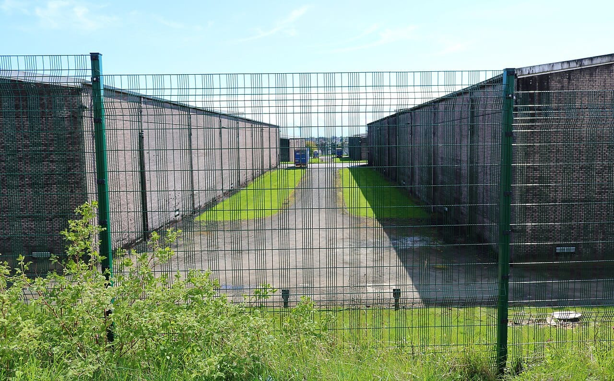

# A Tax History of Scotch Whisky: From the 1644 Excise to the 1823 Excise Act

In 1644 the Scottish Parliament first taxed whisky, opening a period of more than 150 years of illicit distilling and smuggling. By the 1820s as many as 14,000 illicit stills were seized each year, and more than half the whisky drunk was untaxed. The Excise Act passed on 18 July 1823 changed direction: instead of tightening prohibition, it used a £10 licence and duty per gallon to make legal distilling profitable. That turn is usually seen as the start of the modern Scotch whisky industry.

Figure: "A Tax History of Scotch Whisky: From the 1644 Excise to the 1823 Excise Act". Photograph: Diageo distillery, Leven - geograph.org.uk - 6463659. Credit: Bill Kasman, CC BY-SA 2.0 ([source page](https://commons.wikimedia.org/w/index.php?curid=150169452)). Category image; not a claim that it shows the exact product, site or event.

## Date and place

The tax history covers Scotland, especially the Highlands and the north-east countryside. Illicit stills were scattered across farms, glens and coasts, while legal distilling concentrated in towns with licences, ports and excise stations. The chase between the exciseman (also called the gauger) and the illicit distiller formed the everyday landscape of eighteenth-century rural Scotland.

In time there are three stages: the earliest documentary record in 1494; the illicit era from the first tax in 1644 to 1823; and legalisation and industrialisation after the 1823 Excise Act. The turning point in each case was not technology but taxation.

## Background: the earliest record of 1494

The earliest documentary record of distilling in Scotland appears in the Exchequer Rolls of 1494. An entry records a payment: 'Eight bolls of malt to Friar John Cor wherewith to make aqua vitae'. This quantity of malt was enough to make almost 1500 bottles of strong spirit.

The record shows that by the end of the fifteenth century Scotland already had distilling from malt, linked to monasteries, medicine and court consumption. 'Aqua vitae', the water of life, began as a medicinal strong spirit and only later became an everyday drink. Early distilling was small-scale, mostly household or estate use, and had not yet become a national industry.

## Course: the first tax of 1644 and the illicit era

In 1644 the Scottish Parliament introduced the first taxes on whisky. The aim was revenue, but the result was the opposite: the heavier the tax, the more illicit distilling. For the next 150 years smuggling was normal; excisemen and illicit distillers played a cat-and-mouse game, with spirit hidden under floorboards, behind pulpits and even carried in coffins to avoid inspection.

By the 1820s the conflict had peaked: as many as 14,000 illicit stills were seized each year, and more than half the whisky was consumed untaxed. Enforcement was costly while the tax base shrank. Neither higher taxes nor tougher policing could solve the problem.

The turn came from a parliamentary debate. The Duke of Gordon, on whose land some of the finest illicit whisky was made, proposed in the House of Lords that rather than let illicit distilling spread, the government should make legal distilling profitable. The proposal eventually led to the 1823 reform.

## The 1823 Excise Act

On 18 July 1823 the Excise Act passed. Its core was not prohibition but attraction: a bearable duty that would draw illicit distillers into the legal system.

The arrangements included a £10 licence for a still; duty of 2 shillings 3 pence per gallon for stills of 40 gallons or more; a ban on stills below the legal capacity, closing a loophole for small-scale evasion; permission to warehouse spirit before duty was paid, reducing cash pressure; and simplified but stronger excise supervision, reducing opportunities for evasion.

The effect was quick. Within a decade smuggling had almost disappeared; many famous distilleries today stand on sites once used by illicit distillers. Legalisation not only raised revenue but turned distilling from a scattered rural sideline into an industry that could invest, expand and export.

## Influence: the end of illicit stills and an export industry

First, it laid the industrial foundation of modern Scotch whisky. Licences, excise collection and warehousing allowed distilleries to produce steadily, age for years and sell across regions.

Second, it drove technical differentiation. In 1831 Aeneas Coffey invented the patent continuous still, which could produce grain whisky continuously; blending grain with malt whisky widened the market for Scotch.

Third, it seized an external opportunity. In the 1880s French vineyards were hit by phylloxera, and wine and brandy almost vanished from European markets; Scotch whisky filled the gap and became the preferred spirit.

Fourth, it produced an industry body and a legal framework. In 1912 brand owners met in London and set up the Wine & Spirit Brand Association, renamed the Scotch Whisky Association (SWA) in 1942. In 1933 UK law first defined 'Scotch whisky'; a dedicated Scotch Whisky Act followed in 1988, and new regulations in 2009. Today Scotch must be distilled in Scotland, matured in oak casks for at least three years and bottled at no less than 40% abv.

## Sources and disputes

First, the 1494 record is the 'earliest documentary record', not 'the earliest distilling'. Archaeology and local records may suggest earlier activity, but there is no verifiable written evidence; this essay uses 1494 as the documentary starting point.

Second, the exact duty rates of the 1823 Act differ across sources. The association page gives the licence fee and the principle of duty per gallon, while the local history site gives the detail of 2 shillings 3 pence per gallon for stills of 40 gallons or more; the sources do not fully agree on units and scope, and this essay cites both kinds of source.

Third, '1823 made illicit distilling disappear' is a summary. Smuggling fell sharply within a decade but did not vanish at once; legalisation was gradual and regionally uneven.

Fourth, tax history is easily written as heroic narrative. The Duke of Gordon's proposal, Coffey's invention and the brand owners' exports are key nodes, but the reform was also the result of fiscal pressure, enforcement costs and local interest bargaining, and should not be reduced to individual achievements.

## Timeline

- 1494: the Exchequer Rolls record Friar John Cor using eight bolls of malt to make aqua vitae.
- 1644: the Scottish Parliament first taxes whisky, and illicit distilling and smuggling rise.
- 1820s: up to 14,000 illicit stills are seized each year, and more than half the whisky is untaxed.
- 1823: the Excise Act passes on 18 July, replacing prohibition with a licence fee and duty per gallon.
- 1831: Coffey's continuous still is invented, and grain whisky appears.
- 1880s: French phylloxera removes brandy from the market, and Scotch expands.
- 1912: the Wine & Spirit Brand Association is founded in London.
- 1933: UK law first defines 'Scotch whisky'.
- 1942: the association is renamed the Scotch Whisky Association.
- 1988: the Scotch Whisky Act is passed.
- 2009: new Scotch Whisky Regulations are issued.

## Further reading

- [Whisky](ref:whisky): current introduction to whisky styles and production.
- [The spread of distillation](ref:distill-spread): the long technical background from stills to distilled spirits.
- [Scotch Whisky Association](ref:swa): the industry body and current rules.
- [United Kingdom](ref:uk): UK alcohol taxation and trade background.
- [Scotland](ref:scotland): the Scottish region and distilling tradition.
