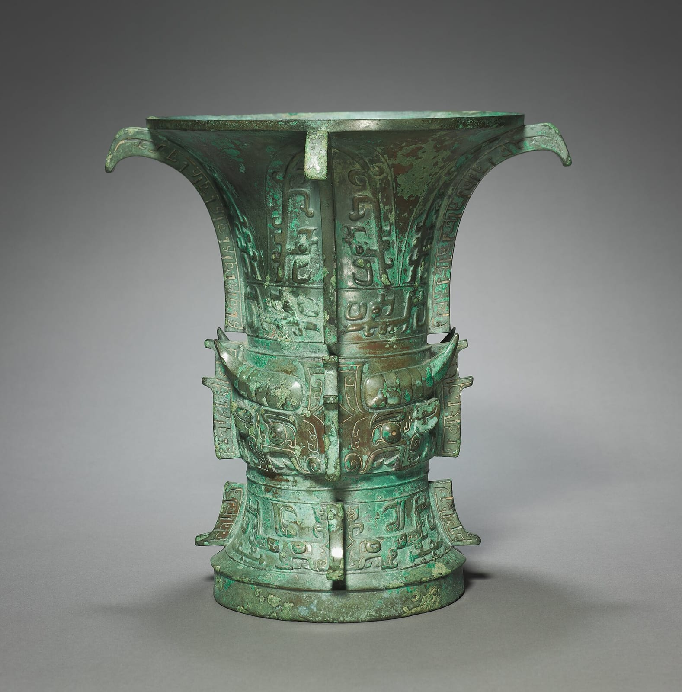
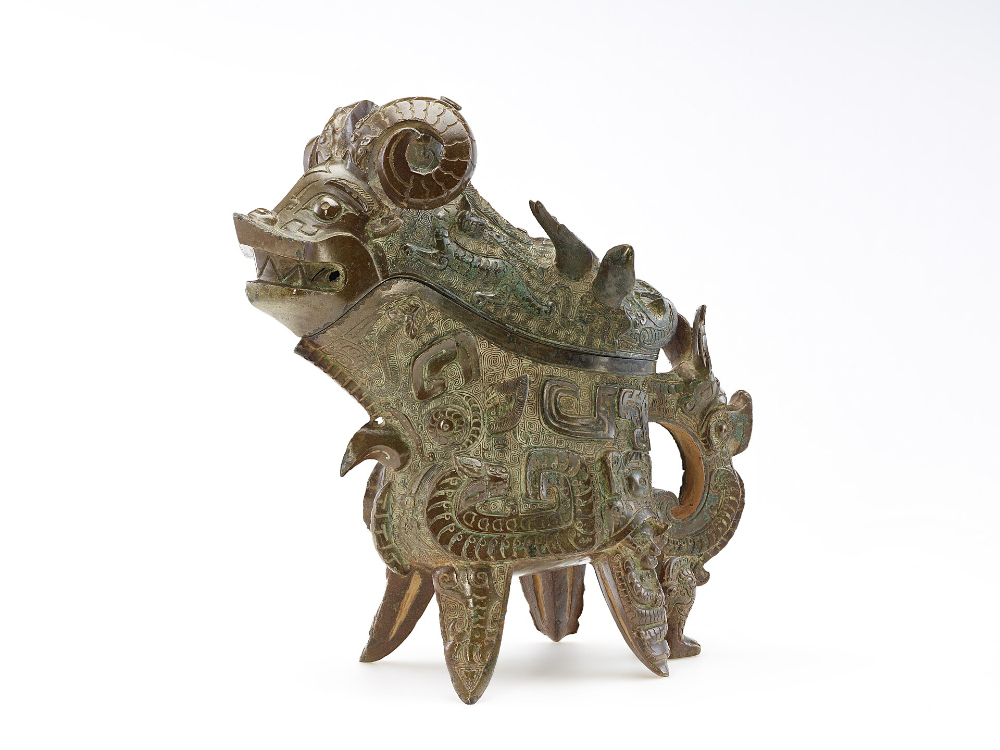

# Shang and Zhou Wine Ritual: Bronze Vessels, the Wine Officer and the Jiugao

Drinking in the Shang and Zhou periods was not casual everyday behaviour; it was a ritual embedded in sacrifice, banqueting and hierarchy. Bronze wine-vessel sets, the division of duties among Zhou officials such as the wine officer, and the limits on drinking in the Book of Documents' Jiugao: these three together make up the substance of 'wine ritual'. Reading it merely as 'the ancients were particular about drinking' misses the point, because wine ritual was first of all a set of rules for allocation and restraint.

Figure: Related photograph of Shang and Zhou Wine Ritual: Bronze Vessels, the Wine Officer and the Jiugao. Image: , CC0, via Wikimedia Commons ([source page](https://commons.wikimedia.org/wiki/File:Clevelandart_1951.151.jpg)).

## Date and place

The period runs roughly from the Shang to the Western Zhou, about 1600 to 771 BCE, centred on the middle and lower Yellow River. Anyang and the Yinxu site have yielded large numbers of bronze wine vessels, while ritual-vessel sets at Zhouyuan and Fenghao show a different system. Archaeology can prove that the vessels and sacrifices existed, but it cannot prove that every ceremony described in the texts was performed exactly as written; the texts and the objects have to be described separately before any correspondence is claimed.

## Background: why wine belonged to the gods first

In Shang sacrifice, wine was an offering to ancestors and deities. Among the bronze vessels, jue, gu, jia, zun, you, hu and lei were connected with warming, drinking, storing and ladling wine. The number, size and combination of vessels found in tombs show that wine vessels were also status markers: how many pieces a person could use, and which types, were tied to their place in the clan and political order.

The Zhou inherited this tradition of vessel use and wrote 'virtue' and restraint into the rules of drinking. Wine ritual therefore expanded from sacrificial technique into political ethics: wine was still offered to the gods, but human drinking became a subject for discussion about virtue and the fate of the state. The Jiugao is a product of that discussion.

## Course: officials, kinds of wine and brewing requirements

The Rites of Zhou, in the section on the heavenly offices, says that 'the wine officer oversees the orders on wine and issues brewing materials according to the standard method', that is, a wine officer managed the rules and allocated materials by fixed standards. The wine officer distinguished the names of the 'five qi' and the 'three wines': shi wine, xi wine and qing wine. The five qi were five kinds of wine differing in fermentation and clarity; the three wines were distinguished by use and by how long they had been kept.

| Five qi | Key wording in Zheng Xuan's annotation | Rough form |
| --- | --- | --- |
| Fan qi | When finished, the lees float freely on top | Cloudiest, the first stage of fermentation |
| Li qi | Liquid and lees go together | A sweet wine with liquid and solids mixed |
| Ang qi | Cloudy and pale, the colour of scallion white | Pale and cloudy |
| Ti qi | Reddish when finished | Leaning to red |
| Shen qi | When finished, the lees sink | Clearer, with the lees settled |

The Book of Rites, in the Yue Ling chapter, gives another set of brewing requirements: 'The great chief is ordered: the glutinous millet and rice must be uniform, the qu starter must be timely, washing and heating must be clean, the water must be fragrant, the pottery must be sound, and the heat must be right.' Zheng Xuan notes that 'when the wine is ripe it is called qiu; the great chief is the head of the wine officials', meaning that a senior wine official supervised grain, starter, washing, water, pottery and heat. This set of requirements raised brewing from a household craft to a public matter that officials could inspect.

The Jiugao sets the boundary of drinking. It records King Wen's teaching to his sons and officials: 'do not drink regularly' and 'drink only at sacrifices; hold to virtue and do not become drunk'. The Duke of Zhou proclaimed this announcement in Wei, repeatedly warning that the Shang had lost virtue and then their state through wine. It was an admonition addressed to the remnants of the Shang and to the newly enfeoffed state of Wei, and should not be read simply as a blanket prohibition imposed on all of Western Zhou society.

## Influence: from ritual to the language of wine policy

First, wine ritual entered later ritual systems. Sacrifice, banqueting and the district drinking ceremony all continued the principle that wine has grades and drinking has occasions; the shape and combination of vessels also became a visual language of status and power, as discussed in [the history of wine vessels](ref:vessels).

Second, the language of wine policy borrowed repeatedly from the Jiugao. Arguments for prohibition, restriction and monopoly in later dynasties often cited it, treating 'drink only at sacrifices' as classical authority for limiting consumption. By the Han dynasty the restriction had turned into a fiscal instrument, with the state monopoly known as que wine, discussed in [the Han wine monopoly](ref:han-monopoly).

Third, the classification of wine shaped later technical description. The five qi and three wines sorted wine by clarity, sweetness and age, a way of classifying that echoes later terms such as new wine, aged wine and clear wine in yellow wine, though the referents cannot be mapped directly; see [yellow wine](ref:yellow-wine).

## Sources and disputes

First, the date of the Rites of Zhou is disputed. Most scholars regard it as edited in the late Warring States period and possibly preserving Western Zhou institutions, but treating the whole book as a verbatim record of Western Zhou government goes too far. The actual operation of the wine officer can therefore only be described cautiously as 'an office designed within the Zhou ritual tradition'.

Second, the Jiugao is traditionally dated to the early Western Zhou, but its transmission is complex and modern research differs on its exact date and character. A safer reading is that it reflects how the early Zhou political group explained the fall of the Shang, rather than a modern-style prohibition law that could be enforced article by article.

Third, interpretations of the five qi and three wines diverge. Zheng Xuan compared them with the wines of his own time, and later commentators differed again; treating the five qi as five modern wine types, or the three wines as three brand grades, would be a mismatch.

Fourth, bronze wine vessels cannot directly prove the extent of social drinking. Vessel sets in tombs show ritual and status, while the textual claim that 'the Shang loved wine' carries the political criticism of the Zhou. The two can illuminate each other but cannot substitute for each other.

## Timeline

- Shang dynasty: bronze wine vessels and sacrificial wine form stable sets.
- Early Western Zhou: the Duke of Zhou proclaims the Jiugao in Wei, limiting drinking with the Shang as a warning.
- Western Zhou: the wine officer, great chief, five qi, three wines and six requirements appear in the ritual tradition.
- Late Warring States: texts such as the Rites of Zhou are edited into the institutional descriptions we have today.
- Han dynasty: alongside ritual restraint, a monopoly form of que wine appears, discussed in [the Han wine monopoly](ref:han-monopoly).

[China](ref:china) and [A history of drinking vessels: how the cup changed the drink](ref:vessels) are the nearest useful comparisons: one clarifies date, the other tests place.

**Short definition:** Drinking in the Shang and Zhou periods was embedded in sacrifice, banqueting and hierarchy. Bronze wine-vessel sets, the duties of Zhou officials such as the wine officer, and the limits on drinking in the Book of Documents' Jiugao together make up what 'wine ritual' meant. This essay sets out what each line of evidence can prove, and why the Rites of Zhou and the Jiugao need to be read with caution.

## Further reading

- [Wine and ritual](ref:ritual): the role of wine in ritual and its later survivals.
- [History of wine vessels](ref:vessels): from bronze vessels to modern glass shapes.
- [The Han wine monopoly](ref:han-monopoly): from ritual restraint to fiscal monopoly.
- [Yellow wine](ref:yellow-wine): the technical category of cereal wine.
- [China](ref:china): background on regions and categories of Chinese alcohol.

## Related images

Image: Related photograph of Wine and ritual: from village drinking rites to the modern toast. Credit: anonymous, CC0, via Wikimedia Commons ([source page](https://commons.wikimedia.org/wiki/File:Ritual_wine_ewer_(gong)_with_masks_(taotie),_dragons,_and_real_animals.jpg)). Related image for Shang and Zhou Wine Ritual: Bronze Vessels, the Wine Officer and the Jiugao.
