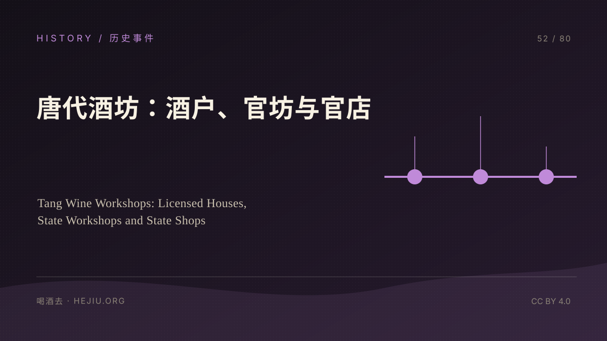

# Tang Wine Workshops: Licensed Houses, State Workshops and State Shops

In the early Tang, brewing was mainly in private hands, and the court ordered prohibition only in famine years or when grain was short; after the An Lushan rebellion, military spending and fiscal pressure rose, and wine turned from 'a consumer good that can be banned' into 'a commodity that can be run for revenue'. Licensed wine households were fixed in 764, state brewing was ordered in 782, excise was imposed in the capital region in 786, and in the Yuanhe period the levy was folded into the two taxes. Wine-making then split into three forms: taxed households, state workshops and state shops, while private brewing was repeatedly banned.

Figure: Tang Wine Workshops: Licensed Houses, State Workshops and State Shops. Project-generated or category illustration used for Chinese alcohol culture context; not a photograph of the subject.

## Date and place

This essay focuses on the period from 764 to 846, where the records are densest, and on the cities and county seats of Chang'an, Luoyang and Yangzhou. The geographical variation is striking: in 782 the court ordered state brewing throughout the realm but singled out the capital as 'the king's city' and exempted it from the levy; in 846 it set up only eight circuits and prefectures, including Yangzhou, with a monopoly on qu and state shops. Capital and frontier, rich prefectures and ordinary counties, were governed by rules of very different intensity.

## Background: from famine prohibition to fiscal excise

Early Tang prohibition was mostly tied to grain. Under Emperor Xuanzong, an edict banned wine-selling in the capital because 'granary supplies were not ample' and 'wine prices in the capital were especially high', keeping only the wine used by the Court of Imperial Sacrifices for rituals and for entertaining foreign envoys, and restoring the normal rule after the wheat harvest. Such bans were temporary grain-saving measures, not a permanent monopoly.

After the An Lushan rebellion the situation changed. Military pay, rewards and local tribute all required cash, and wine, widely consumed and reliably profitable, entered the fiscal system. The edict of the twelfth month of 764 singled out 'wine-selling households' from ordinary households, required each prefecture to fix their number, and had them pay tax monthly while banning all other official and private brewing. This step was crucial: it recognised a group of legal wine households and pushed all other producers into illegality.

## Course: households, state brewing and state workshops

In the intercalary first month of 782 the court 'first established the wine monopoly, ordering state brewing everywhere', with prefectures and counties in charge, a price per hu set by the state, and penalties for thin or privately brewed wine; the capital was exempted because it was the emperor's city. This was the Tang's first nationwide system of state brewing and state selling.

In the twelfth month of 786 the Finance Office asked to impose the wine levy in the capital and its metropolitan counties at '150 per dou', and to exempt wine households from corvée. Wine households thus entered an exchange: they bore the levy in return for exemption from corvée and a legal right to trade. In the sixth month of 811 the metropolitan government of Chang'an asked that, apart from the regular wine households, the levy be apportioned through the two taxes and the green-sprout tax at so much per string; households outside the licensed group now shared the payment, and the wine levy began to merge into the land tax.

In 819 the prefect of Huzhou, Li Ying, exposed the other side. Local state selling had replaced the people's payment of the levy, and after years the abuse had deepened; he asked that the people be allowed to brew and sell themselves while still paying the old quota through the two taxes. The commentary says that an earlier request had 'set up state workshops to brew wine in place of them', after which 'the wine law was made severe', so that 'people in the lanes were caught by prohibitions as soon as they raised a hand, while the state took the rich profit'. The state workshop here is a state-run brewing establishment, which together with state shops formed the directly operated end of the system.

In the ninth month of 846 an edict of Emperor Wuzong set up a monopoly on qu and state shops selling wine in eight circuits and prefectures including Yangzhou, replacing the people's payment of the wine levy and devoting the income to military expenses; at the same time it admitted that the ban on private selling had been 'excessively harsh' and ruled that private brewing and private qu should 'punish the offender alone', without implicating the neighbourhood or confiscating family property.

| Date | Measure | Key content |
| --- | --- | --- |
| 764 | Fixing wine households | Each prefecture fixed the number; monthly tax; all other brewing banned |
| 779 | Abolition of the levy | Briefly ended after Emperor Dezong's accession |
| 782 | First wine monopoly, state brewing everywhere | Prefectures in charge, price per hu, capital exempt |
| 786 | Levy in the capital and metropolitan counties | 150 per dou; wine households exempt from corvée |
| 811 | Levy apportioned through the two taxes | Outside regular wine households, shared by tax quota |
| 819 | Huzhou asks to end state selling | State workshops' levy substitution abused; people to brew again |
| 846 | Qu monopoly and state shops in eight circuits | Replacing the levy, funding the army; relaxing collective punishment |

## Influence: three forms of operation

The first was the taxed wine household. Fixed by the authorities, paying the levy monthly or by quota, it brewed and sold legally and, in 786, gained exemption from corvée. It was neither a purely private merchant nor a state employee, but a licensed operator standing between the two.

The second was the state workshop and state shop. The authorities ran their own brewing rooms and their own shops, with income going straight to military or local funds. The advantage was that profit accrued to the state; the disadvantage was quality and efficiency. The Huzhou memorial's complaint that state selling had 'long been deeply abused' is exactly that backlash.

The third was private brewing. It never disappeared and was never legal. The 846 edict's admission that the ban had been too harsh and too widely implicating shows that private brewing had grown beyond what severe punishment could suppress. On this foundation the Song developed a dual system of 'offices in prefectural cities, and private brewing with a fixed annual quota in counties, towns and villages', discussed in [Song wine tax](ref:song-tax).

## Sources and disputes

First, the price figure for 782 differs between editions. The Cefu Yuangui reads 'one hu valued at one thousand', while the Old Tang History reads 'one hu valued at three thousand; even if rice is cheap, it may not fall below two thousand'. Both readings can explain part of the evidence, but not both at once; this essay therefore records only that a price per hu was set and does not convert it into a tax rate.

Second, the nature of the 'wine household' is still debated. The 764 'fixing of wine-selling households' looks like a list of licensed operators, while the 811 phrase 'apart from the regular wine households' shows that regular households were distinct from ordinary taxpayers. How qualification was obtained, how many there were, and whether the status was hereditary are all poorly documented.

Third, the capital exemption was not only economic. In 782 the capital was exempted as 'the king's city', while in 846 an edict noted that private brewing in the capital was abundant and the levy hard to collect. Political symbolism and actual collecting power are entangled here, and it cannot simply be called a favour to the capital.

Fourth, the effect of folding the levy into the two taxes lacks follow-up records. The 811 measure was a memorial approved for the Chang'an metropolitan area; whether it spread, and whether apportionment provoked resistance, is not recorded. Treating it as a nationwide tax reform goes too far.

Fifth, the term 'wine workshop' needs care. In Tang material 'state workshop' means a state-run brewing establishment, not exactly the later generic 'wine workshop'; local gazetteers and modern accounts often conflate the two, and the context has to be checked.

## Timeline

- 764: wine households fixed, taxed monthly, all other official and private brewing banned.
- 779: Emperor Dezong's accession, abolition of the wine levy throughout the realm.
- 782: first wine monopoly, state brewing everywhere, capital exempt.
- 786: levy in the capital and metropolitan counties at 150 per dou, wine households exempt from corvée.
- 811: outside regular wine households, the levy apportioned through the two taxes and green-sprout tax.
- 819: Huzhou asks to end state selling, allowing private brewing while paying through the two taxes.
- 846: qu monopoly and state shops in eight circuits, income funding the army.

The comparison with [China](ref:china) and [The Han Wine Monopoly: State Trading in 98 BCE and Its Abolition in 81 BCE](ref:han-monopoly) runs through date and place. Each answers a different question.

## Further reading

- [History of Chinese wine](ref:chinese-wine-history): the longer line from Tang policy to later trades.
- [The Han wine monopoly](ref:han-monopoly): an earlier model of state monopoly.
- [Song wine tax](ref:song-tax): offices, quotas and private brewing made into a system.
- [China](ref:china): background on regions and categories of Chinese alcohol.

## Related images

Image: Category image for "Song Wine Tax: State Offices, Private Quotas and Fiscal Dependence". Credit: Jiong Sheng, CC BY-SA 2.0, via Wikimedia Commons ([source page](https://commons.wikimedia.org/wiki/File:ShaoxingXianheng.jpg)). Related image for Tang Wine Workshops: Licensed Houses, State Workshops and State Shops.
