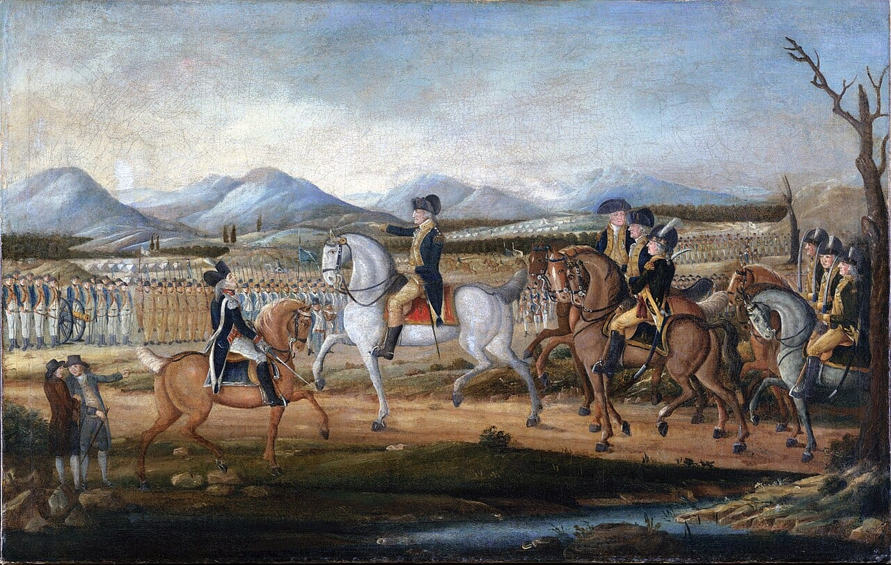
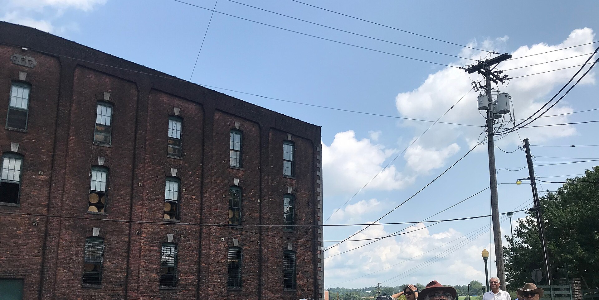

# The Whiskey Rebellion of 1791: Federal Taxation and Frontier Politics in Early America

In 1791 the new federal government of the United States imposed an excise tax on distilled spirits to help pay its Revolutionary War debt. For eastern merchants this was fiscal policy. For farmers west of the Appalachian mountains it struck the one product that could carry grain to market. Grain was bulky and expensive to transport; distilled into whiskey, it became lighter, more compact and less perishable, and could also serve as local currency. A federal tax therefore felt like an attack on a way of life. The armed protest of 1794 and the militia march that followed became known as the Whiskey Rebellion.

Figure: Frederick Kemmelmeyer's painting of Washington reviewing the western army at Fort Cumberland, c. 1794. Image: Attributed to Frederick Kemmelmeyer, Public domain, via Wikimedia Commons ([source page](https://commons.wikimedia.org/wiki/File:WhiskeyRebellion.jpg)).

## Background

After the Revolution, the federal government assumed state debts and faced severe fiscal pressure. Treasury Secretary Alexander Hamilton wanted federal taxation to establish credit. In March 1791 Congress passed an excise on distilled spirits. The law taxed distillers by capacity or output and allowed payment in cash. In the frontier, however, cash was scarce; farmers were more accustomed to barter and whiskey exchange. Worse, anyone accused of evasion had to answer in the federal court in Philadelphia, often more than 300 miles away. Travel and time costs could persuade a small farmer to give up the fight.

The Monongahela Valley of western Pennsylvania was an important rye-whiskey region. Farmers distilled rye into whiskey and shipped it east by river and road. The federal tax raised costs and pulled local production into an administrative system they did not control. Protesters called the law tyranny; the federal government saw it as a test of whether the new Constitution could tax and enforce.

## Course and timeline

After the tax took effect in 1791, western counties saw refusals, threats against tax collectors and protest meetings. In 1792 protesters began organising committees of correspondence to coordinate action across counties. In the summer of 1794 federal courts issued summonses to non-payers, and marshals and excise officers were besieged. In July, the house of excise officer John Neville was surrounded by an armed crowd, and a person was killed in the confrontation. A federal marshal was then detained, and the situation escalated.

On 7 August 1794 Washington issued a proclamation declaring the western resistance an insurrection and invoked the Militia Act of 1792 to call out militia from Pennsylvania, Virginia, Maryland and New Jersey. About 13,000 men assembled and advanced west in two columns. Washington accompanied the army to Bedford, then returned to Philadelphia and left field command to Henry "Light-Horse Harry" Lee. Under military pressure the rebellion collapsed quickly, with almost no large-scale fighting. A small number were arrested and tried, and later pardoned. The federal whiskey tax did not disappear at once; it was repealed in 1802.

## Key people and institutions

Hamilton was the tax's principal designer and saw the excise as part of federal finance and industrial policy. Washington's handling was symbolic: he issued a proclamation, mobilised militia and sent commissioners to negotiate with western representatives, trying to turn resistance from "rebellion" into "restorable order". Albert Gallatin was a moderate western voice. He opposed the tax but worked to prevent violence and later became Jefferson's Treasury secretary. John Neville and Henry Lee represented, respectively, local enforcement and military suppression.

At the institutional level, Congress, the Treasury, the federal courts and state militia formed the chain of the crisis. Congress passed the tax, the Treasury and federal marshals enforced it, federal courts issued summonses, and the president mobilised military force under the Militia Act. The crisis was therefore not only a farmers' tax revolt but a stress test of the new federal system.

## Concrete changes for the industry

First, the federal power to tax was demonstrated in practice. The government showed it could not only legislate but carry a tax into the frontier. Second, the geography of distilling became politicised. The western rye-whiskey region's relationship with the federal government grew tense, and distillers became more active in local politics. Third, the form of taxation changed. After 1794 the law was modified, including adjustments to capacity-based collection; in 1802 the Jefferson administration repealed the federal whiskey tax. Fourth, whiskey's symbolic meaning grew. It was no longer merely a commodity but a symbol of frontier autonomy, tax resistance and local identity. Fifth, party politics were pushed forward. The federalist-republican argument over the tax, the militia and federal power became a central part of 1790s American politics.

## Disputes and sources

First, accounts differ on casualties and the scale of the initial clashes in the summer of 1794. No single number can summarise the confrontation, arrests and deaths. Second, the composition of the protesters has been simplified. They were not all poor farmers; they included local elites, distillers, merchants and political figures opposed to federal power, with different motives. Third, the labels "rebellion" and "protest" carry positions. The federal government called it an insurrection; local participants often described legitimate tax resistance and petitioning. Fourth, the military action is sometimes over- or understated. The march avoided large-scale fighting, but the arrests, trials and pardons also shaped the outcome. Fifth, the reasons for repeal were complex. The 1802 repeal was tied to Jeffersonian fiscal policy, enforcement costs, frontier politics and war pressures, not simply to the rebellion.

## Common misreadings

One: "This was a real war." It was closer to an armed tax resistance and a federal military display; there was no large-scale battle. Two: "Washington personally led troops in combat." He accompanied the army and reviewed it, but field command was Henry Lee's. Three: "The rebellion directly caused the repeal of the whiskey tax." The tax survived after 1794 and was repealed only in 1802. Four: "All western farmers opposed the tax." Some refused, some paid, some waited, and some opposed violence; frontier society was not monolithic. Five: "The Whiskey Rebellion was only about whiskey." It was also about federal finance, judicial jurisdiction, the militia and western political representation, which makes it a window on early American state-building.

## See also

- [Whisky](ref:whisky): the basic framework from grain distillation to oak ageing.
- [Buffalo Trace](ref:buffalo): a modern reference for American bourbon and rye traditions.
- [Jack Daniel's](ref:jack): Tennessee whiskey and the American distilling tradition.
- [United States](ref:usa): the regional background of federal taxation, states' rights and alcohol regulation.
- [American Prohibition](ref:prohibition): another direct confrontation between the federal government and drinking.

**Short definition:** In 1791 the United States imposed an excise tax on distilled spirits. Farmers and distillers in western Pennsylvania resisted with refusals, assemblies and violence. In 1794 Washington mobilised about 13,000 militia and marched west; the rebellion collapsed under military pressure. The Whiskey Rebellion became an early test of federal authority, tax politics and frontier interests.

## Related images

Image: Related photograph of Buffalo Trace. Credit: Jaimin Trivedi, CC BY-SA 4.0, via Wikimedia Commons ([source page](https://commons.wikimedia.org/wiki/File:Buffalo_Trace_Distillery_Barrel_Aging_Warehouse_(outside).jpg)). Related image for The Whiskey Rebellion of 1791: Federal Taxation and Frontier Politics in Early America.
