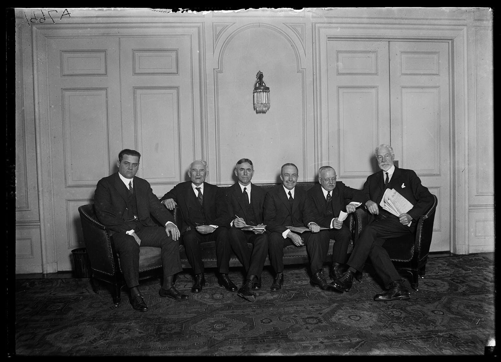

# The Anti-Saloon League: the pressure group that wrote prohibition into the Constitution

In the history of American prohibition, the Anti-Saloon League is hard to avoid. It was not an ordinary temperance society, nor a church group content with moral persuasion alone; it turned “prohibition” into a political programme that could be advanced through elections, lobbying and legislation. Understanding it shows how a social movement grew from a local body into a national pressure group, and how it lost its bearings once its goal was achieved.

Figure: Related photograph of The Anti-Saloon League: the pressure group that wrote prohibition into the Constitution. Image: Harris & Ewing, photographer, Public domain, via Wikimedia Commons ([source page](https://commons.wikimedia.org/wiki/File:Nat%27l_Officers_of_the_Anti-Saloon_League,_now_in_session_LCCN2016887060.jpg)).

## What kind of organisation it was

The Anti-Saloon League was the main lobbying organisation behind American prohibition legislation in the early twentieth century. Its name literally means an alliance against saloons, but its aim went beyond closing them: it sought to ban the manufacture and sale of intoxicating drinks. It drew support mainly from evangelical Protestant churches and pressed legislators at federal, state and local level.

That positioning matters. It was neither a government agency nor a purely charitable body, but a political organisation that turned scattered religious and moral demands into votes and lobbying capacity. Its influence came from being able to organise people, not from administrative power.

## Starting in Ohio in 1893

Britannica's entry records that the League began in 1893 as a state-level body founded in Ohio. Two years later, in 1895, it expanded into a national organisation. The sequence shows that it was not a national movement appearing overnight, but one that accumulated organising experience locally before copying it across the country.

The Ohio starting point also indicates its social base: local churches, small-town communities and temperance groups. These networks supplied people, funds and channels for mobilisation. When the same methods were extended to other states, the League turned from a local pressure group into a national political force.

## From a state body to a national pressure group

The League's expansion can be summed up as single-issue, multi-level, long-term pressure. It did not try to persuade everyone at once; in every election and at every level of legislation it put the prohibition question to candidates. Its supporters could vote according to a candidate's stance on prohibition, and this single-issue voting made politicians find it hard to ignore.

That strategy also carried a problem: when an organisation stakes all its political capital on one issue, its fate is tied to that issue. When prohibition passed, the League won an unprecedented victory; when prohibition was repealed, it lost the core of its mobilisation.

## Its relationship with the Eighteenth Amendment

Britannica's entry on Prohibition notes that the Eighteenth Amendment was pushed by the League's Wayne Wheeler and others, passed in Congress in December 1917 and ratified by the states in January 1919. The League did not disband after the amendment passed; it turned to pressing for strict enforcement.

Here one sees the relationship between a pressure group and a constitutional amendment: a social movement can drive a constitutional change, but enforcement, interpretation and resourcing after the change still require sustained political organisation. The League treated the amendment's passage as a stage victory, only to find that making it take effect was a harder campaign.

## Its methods and political influence

What the available material supports is this: the League lobbied at every level of government, mobilised through church networks and made prohibition a central election issue. As for its internal budgets, membership figures and number of local branches, this organization has no reliable data and so makes no estimates.

Its political influence can be inferred from the outcome: a voluntary moral campaign became a prohibition written into the Constitution. However people judge prohibition, the League demonstrated how an organised minority can change national policy through institutional channels. That is why it became a case study in political science and history.

## After 1933: decline and merger

The Eighteenth Amendment was repealed by the Twenty-first Amendment in 1933. Britannica's entry says that after repeal the Anti-Saloon League was no longer a force in American politics. In 1950 it merged with other groups to form the National Temperance League.

That ending is telling: when an organisation's main goal is removed, it must either transform or shrink. The League chose to merge, but prohibition as a national constitutional question was over. Its networks and experience remained; its former political leverage did not.

## Common misreadings

First, taking the League as an ordinary temperance association. It did have a moral and religious background, but its core work was large-scale political lobbying.

Second, taking it as the sole driver of prohibition. The prohibition movement had a longer history and many participants; the League was its best-organised strand, not the whole of it.

Third, describing its success as having “persuaded everyone”. Passing prohibition was the result of institutions and political coalitions, not a national consensus; the illegal drinks market of the prohibition years shows how far enforcement fell short of being universal.

Fourth, treating 1933 as the moment it vanished. It lost national influence, but the organisation persisted until the 1950 merger.

## How to understand such organisations today

Placed back in the history of pressure groups, the League still poses live questions: how does a single-issue organisation sustain long-term mobilisation? How does it transform once its goal is written into law? What can its social network still do after the policy is overturned?

For readers today it is both a historical case and a reminder: moral demands can enter politics, but once they do they must face enforcement costs, opposing coalitions and policy backlash. To read about the history it pushed, see [US Prohibition](ref:us-prohibition); for the place of saloons in urban life, see [Pubs and the City](ref:pub-and-city); for the drinks industry hit during prohibition, see [Whisky](ref:whisky).

**In brief:** The Anti-Saloon League began in 1893 as a state-level body in Ohio and became a national organisation in 1895, drawing mainly on evangelical Protestant churches to press legislators at every level of government. After the Eighteenth Amendment it pushed for strict enforcement; once prohibition was repealed in 1933 it lost its political weight, merging into the National Temperance League in 1950.

For The Anti-Saloon League, begin with the mandate. Then look at the members, and finally ask any standard it publishes. The answers point to different choices, not to a single score.

Setting [US Prohibition: The Experiment's founding context beside Repeal of 1920 to 1933](ref:us-prohibition) and [Whisky](ref:whisky)'s function makes the boundary between them visible.

## Further reading

- [US Prohibition](ref:us-prohibition): the prohibition experiment of 1920–1933 and its repeal.
- [Pubs and the City](ref:pub-and-city): bars, neighbourhoods and urban life.
- [Whisky](ref:whisky): the distilled drinks industry under prohibition.
