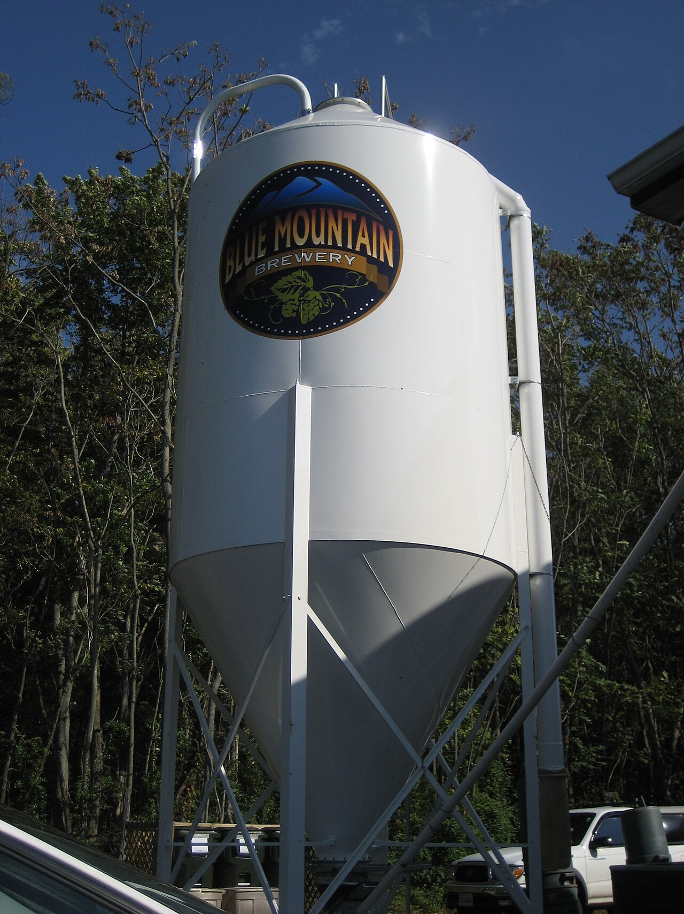

# Brewers Association: the trade body that defines small and independent

The name Brewers Association suggests a general society of all American brewers. In practice it represents small and independent US breweries, especially the craft beer sector. It advocates, collects data, runs competitions and educates consumers. To understand the BA, the important question is not how many members it has but how it defines a “craft brewer”, and why that definition is contested.

Figure: A fermentation tank at Blue Mountain Brewery in the United States; the image is not the Brewers Association headquarters or one of its competitions. Photo: Schwars1, CC0.. Image: Schwars1, CC0, via Wikimedia Commons ([source page](https://commons.wikimedia.org/wiki/File:Blue_Mountain_Brewery_beer_fermentation_tank.jpg)).

## The 2005 merger

The BA has two immediate ancestries. One is the American Homebrewers Association (AHA), founded in Boulder, Colorado, in 1978 by Charlie Papazian and Charlie Matzen, initially for home brewers and publishers of Zymurgy magazine. The other is an older small-brewer body: the Small Brewers Committee of 1942 is treated as a precursor of the Brewers' Association of America.

In 1983 the Association of Brewers was organised, bringing the AHA together with the Institute for Brewing and Fermentation Studies to serve the emerging microbrewery movement. In 2005 the Association of Brewers and the Brewers' Association of America merged to form the Brewers Association. The merger concentrated homebrewing, small-brewery representation and policy advocacy in one organisation.

## The “small and independent” definition

The BA's best-known act is to define a “craft brewer”. The definition is not a legal one; it is an trade classification used for statistics and communication. It generally requires a brewery to be small, independent of large drinks companies, and to brew in a traditional or innovative way. The BA board has revised the definition several times, most recently in 2018, when the boundaries of “traditional” and “innovative” were sharpened.

The definition matters because it decides who may be called a craft brewer, who may join certain programmes, use certain marks and appear in certain statistics. It also gives consumers a quick test: is this brewery independent, or part of a multinational group? The definition is not permanent; mergers, joint ventures and market changes force the BA to adjust it.

## Members, governance and advocacy in Washington

The BA is a 501(c)(6) trade association. Its members include breweries, suppliers, distributors, retailers and allied businesses. A board and committees govern it, while a team in Boulder runs daily operations. It advocates in Washington on federal tax, alcohol regulation, trade and labelling rules.

Advocacy is routine for a trade association, but the BA's stance has a clear boundary: it speaks for small and independent breweries, not for all drinks companies. Its interests do not always align with those of large beer groups, wine associations or distillers' bodies. When reading a BA policy statement, ask who it represents before judging the argument.

## GABF and the beer style guidelines

The BA presents the Great American Beer Festival (GABF). The first GABF was held in 1982 at the Harvest House in Boulder, with 24 breweries, 47 beers and 800 attendees; it moved to Denver in 1984, later settled at the Colorado Convention Center, and in 2026 moves outdoors. GABF is both a consumer festival and a trade competition, with judges scoring against the BA's beer style guidelines.

The BA also maintains the Beer Style Guidelines, which group beers by ingredients, process, flavour and history. The guidelines are not law, but they shape how breweries enter competitions, how judges score and how consumers understand what kind of beer they are drinking. They are updated as new styles appear, including non-alcohol categories in recent years.

## Data and industry statistics

The BA publishes regular data on the US craft beer industry: brewery counts, production, sales, exports and employment. Its statistical basis is the craft brewer definition, so its figures are not directly comparable with government statistics or commercial databases. Always check the year, the definition and the sample before quoting a BA number as “the US beer market”.

The data have practical uses: breweries read the market temperature, investors do due diligence, journalists write trends and policymakers understand small business conditions. The figures can also be misread, especially when shipments, retail sales and production are treated as the same thing.

## How it shapes craft beer

The BA's influence runs through three channels. First, definition: it turns “craft beer” from a vague marketing phrase into an operating category. Second, competition: GABF and the World Beer Cup give breweries a quality signal and consumers a way to discover new beers. Third, advocacy: it brings small-brewery concerns into federal policy debates, especially taxation, distribution and labelling.

For consumers, BA marks and competition medals can help filter, but they are not a guarantee of quality. For breweries, joining the BA means entering a community and accepting its definitions and rules. For researchers, BA data are a starting point for understanding the US craft market, but they need cross-checking against other sources.

## Boundaries and common misreadings

First, the BA is not a government agency. It does not issue permits, write law or enforce rules for the FDA or the TTB. Second, it does not represent every American brewery. Large beer groups, non-member breweries and importers sit outside its core constituency. Third, “craft” is not a simple case of smaller-is-better or smaller-is-purer; the definition moves with ownership and output. Fourth, a GABF medal is not an absolute ranking; competitions are judged by category, and entry strategy affects results. Fifth, BA data have a definitional basis and should not be mixed with government statistics.

Other common misreadings: treating the BA as a brewers' union; treating the craft brewer definition as law; treating GABF as the “beer Olympics”. A more accurate reading is that the BA is a trade association of small and independent breweries that maintains a market segment through definitions, competitions, data and advocacy. To build your own beer vocabulary, see [Beer tasting from aroma to bitterness](ref:beer-tasting-intro); to read a label, see [A small label, many clues](ref:read-a-label); the [Great American Beer Festival](ref:gabf-event) it runs, and styles such as [IPA](ref:ipa), have shaped how the public pictures craft beer. The BA's story is ultimately about how [beer](ref:beer) was remade in America as a small-scale, independent and identifiable business.

**In brief:** The Brewers Association (BA) grew out of the American Homebrewers Association founded in 1978 and earlier small-brewer bodies, and took its present form in 2005 when the Association of Brewers merged with the Brewers' Association of America. It represents small and independent US breweries, maintains the craft brewer definition, runs the Great American Beer Festival and advocates in Washington. It is not a government regulator.

**Key facts.**

| Item | Detail |
| --- | --- |
| In one line | The Brewers Association (BA) grew out of the American Homebrewers Association founded in 1978 and earlier small-brewer bodies, and took its present form in 2005 when the Association of Brewers merged with the Brewers' As… |
| Founded | 2005 |
| Official site | brewersassociation.org |

**Sources and limits.** The key claims about Brewers Association: the trade body that defines small and independent are checked against the following sources: Brewers Association (Used to check the BA's mission, membership composition and small-and-independent positioning; Used to check the size, independence and ownership criteria in the craft brewer definition), Great American Beer Festival; Brewers Association, CraftBeer.com; Brewers Association (Used to check the craft brewer definition created after the 2005 merger and its later revisions). For current products, addresses or opening status, use brewersassociation.org. Prices, batches and status change; the body is project-written and does not reproduce source text.
