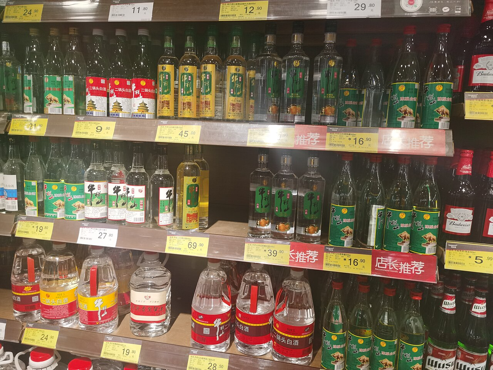

# China Alcoholic Drinks Association: from an industrial body to a cross-category trade organisation

The China Alcoholic Drinks Association (CADA) is often shortened to “Zhongjiuxie” in Chinese. Its name contains “alcoholic drinks”, but its predecessor was the China Brewing Industry Association. The change of name reflects a wider shift in the Chinese drinks sector, from industrial production to a full-chain, multi-category trade. To understand CADA, first separate what it is from what it is not.

Figure: Niulanshan Erguotou on a supermarket shelf in Suzhou; the image is not the China Alcoholic Drinks Association headquarters or an association event. Photo: Shwangtianyuan, CC BY-SA 4.0.. Image: Shwangtianyuan, CC BY-SA 4.0, via Wikimedia Commons ([source page](https://commons.wikimedia.org/wiki/File:Niulanshan_Erguotou_on_shelves_in_CR_Vanguard_Suzhou_Fangzhou_Road_Store.jpg)).

## Registration and renaming in 1992

The association's own profile is explicit: it was originally the China Brewing Industry Association, approved by the former Ministry of Light Industry and registered with the Ministry of Civil Affairs on 22 June 1992. The date matters: this was not a national body inherited from 1949, but a product of the institutional restructuring of the 1990s.

It later took the name China Alcoholic Drinks Association and expanded from brewing industry affairs to a fuller chain covering baijiu, beer, wine, yellow wine, liqueurs, alcohol, additives, equipment, distribution and drinks culture. The renaming was not cosmetic; it marked a change of positioning from an industrial association managing production to a trade organisation serving the whole drinks market.

## Registration authority and business guidance

National social organisations in China usually sit within a dual-management structure. CADA's profile states that its registration authority is the Ministry of Civil Affairs, its Party-building guidance comes from the Social Work Department of the CPC Central Committee, and its business guidance unit is the Ministry of Industry and Information Technology. It is therefore subject to registration and annual review by the civil affairs system and to business guidance from the industrial ministry.

“Business guidance unit” does not mean “administrative agency”. The association is not a government department. It cannot issue production licences, enforce the law in place of market regulators, or compel companies to join. Its authority comes from member authorisation, trade consensus and projects delegated by government, not from an administrative rank. Treating it as a “liquor administration” is a common misreading.

## Which drinks it covers

The association's activities cover baijiu, beer, wine, yellow wine, liqueurs, alcohol and related supply industries. It has specialist committees for baijiu, beer, wine, yellow wine, markets, culture, equipment and standards. Each committee has its own experts, members and events, but all sit within the association's framework.

This cross-category structure is unusual in China. Baijiu, beer, wine and yellow wine differ greatly in history, tax treatment, consumption occasions and regional production. Putting them under one body requires balancing interests. The advantage is the ability to coordinate industry data, standards and policy advocacy; the challenge is that different drinks may want different things, and the association must mediate rather than simply aggregate.

## Group standards and exhibitions

One practical function is group standards. A group standard is issued by a social organisation for voluntary market adoption; it cannot replace a mandatory national standard. CADA has a group-standards review committee, and its standards often carry the T/CBJ prefix, covering baijiu products, processes, vintage claims and estate wines. The texts are published on the association's site and the national group-standards platform.

CADA also organises or participates in major exhibitions, including the China International Alcoholic Drinks Expo, the China International Yellow Wine Industry Expo and the China International Famous Liquor Expo. Exhibitions are trading venues and also occasions for industry data, brand display and regional promotion. For small companies, an exhibition is a chance at exposure; for the association, it is a way to maintain the network and revenue.

## Industry data and annual reports

CADA publishes industry data and research reports. One checkable set comes from the 2025 China Baijiu Market Mid-Year Research Report, produced with KPMG: in 2024, China had 989 above-scale baijiu enterprises, output was 4.145 million kilolitres, down 1.8%; revenue was RMB 796.38 billion, up 5.3%; total profit was RMB 250.87 billion, up 7.8%.

The figures are often summarised as “lower volume, higher profit”. They show an industry contracting output while sustaining revenue and profit through premiumisation, price-band adjustment and brand concentration. Note the basis: above-scale enterprises only, and 2024 rather than the whole of 2025. The report's value is a consistent statistical frame; readers should still check the coverage.

## How it shapes the trade

CADA's influence runs through four channels. First, standards: group standards codify terminology, process and quality claims for niche categories, shaping production and consumer understanding. Second, data: reports give government, companies and media a common reference. Third, exhibitions and events: they bring distilleries, distributors, regions and media together for transactions and publicity. Fourth, policy communication: the association represents industry views to regulators and takes part in discussions on rules and standards.

These functions make the association part of the industry's infrastructure, but it is not all-powerful. Standards depend on voluntary adoption, data on members and statistical agencies, exhibitions on market demand, and policy communication on regulators accepting the input. Its energy comes from its membership and expertise, not from administrative command.

## Boundaries and common misreadings

First, CADA is not an administrative agency. It cannot issue production licences, enforce the law or compel membership. Second, a group standard is not a national standard. It cannot replace a mandatory GB standard, and adoption is voluntary. Third, CADA data have a basis: above-scale enterprises, revenue, output and other indicators each have boundaries and should not be mixed. Fourth, the association represents members and the industry as a whole, not every individual company's interest; different drinks and different company sizes may disagree. Fifth, CADA has a business-guidance relationship with government, but its resolutions are not government policy.

Other common misreadings: confusing CADA with the China Alcoholic Drinks Circulation Association, which focuses on distribution and is a separate body; treating CADA as a “baijiu association” and ignoring its coverage of beer, wine and yellow wine; treating a CADA group standard as mandatory law. A more accurate reading is that CADA is a national trade organisation registered with the Ministry of Civil Affairs and guided by the Ministry of Industry and Information Technology, serving the drinks trade through standards, data, exhibitions and policy communication. To start with baijiu, see [How to choose your first baijiu](ref:first-baijiu); to read a label, see [A small label, many clues](ref:read-a-label). Its work ultimately lands on [baijiu](ref:baijiu), [yellow wine](ref:yellow-wine), [beer](ref:beer) and [wine](ref:wine).

**At a glance:** The China Alcoholic Drinks Association (CADA) was originally the China Brewing Industry Association. It was approved by the former Ministry of Light Industry and registered with the Ministry of Civil Affairs on 22 June 1992. Its registration authority is the Ministry of Civil Affairs and its business guidance comes from the Ministry of Industry and Information Technology. It covers baijiu, beer, wine and yellow wine, runs group standards, exhibitions and industry data, but it is not an administrative agency and does not issue production licences. 
