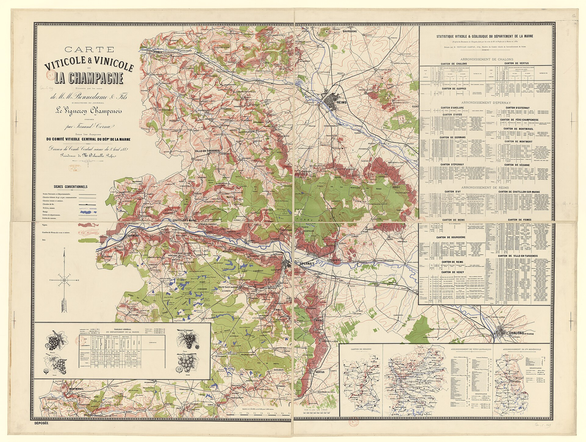

# Comité Champagne: How Growers and Houses Manage a Region Together

Champagne is a place that has turned a wine region into an institution. The grapes are grown by thousands of growers, the wine is made by hundreds of houses and cooperatives, and in the end all of it bears one name. No single party could keep that name credible around the world on its own. The Comité Champagne, formerly the CIVC, is the interprofessional body that brings growers and houses to the same table.

Figure: Related photograph of Comité Champagne: How Growers and Houses Manage a Region Together. Image: Bonnedame, Raphaël-Frédéric (1843-1870). Fonction indéterminée Cornu, Fernand (18..-19..?). Fonction indéterminée Testulat-Gaspar, A. (18..-18..? ; cartographe), Public domain, via Wikimedia Commons ([source page](https://commons.wikimedia.org/wiki/File:Carte_viticole_%26_vinicole_de_la_Champagne_-_dress%C3%A9e_par_les_soins_de_MM._Bonnedame_%26_Fils,_directeurs_du_journal_%22Le_Vigneron_Champenois%22_;_dessin%C3%A9e_par_Fernand_Cornu_Sous_les_auspices_du_Comit%C3%A9_Vinicole_Central..._-_btv1b53020922z.jpg)).

## What kind of organisation it is

The association's older French name is Comité Interprofessionnel du Vin de Champagne, abbreviated CIVC; it is now generally called the Comité Champagne. It was founded in 1941 and is one of the earliest agricultural interprofessional bodies in France. Interprofessional means that it represents both growers and houses, not one stage of the trade alone.

Its members include the vine growers, cooperatives and houses of the Champagne region. Public material around 2023 often mentions about 16,000 growers, 130 cooperatives and 370 houses; these figures change with the structure of the trade and should not be treated as permanent statistics.

It is not the same as INAO, the French national institute for origin and quality. INAO sets and recognises the rules of the AOC; the Comité Champagne handles coordination, promotion and protection of the name within the region. Confusing the two is a common mistake when reading about Champagne.

## From 1941

In 1941, with France under war and occupation, the Champagne region needed a body able to bind growers and houses together on yields, prices, quality and market order. The association was founded then, and one of its first tasks was to protect the name Champagne and to act against sparkling wines that used the name without coming from the defined area.

After the war its work expanded into economic, technical, environmental and promotional matters. It ceased to be merely a guardian of the name and became a forum where the region negotiates yields, reserves and the rhythm of the market. Its name and offices have changed little, but its list of tasks has kept changing with the market.

## What it does

First, it coordinates matters inside the region. Growers and houses do not always want the same thing: the former care about purchase prices and yields, the latter about stocks and sales. The association provides a forum in which the two sides can reach a basic consensus on the region's common interest.

Second, it manages yields and reserves. Vintage variation in Champagne is large, and the region balances supply and demand through yield control and a reserve system. The detailed rules are authorised through the AOC framework and coordinated within the region by the association; this is not a power the association can exercise at will.

Third, it promotes and protects the name. The association promotes Champagne in markets around the world and maintains the boundaries of the name Champagne in many countries. For consumers, whether a label may say Champagne depends on the rules of origin, not on marketing copy.

Fourth, it works on technology and sustainability. It supports research on growing and winemaking and promotes reducing pesticides, responding to climate change, managing water and cutting emissions. Such work seldom appears on a label, yet it affects the region's long-term costs and quality.

## Members and standards

The association's members come from both growers and houses, and the exact composition changes with the structure of the trade, so a fixed membership figure should not be treated as permanent.

Standards here means above all the rules of the Champagne AOC and the region's specifications. The rules are set and recognised by bodies such as INAO; the association's role is to help the trade understand them, to help the market know the region, and to coordinate their application inside the region. Whether a label may use Champagne ultimately depends on the recognition of origin and the relevant regulations.

## What it means for readers

For consumers, the association's promotional material is one way into Champagne, but a purchase should still be checked against the legal information on the label, and readers may consult [How to Start Drinking Wine](ref:first-wine). Champagne is the most famous kind of [sparkling wine](ref:sparkling-wine), but sparkling wine is not the same as Champagne: only sparkling wine made in the Champagne region of France under the rules may use the name.

For people in the trade, the association's yield and market information is a reference for reading the direction of the region, but it is not proof of any one house's quality. The region is the background; the house, the vintage and the blend are the specific variables, and understanding [terroir](ref:terroir) helps make sense of differences within the region.

## Common misreadings

First, taking the Comité Champagne as an AOC enforcement body. Rule-making and recognition belong mainly to INAO.

Second, taking the association's promotion as a guarantee of quality. Promotion speaks for the region as a whole, not for every bottle.

Third, taking interprofessional to mean that it represents only the large houses. It includes growers as well as houses, and its members differ in size.

Fourth, calling every sparkling wine Champagne. Champagne is a protected designation of origin, and other regions have their own names and rules.

**Short definition:** The Comité Champagne, formerly the CIVC, was founded in 1941 as the interprofessional body of Champagne growers and houses. It coordinates the region's economic, technical, environmental and promotional work and protects the Champagne designation abroad; the rules of the AOC are still set and recognised by INAO, the French national institute for origin and quality.

For Comité Champagne, begin with the mandate, then the members, and finish with any standard it publishes; that order keeps the account grounded.

Start with [France](ref:france) for founding context, then read [Terroir](ref:terroir) for function. Seeing both keeps Comité Champagne from being confused with a neighbouring idea.

**Key facts.**

| Item | Detail |
| --- | --- |
| In one line | The Comité Champagne, formerly the CIVC, was founded in 1941 as the interprofessional body of Champagne growers and houses. It coordinates the region's economic, technical, environmental and promotional work and protects… |
| Founded | 1941 |
| Official site | champagne.fr |

**Sources and limits.** The key claims about Comité Champagne: How Growers and Houses Manage a Region Together are checked against the following sources: Comité Champagne (Used to check the 1941 foundation, the interprofessional composition and the main functions), Oxford University Press; edited by Jancis Robinson and Julia Harding (Used to check the Champagne interprofessional body and the AOC framework; no entry is reproduced), OIV (the entry's background, terminology and regulatory context). For current products, addresses or opening status, use champagne.fr. Prices, batches and status change; the body is project-written and does not reproduce source text.

## Further reading

- [France](ref:france): the AOC system and its regulatory framework.
- [Sparkling Wine](ref:sparkling-wine): where Champagne sits in the family of sparkling wines.
- [Terroir](ref:terroir): a key to differences between plots inside Champagne.
- [How to Start Drinking Wine](ref:first-wine): a reader's guide to labels and basic terms.
