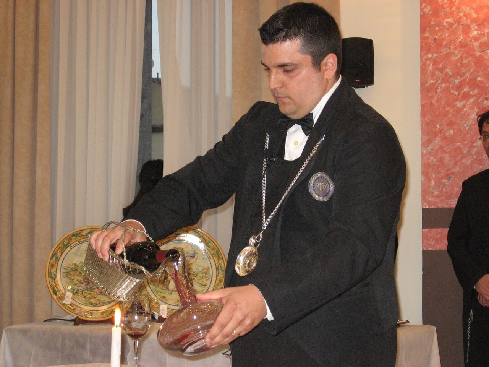

# Court of Master Sommeliers: turning restaurant wine service into an exam

“Court” suggests a royal household or an order of knights. The Court of Master Sommeliers is in fact a modern professional examining body, and the word Court is closer to a panel of examiners than to a tribunal. Its problem was concrete: in a grand restaurant, who is responsible for the wine list, the choosing, the tasting, the temperature, the decanting, the pairing and the explanation to guests? That work had long passed from master to apprentice, and from the mid-twentieth century it was standardised into an examination.

Figure: A sommelier decanting and serving wine in a restaurant; the image is not a Court of Master Sommeliers examination, nor its headquarters. Photo: Fabio Ingrosso, CC BY 2.0.. Image: Fabio Ingrosso, CC BY 2.0, via Wikimedia Commons ([source page](https://commons.wikimedia.org/wiki/File:Sommelier_decanting_and_serving_wine_at_a_restaurant.jpg)).

## It is not an order of knights

The formal name is the Court of Master Sommeliers, and those who pass its highest examination earn the title Master Sommelier (MS). It has no royal charter and no regulatory function. It does not issue business licences, inspect restaurants on behalf of the state, or decide whether a bottle may be sold. What it does is design courses, run examinations, and maintain a title and a code of conduct.

That fact defines its limits. Passing an examination shows that a candidate commands the knowledge and service practices the Court considers essential to a sommelier. Whether a restaurant hires that person, whether the person may work in a particular role, or whether the person speaks for a brand remains a matter for employers, trade regulation and the market. Treating the MS as a “state certification” is a common misreading.

## The 1969 examination and the 1977 organisation

The Court's origin can be traced to 1969. London wine-trade bodies had concluded that British restaurant wine service lacked a consistent high standard, so the Vintners' Company, the Institute of Masters of Wine and the British Hotels and Restaurants Association, among others, arranged the first Master Sommelier examination at Vintners' Hall in London. The first passes were Cyril Ware, Danny Lydon and George Clarke.

The examination came first; the organisation came later. In 1977 Brian Julyan MS and other MSs organised the scattered title holders into the Court of Master Sommeliers, with Cyril Ware as its first chairman. In 1987 the first MS examination outside the United Kingdom took place in Monterey, California, which is treated as the beginning of the Court's North American expansion. Today examinations are held regularly in Europe, the Americas, Asia and Oceania.

## Four levels, from introductory to master

The Court sets four levels, each harder than the last.

The first is the Introductory Sommelier Certificate, aimed at people entering beverage service, with the main drinks categories, basic tasting and restaurant service procedure. The second is the Certified Sommelier, requiring fuller knowledge of regions, varieties, production and service, plus a practical service examination. The third is the Advanced Sommelier Certificate, with more demanding blind tasting, wine-list design, operations and deeper regional detail. The fourth is the Master Sommelier Diploma, the Court's highest title, examined in theory, blind tasting and service.

The four are not “four degrees” but four successive thresholds. The higher one goes, the less the examination resembles recitation and the more it resembles a real restaurant: a guest gives you a list, a budget and a table of food, and you must make a choice you can explain in limited time.

## What the examinations test

Theory covers viticulture, winemaking, regional law, drinks history, service and operations. Blind tasting asks candidates to describe a wine without seeing the label, following appearance, aroma, palate and conclusion, and then to infer variety, region, vintage or style. Service tests opening, decanting, pouring, temperature control, wine-list communication and handling unexpected situations.

Blind tasting is not a guess at the name. Its core is turning sensory observation into reviewable language: depth of colour, aroma families, acidity, body, tannin, finish, each with a reason. Service is not theatre either; it tests making a guest feel cared for without making mistakes. Together they represent the whole job.

## Who governs, who awards

The Court is a membership-based professional body, governed by a board and committees, with examinations set, invigilated and marked by senior MSs and trade experts. It has branches in the Americas, Europe and elsewhere, each handling local examinations and membership. The existence of branches shows that it is not a single global regulator but a standard maintained by professional communities in different markets.

The certificate is issued by the Court, not by the state. Its legal effect depends on local professional regulation; in most markets sommeliers are not a licensed occupation. The Court's authority rests on trade recognition and examination difficulty, not on administrative delegation.

## How it changed restaurant wine service

Before the Court, restaurant wine service depended heavily on personal experience and apprenticeship. The Court broke choosing, tasting, decanting, pairing and list management into modules that could be taught and examined, making “sommelier” a professional identity with a shared language.

That has practical consequences: hiring has a reference point, training has a path, and guests can use a title to judge a server's training. For merchants and regions, the sommelier is the node between the cellar and the table; for consumers, a well-trained sommelier can turn an intimidating list into an actionable recommendation.

## Boundaries and common misreadings

First, the MS is not a “global licence”. It certifies training; it does not grant a right to practise. Second, the Court is not a government body or an international organisation; its standard is maintained by trade recognition. Third, the examination is weighted toward the Western restaurant beverage system and covers other traditions less fully. Fourth, a title and commercial promotion must be kept at a distance; a title holder may work for a brand, but the title itself is not a brand endorsement. Fifth, examinations are costly in time and money, and access is uneven.

Other common misreadings: treating Court as a tribunal; treating the MS as a “doctorate in wine”; treating blind tasting as a guessing game; treating the service examination as plating theatre. A more accurate reading is that this is a system for professionalising restaurant wine service. It raises the floor, but it cannot replace experience or ethics. To practise describing what you taste, see [First taste, hold the verdict](ref:first-tasting); to read a list with more confidence, see [A small label, many clues](ref:read-a-label); [Champagne](ref:champagne) and [sparkling wine](ref:sparkling-wine) on a restaurant list are among the most common service scenarios. In the end the sommelier serves [wine](ref:wine) and a table, not a certificate.

Start with [Wine](ref:wine) for founding context, then read [A small label, plenty of clues](ref:read-a-label) for function. Seeing both keeps Court of Master Sommeliers from being confused with a neighbouring idea.
