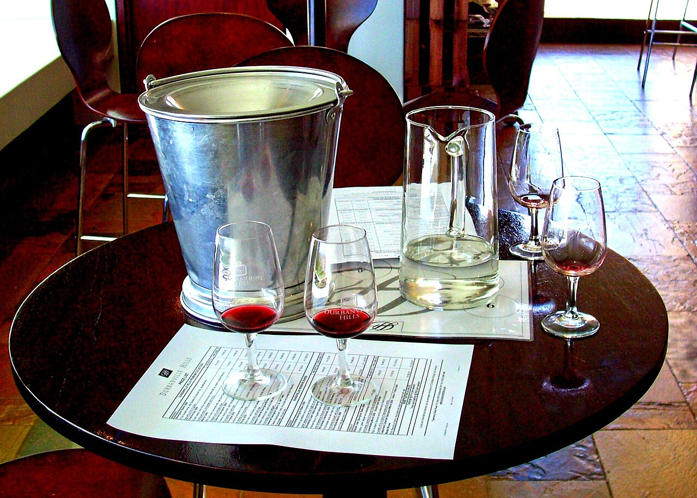

# Institute of Masters of Wine: a professional community born from an exam

The Master of Wine (MW) is often described as a doctorate in wine. The comparison is half right: the qualification demands deep knowledge and independent research, but it is not a university degree and not a government credential. It is an examination run by a trade body, and those who pass join a membership organisation. To understand the IMW, start with the fact that the examination came before the Institute.

Figure: Glasses and a spit bucket set out for a tasting; the image is not an Institute of Masters of Wine examination, nor its London headquarters. Photo: Randy OHC, CC BY 2.0.. Image: Randy OHC, CC BY 2.0, via Wikimedia Commons ([source page](https://commons.wikimedia.org/wiki/File:Wine_Tasting_set_up.jpg)).

## An Institute founded by six passes

On 11 May 1953 the Vintners' Company and the Wine and Spirit Association organised the first MW examination in London. Twenty-one candidates sat it and six passed: Reg Barrett, Leonard Dennis, Geoffrey Jameson, Rob Kewley, Geoffrey Nobes and Kenneth Simonds. Those six became the first Masters of Wine.

Two years later, in 1955, the six founded the Institute of Masters of Wine. The order matters. There was no large association that then designed a test; there was a test that produced a group, and that group built an organisation to maintain the standard. The origin explains the Institute's character: it behaves more like a college of peers than like a top-down agency.

## The first examination in 1953

Only 21 candidates sat the first examination, and fewer than a third passed. The figure is often quoted to show how hard the MW is, but difficulty was not the purpose; selection was. The British wine trade in the mid-twentieth century needed people who could judge quality, understand a region and write a credible report. The examination standardised that process of judgement.

In 1970 Sarah Morphew Stephen became the first female Master of Wine. The share of women in the membership has risen since, and today more than a third of the world's MWs are women. The examination itself did not set a gender bar, but access to education, capital and trade roles long shaped who reached the examination room.

## Three gates: theory, blind tasting and a research paper

The MW examination has three parts. The first is theory, covering viticulture, winemaking, regions, regulation, markets and history, and asking candidates to turn scattered knowledge into an argued answer. The second is blind tasting, in which candidates identify variety, region, vintage, technique or quality without seeing the label, and set out their reasoning. The third is an individual research paper on a subject that contributes to the understanding of wine, researched and written to a professional standard.

The three parts test three capacities: theory tests what you know, blind tasting tests what you can taste and explain, and the paper tests whether you can pose and answer a real question. Many candidates struggle with blind tasting because it demands both memory and composure under pressure; others struggle with the paper because moving from tasting to research is a different discipline.

## A membership, not a licence

After passing, a candidate becomes a member of the IMW, earns the MW title and signs a code of conduct. The code requires high standards in commercial conduct and forbids misleading use of the title. The Institute is governed by a council and committees, with a London office running day-to-day operations.

There is no licence here. The MW does not authorise you to open a winery, sell wine or practise a regulated profession, and it does not replace government supervision of the market. It confers a professional title backed by a community of peers. A title can be misused, so the Institute maintains a code and a complaints route; but the Institute has no power to impose administrative penalties.

## A London headquarters and a global network

The IMW is headquartered in London, but its members and activities are global. London became the home because it was a major node of the international wine trade and the place where the examination began. Today the Institute runs tastings, lectures, mentor schemes and regional groups around the world, and candidates can join study programmes and sit examinations in different countries.

The “London headquarters, global network” structure lets the Institute keep one standard while absorbing regional knowledge. It also creates a tension: the examination's language and framework are centred on English and Western wine regions, and other traditions require translation and supplementation.

## Why it became a benchmark

The MW's influence comes from three things at once. First, longevity: the examination has run since 1953 and the title has accumulated standing. Second, difficulty: theory, blind tasting and a research paper all demand independent judgement, which short courses cannot substitute. Third, community: MWs form a network that teaches, judges, writes and advises, so the title keeps appearing in the trade's public life.

For the trade, the MW offers a template of a trustworthy expert: able to taste, write, research and observe ethics. For consumers, the letters often appear in tasting notes, wine lists and media, but the title is not a guarantee of quality; the judgement still has to be checked against the wine and the source.

## Boundaries and common misreadings

First, the MW is not a degree. It confers no bachelor's, master's or doctoral title and sits outside the university system. Second, it is not a regulatory qualification. It does not authorise practice or replace appellation law. Third, an MW is not an all-round expert. Each member's research and experience differ, and the title does not imply equal familiarity with every drink. Fourth, the examination favours English and Western wine frameworks, and global coverage remains uneven. Fifth, the title has commercial value; holders may work for brands, wineries or media, and readers should separate a personal view from an institutional position.

Other common misreadings: treating the MW as a lifetime licence earned once; treating blind tasting as name-guessing; treating the research paper as a book report. A more accurate reading is that the MW is an advanced professional training and certification maintained by a community of peers, and its value lies in judgement and ethics rather than in the letters. To build your own tasting language, see [First taste, hold the verdict](ref:first-tasting); to understand regional difference, start with [terroir](ref:terroir); to read a label, see [A small label, many clues](ref:read-a-label); blind-tasting practice often begins with a classic region such as [Bordeaux](ref:bordeaux). The MW is ultimately about [wine](ref:wine), not a certificate.

[Wine](ref:wine) and [A small label, plenty of clues](ref:read-a-label) are the two useful reference points for Institute of Masters of Wine. [Wine](ref:wine) sets out founding context; [A small label, plenty of clues](ref:read-a-label) brings in function. Read them together.

The Vintners' Company connection dates to 1363.
