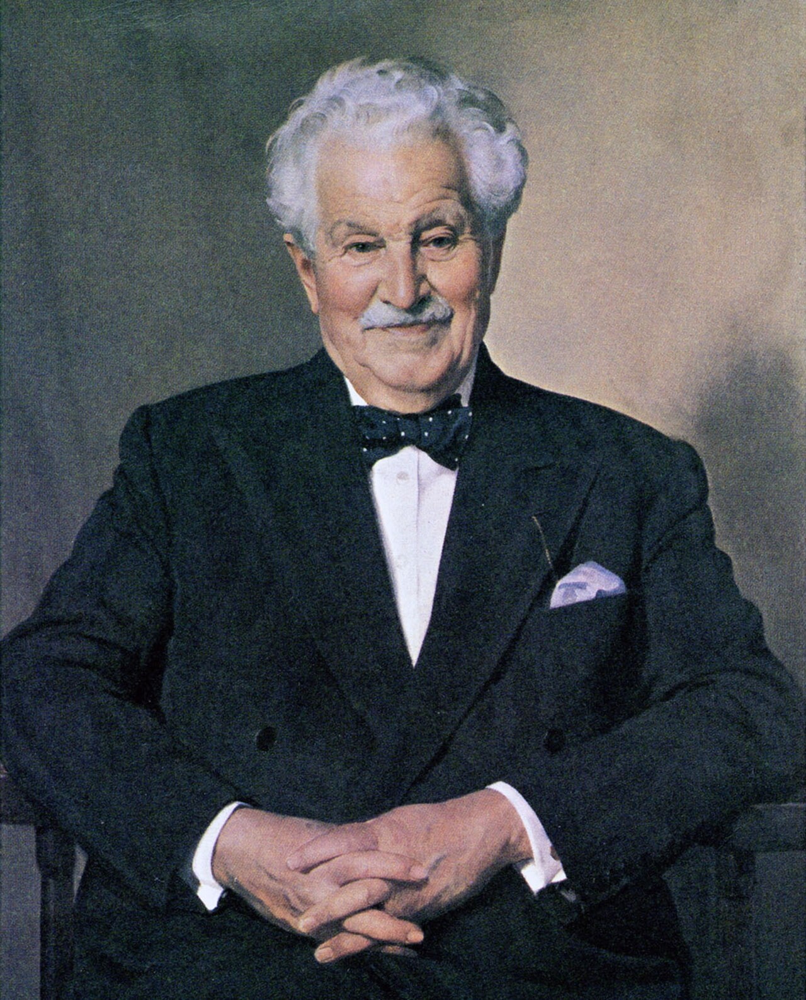

# André Simon

André Simon (1877–1970) was a French-born wine merchant, writer and bibliophile who spent most of his working life in Britain. Today his name is more likely to appear in the title of an award or a society than on a wine label. In the first half of the twentieth century, however, he was four things at once: an importer, a newspaper and magazine writer, the founder of an association, and a historian of the wine trade. To understand him, it is not enough to say that he wrote a great many books. The more important point is that he moved wine writing from the tasting note toward the archive.

Figure: Centenary portrait of André Simon, held by the International Wine & Food Society; not a photograph from life. Image: Unknown author Unknown author, Public domain, via Wikimedia Commons ([source page](https://commons.wikimedia.org/wiki/File:Andr%C3%A9_Simon_Centenary_1190.jpg)).

## From Paris to London

Simon was born in Paris on 28 February 1877. In 1902 he moved to London as the British agent for Pommery, the Champagne house. The following year the London wine trade journal Wine and Spirit Trade Review commissioned twelve articles from him on the history of the British Champagne trade. That commission gave him both an entry into writing and a method: ledgers, advertisements, customs records and family papers could be assembled into a longer history than a sequence of tasting impressions.

His work in the British trade was not limited to selling wine. In 1908 he helped found the Wine Trade Club and, at the age of thirty-two, was elected its first president; he also lectured there on technical questions of the trade. Later accounts treat the club as one of the early attempts at professional education in British wine. In 1931 he helped launch the Saintsbury Club, a dining club named after George Saintsbury, the author of Notes on a Cellar-Book.

## From merchant to writer

The sterling left the gold standard in 1931 and depreciated sharply. Simon's ability to pay for French Champagne was hit; in 1932 Pommery ended an agency relationship that had lasted more than three decades. The loss of the agency did not push him out of wine. It pushed him into full-time writing. He signed with Constable, edited a series of wine books for general readers, and began turning his accumulated trade papers into history.

His output was large. The International Wine & Food Society's history says he wrote "over one hundred books and pamphlets", ranging from the three-volume History of the Wine Trade in England to primers, food encyclopaedias and annual selections. He treated the good life as a single subject: wine, food, table manners, menus and travel belonged in one frame rather than in separate technical compartments.

## The Wine & Food Society

On 20 October 1933 Simon and A. J. A. Symons founded the Wine & Food Society in London, which later became the International Wine & Food Society. Its stated aim was to bring together people with "an intelligent interest in the problems and pleasures of the table". Behind the gentle wording stood three activities: dinners and tastings, a quarterly journal, and branches.

The first event was an Alsace lunch at the Café Royal on 14 November 1933: five courses, wines from Dopff, ten shillings and sixpence a head, and 232 people present. The number suggests that, even in the Depression, "educational consumption" of wine and food had a London market. In 1934 Simon used the end of American Prohibition to visit North America, establishing branches first in Boston and then in San Francisco. The society gradually changed from a British organisation into an international network.

Simon served as president and edited its journal, Wine and Food. He chose wines, set menus, wrote introductions and turned the society's taste into repeatable prose. It was not merely a dining club: it put knowledge about wine and food into public lectures, menu notes and study tours, a model that the international branches continued.

## Writing wine history

Simon's most durable contribution was wine history. His History of the Wine Trade in England appeared in three volumes between 1906 and 1909. Working from port records, customs schedules, merchants' letters and newspaper advertisements, he reconstructed the routes, varieties and commercial structures of English wine imports since the Middle Ages. The book's value lies less in its antiquarian prose than in its method: it pulled wine history away from anecdotes about famous drinkers and made it a branch of trade history that could be checked.

A second method was bibliography. Simon collected wine books throughout his life and compiled works such as Bibliotheca Vinaria, recording editions, places of publication and illustrations. For later researchers these bibliographies are a gateway: to understand how wine knowledge circulated in a given period, one first needs to know which books existed, who read them and who copied them. His private library became an important resource for wine history, and parts of it entered public institutions.

His writing also had a strong belletristic streak. He cared about the rhythm of a sentence, liked anecdotes and quotations, and often placed wine beside literature, politics and travel. That widened his readership, but it created a problem: when anecdote and archive sit on the same page, a reader cannot always tell which sentence has a source and which is the author's judgment. His books are best read with the evidence and the essay kept apart.

## Representative books

Beyond the History of the Wine Trade in England, he wrote Wine and the Wine Trade, A Wine Primer and The Wines of the World, among other volumes. During the Second World War he compiled A Concise Encyclopaedia of Gastronomy in parts, adapting to paper shortages and rationing; the series became a reference point for English-language food writing.

He also wrote In the Twilight, a memoir of friends, authors and wine merchants. These pages are useful to historians of the British wine trade because they preserve the texture of professional life: how an order was negotiated, how a dinner was seated, how a merchant judged a vintage. They remain reminiscence rather than record, and should be checked against trade papers.

## Assessment and controversy

The favourable view calls him a "charismatic leader of the British wine trade for nearly half a century" and a cultivated connoisseur. There is a factual basis: he worked simultaneously in trade, writing, association building and bibliography, and he put wine and food at the same table. For general readers his books were an entry point; for researchers his bibliographies and trade history were leads to follow.

Criticism is also warranted. First, his writing is strongly Eurocentric, especially French and British; wines from other regions are often treated as "local flavours" rather than as equally complex historical subjects. Second, his merchant identity and his writing identity were not fully separated: the wines he recommended, the brands he represented and the society's activities created interests that readers had to judge for themselves. Third, his anecdotal style was easy for later popular writers to imitate, turning into a repetitive "celebrity plus famous wine" narrative that weakened the archival method he had helped establish.

## Common misreadings

The first is to treat Simon as a "French wine merchant" and forget the three decades of writing and organising in Britain. His French origin matters, but his professional life was mainly British.

The second is to treat the Wine & Food Society as a simple tasting club. From the start it combined publication, lectures, travel and branch building: a knowledge-distribution machine.

The third is to treat every book he wrote as original research. The trade history and bibliographies rest on archives; the primers, selections and memoirs are more often synthesis and retelling. The distinction matters when citing him.

The fourth is to treat "more than a hundred books" as a guarantee of quality. Quantity shows output and a market, not that every volume was verified to the same standard.

## See also

- [France](ref:france): his birthplace and the starting point of his Champagne career.
- [United Kingdom](ref:uk): the country where he worked, wrote and organised.
- [Champagne](ref:champagne): his Pommery agency is the clearest entry into his trade position.
- [Wine](ref:wine): the central subject of his writing.
- [History of world wine](ref:world-wine): the longer timeline into which his trade history fits.
