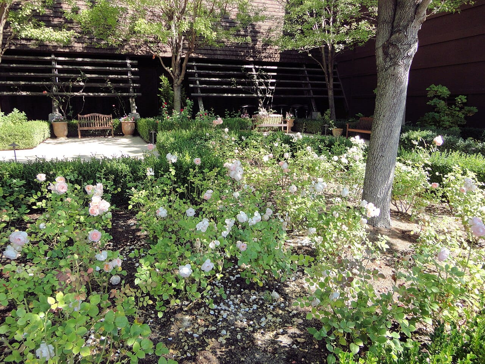

# André Tchelistcheff

André Tchelistcheff (1901–1994) was a Russian-born American winemaker who became vice-president and chief winemaker at Beaulieu Vineyard in Napa Valley in 1938. In Napa's wine history he is often called "The Maestro". The title can suggest a purely artistic talent, but his work was more concrete: he brought European microbiology, temperature control and oak practice into a California winery that was just recovering from Prohibition.

Figure: Rutherford Hill vineyards in Napa Valley; a regional scene, not Beaulieu Vineyard or a portrait of Tchelistcheff. Image: Jim G from Silicon Valley, CA, USA, CC BY 2.0, via Wikimedia Commons ([source page](https://commons.wikimedia.org/wiki/File:Rutherford_Hill_Vineyards,_Napa_Valley,_California_(8563638730).jpg)).

## From Russia to France

Tchelistcheff was born in Russia in 1901. As a young man he served in the White Army and was badly wounded in Crimea in 1921, then went into exile. After recovering, he studied microbiology, agronomy and winemaking at the Institut Pasteur and the Institut National Agronomique in France, and later worked at Moët & Chandon and Nicolas. That period gave him two things: laboratory training, which taught him that fermentation was not a spontaneous mystery but a microbial process that could be observed and controlled; and commercial experience in the French wine trade, which taught him how wineries, merchants and buyers organised production and sales.

In 1938 Georges de Latour, founder of Beaulieu Vineyard, travelled to France looking for a new winemaker. Through an introduction he met Tchelistcheff and invited him to Napa. Tchelistcheff arrived in September 1938, just in time for the harvest. California winemaking was still recovering from Prohibition: many wineries used high-yielding grapes, excessive sulphur and ice in the crusher, and dry wine quality was inconsistent.

## Technical reform at Beaulieu

Tchelistcheff began with subtraction. He stopped excessive sulphur and stopped throwing ice directly into the press, replacing it with more controlled cooling. He inspected fermentation tanks and pipes and replaced cast-iron lines that could give a metallic taste. He separated vineyard and winery management so that "bought grapes" were not simply dumped into a tank.

Then he added. He promoted cold fermentation for white and rosé wines so that aromas were not destroyed by heat. He controlled malolactic fermentation in red wines, turning sharp malic acid into softer lactic acid. He studied frost protection and vineyard disease to reduce losses before harvest. He introduced small French oak barrels so that Cabernet Sauvignon could gain finer texture in ageing rather than relying only on large or American oak.

He also made a longer-term move: he turned "what should be planted where" into a discussable question. He studied the soils, drainage and exposure of Rutherford and nearby sites, judging which plots could produce structured Cabernet. He planted Pinot Noir and Chardonnay in Carneros, which later became an important cool-climate district. He suggested Pinot Gris to Oregon and Cabernet Sauvignon to Washington. Not every suggestion succeeded immediately, but they put variety-site matching on the California agenda.

## Georges de Latour Private Reserve

In 1936 de Latour told Tchelistcheff that a particular wine was "the finest we have ever made" and asked that every wine reach that level. Tchelistcheff concentrated on Cabernet Sauvignon, creating what became Georges de Latour Private Reserve. By the mid-1940s the wine was regarded as a benchmark for California Cabernet and was served at White House state dinners.

Private Reserve mattered beyond its fame. It proved that California could make a red wine with the structure and longevity expected of a classified Bordeaux, rather than only sweet or light dry wine. It also gave Napa a replicable template: site selection, yield control, temperature-controlled fermentation, small-barrel ageing and long bottle maturation. Later Napa wineries did not all copy his recipe, but most inherited the idea of writing quality into the process.

## Laboratory, protégés and consultancy

In 1947 Tchelistcheff opened the Napa Valley Enological Research Laboratory and the Napa Valley Enological Center at St. Helena, with members including Robert Mondavi, Louis P. Martini and August Sebastiani. It was not an academic institute but an industry mutual-aid body: wineries could send samples, discuss fermentation problems and share equipment experience. It turned personal experience into a technical conversation among peers.

His "Maestro" reputation also rested on a network of protégés. Robert Mondavi, Louis Martini, Rick Sayre and Rob Davis worked with him or were guided by him. He retired from Beaulieu in 1973, then returned in 1991 at the age of eighty-nine as a consultant, tasting fifty vintages of Private Reserve with the new team. The gesture shows that his legacy was not a fixed recipe but a habit of continuing trials.

## Assessment and controversy

The favourable view treats him as the most influential winemaker in Napa history, because he rebuilt a quality system after Prohibition and put California Cabernet on the international stage. There is a factual basis: cold fermentation, malolactic control, French oak and the Carneros trials all have specific points in his work.

Criticism should also be stated. First, the "Maestro" narrative tends to credit one man for a winery's success; Beaulieu's owners, growers, laboratory colleagues and later winemakers all contributed. Second, his methods were not all inventions: cold fermentation and malolactic fermentation had European precedents, and his contribution was systematic application to Napa conditions. Third, his preference for French oak later shifted to American oak when the Second World War interrupted supply, showing that "tradition" itself changes with logistics. Fourth, his recommendations were not uniformly right; Carneros, Oregon and Washington trials had successes and also parts that later generations corrected.

## Common misreadings

The first is to call him the founder of Beaulieu Vineyard. Georges de Latour founded the estate in 1900; Tchelistcheff was the winemaker hired in 1938.

The second is to treat him only as a Cabernet specialist. He was famous for Cabernet, but he also made white wine, rosé, Carneros Pinot Noir and Chardonnay, and advised on varieties in Oregon and Washington.

The third is to call cold fermentation his invention. Low-temperature fermentation existed in Europe; his contribution was to make it executable under California's warm harvest and simple equipment.

The fourth is to treat "The Maestro" as a man who never erred. His value was in building trial and tasting mechanisms, not in supplying an infallible recipe.

## See also

- [United States](ref:usa): the country where he worked and became famous.
- [Napa Valley](ref:napa): the home of Beaulieu Vineyard and Private Reserve.
- [Cabernet Sauvignon](ref:cabernet): the variety in which he invested most and influenced most.
- [Red wine](ref:red-wine): the category that explains Private Reserve's structure and ageing.
- [Place and process](ref:place-process): the wider framework for his variety-site-technique approach.

Start with the period and the role. From there, consider the documented work, then the sources behind the claim. That is how a practical judgment about André Tchelistcheff is built.

Start with [United States](ref:usa) for role, then read [Cabernet Sauvignon](ref:cabernet) for period. Seeing both keeps André Tchelistcheff from being confused with a neighbouring idea.
