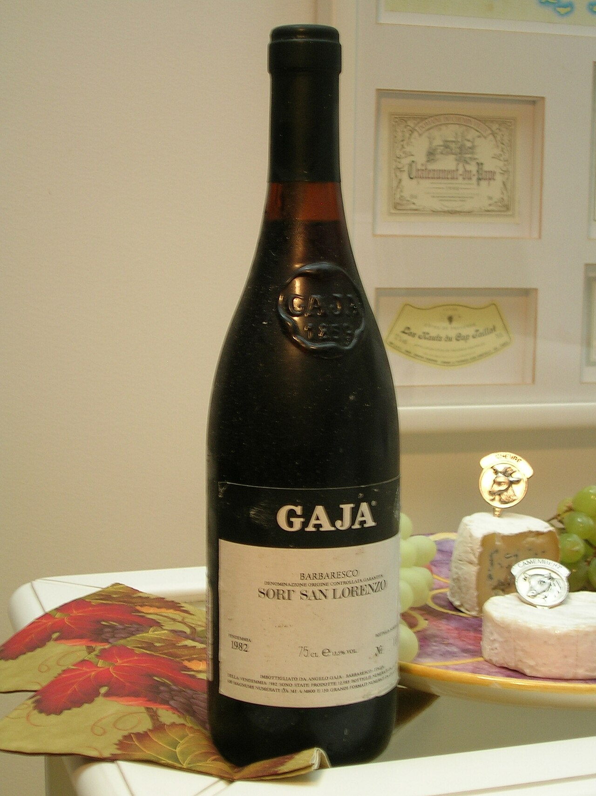

# Angelo Gaja

Angelo Gaja (born 1940) is a Piedmontese winemaker and estate owner. The Gaja family began making wine in Barbaresco in 1859; Angelo took over in 1961, aged twenty-one. He brought French barriques, lower yields, green harvest, single vineyards and cross-regional investment into Piedmont, turning Barbaresco from a local northern Italian wine into a name on international wine lists and at auction. In 1996 he also declassified three of his most famous single vineyards from Barbaresco DOCG to Langhe DOC, igniting a traditionalist-versus-modernist argument that continues today.

Figure: A bottle of Gaja's Sorì San Lorenzo. Image: Renzo Grosso, CC BY-SA 3.0, via Wikimedia Commons ([source page](https://commons.wikimedia.org/wiki/File:Sori_San_Lorenzo_Gaja_-_bottle.jpg)).

## From family estate to international name

The Gaja family traces its winemaking to 1859, when Giovanni Gaja established an estate in Barbaresco. By the early twentieth century the family sold wine across northern Italy and Europe. After the Second World War, Barbaresco was still dominated by large casks, long ageing and blended vineyards, and its international fame lagged behind Barolo. Angelo was born in 1940, studied economics in Turin, and took over from his father in 1961.

His first move was subtraction. Many growers chased volume, picking Nebbiolo before full ripeness; the resulting wines had coarse tannin, high acidity and needed long ageing in large oak to soften. Angelo reduced yields, picked later and practised green harvest, removing some bunches early so the remaining fruit ripened more fully. He believed Barbaresco's problem was not the variety but the lack of control over yield and ripeness.

His second move was the barrel. In the 1970s he began ageing Nebbiolo in small French barriques and controlled fermentation temperature and maceration time. Traditionalists saw this as betrayal: small barrels bring vanilla, toast and obvious oak, which can mask Nebbiolo's rose, cherry and tar. Angelo's answer was that the barrel is a tool; the wine must have enough fruit and structure to carry it. If the grapes are not good, small barrels only expose the weakness.

His third move was the single vineyard. He divided the family's land into Sorì San Lorenzo, Sorì Tildìn and Costa Russi and bottled them separately. Sorì San Lorenzo was first made as a separate wine in 1967, Sorì Tildìn in 1970 and Costa Russi in 1978. A single vineyard is not a guarantee of "better" wine; it puts terroir differences on the table: on the same Barbaresco hills, aspect, soil and altitude give different ripening and aromatics.

## The 1996 declassification and Langhe

In 1996 Angelo did something that shook Italian wine: he changed the legal category of Sorì San Lorenzo, Sorì Tildìn and Costa Russi from Barbaresco DOCG to Langhe DOC. The reason was not a decline in quality but the presence of small amounts of non-Nebbiolo varieties, such as Barbera, planted in those vineyards; Barbaresco DOCG rules did not allow them. Rather than label the wine as something it was not, he accepted declassification and kept the true composition.

There are two ways to read this. Traditionalists saw it as a betrayal of Barbaresco: the most famous estate voluntarily leaving the DOCG tells consumers the appellation label does not matter. Supporters saw it as transparency: if the wine really contains Barbera, it should not be sold as 100% Nebbiolo Barbaresco; declassification is honesty, not escape. Either way, after 1996 "is Gaja's Sorì San Lorenzo Barbaresco or Langhe?" became a question every wine list has to answer.

At the same time Gaja expanded beyond Piedmont. In 1994 he bought Pieve Santa Restituta in Montalcino; in 1996 he bought Ca' Marcanda in Bolgheri. The first took him into Brunello, the second into Cabernet, Merlot and Syrah on the Tuscan coast. With the Barolo parcels Sperss and Conteisa in Piedmont, Gaja was no longer only a Barbaresco estate but a cross-regional brand.

## How to drink Gaja

Gaja's Barbaresco and Barolo are built on Nebbiolo, with rose, cherry, red plum, tar, liquorice and spice. The tannin is strong and the acidity high, so young wines can seem tight. Decant for one to two hours, serve at 17–18°C in a large tulip glass. Nebbiolo works with red meat, braised beef, truffles, hard cheese and game; avoid very spicy dishes, which amplify tannin bitterness.

Darmagi is Gaja's Cabernet Sauvignon in Barbaresco; the name is said to approximate "what a pity" in Piedmontese, after his father's reaction to the Cabernet rows. It is not a Bordeaux copy: ripeness more typical of California, Piedmont acidity and French oak spice make it a Cabernet made in an Italian climate. Sperss and Conteisa are two Barolo expressions: Sperss broader, with black fruit and truffle; Conteisa finer, with more flower and mineral.

To judge whether a Gaja has too much oak, look at three things. First, does the aroma offer only vanilla, coconut and toast, with no rose, cherry or tar? Second, does the tannin feel wrapped in wood rather than grainy? Third, does the finish taste mainly of wood sweetness? A good Gaja should have fruit, flower and structure at once; oak should be the background, not the subject.

## Disputes and common misreadings

First, Angelo Gaja did not invent Barbaresco. The zone had estates and vineyards in the nineteenth century, and the Gaja family was making wine there in 1859. Angelo's contribution was to bring international technique, branding and the single-vineyard idea, not to create the appellation from nothing. Second, he is not simply a "French-oak modernist". He also insists on long ageing, low yields and terroir; barrique is one tool, not the whole philosophy.

Third, the 1996 declassification is not proof that the wines became worse. It was a compliance adjustment after a conflict between planting choices and appellation rules. Reading it as "Gaja declined" misses the real question: when the law and the true composition disagree, what should an estate do? Fourth, Darmagi is not a Bordeaux blend. It is mainly Cabernet Sauvignon, closer to an international variety grown in an Italian climate than to a Left Bank copy.

Fifth, Gaja's high prices do not mean every bottle is worth buying. The range includes entry-level Barolo and Barbaresco as well as single vineyards; scarcity and brand premium do not make the most expensive wine the necessary everyday choice. Sixth, Angelo's "modernism" is not beyond dispute. Traditionalists still argue that small barrels and single vineyards weaken Barbaresco's collective identity. These arguments have no final answer; they are part of the region's history.

## Place in this atlas

Gaja connects three threads. The first is the regional history of [Piedmont](ref:piedmont): Barbaresco, Barolo, Nebbiolo, Langhe DOC and the 1996 declassification. The second is the craft of [wine](ref:wine): yield control, green harvest, small oak, single vineyards and cross-regional branding. The third is the geography of [Italy](ref:italy): Piedmont, Montalcino and Bolgheri, and the stylistic divide between north and south.

To follow the traditionalist-modernist conflict, compare Barolo's traditional and modern schools. To follow how single vineyards change markets, read Burgundy's climats. To follow how a family estate expands across regions, read Gaja's Montalcino and Bolgheri purchases. Angelo is not an isolated reformer; he is a key node in the internationalisation of twentieth-century Italian wine.

## See also

- [Gaja Barbaresco](ref:gaja-place): Barbaresco, the Gaja estate and visits.
- [Wine](ref:wine): Nebbiolo, oak, single vineyards and ageing.
- [Piedmont](ref:piedmont): Barbaresco, Barolo, Langhe and Nebbiolo terroir.
- [Italy](ref:italy): Piedmont, Tuscany and the geography and institutions of Italian wine.
