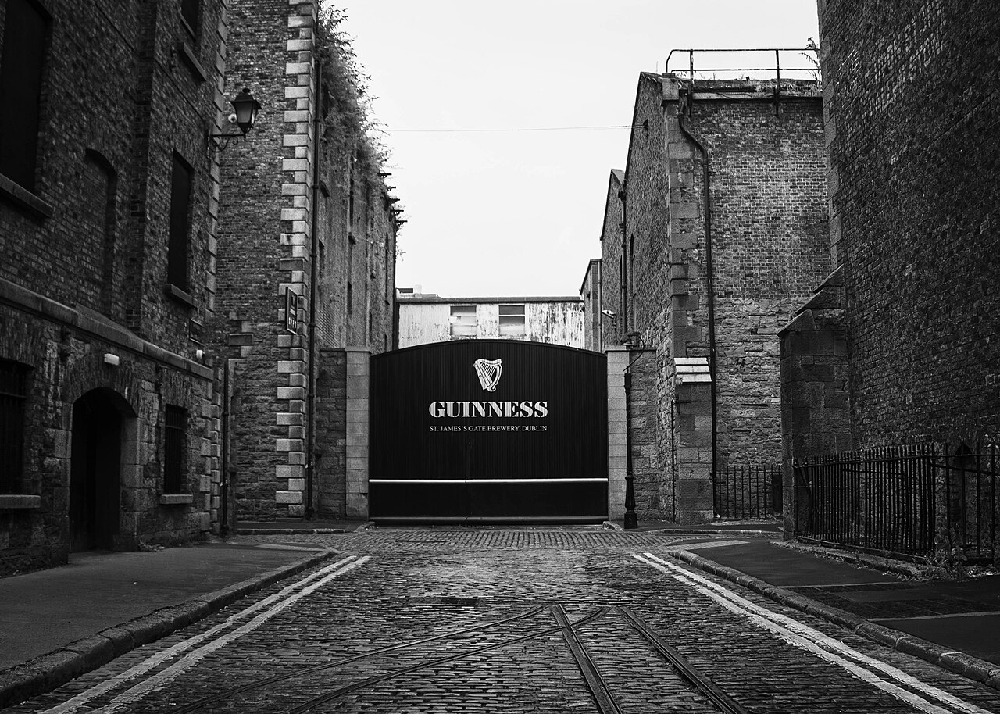

# Arthur Guinness

Arthur Guinness (1725–1803) was an Irish brewer, entrepreneur and philanthropist, and the founding figure of the Guinness brand. On 31 December 1759 he signed a 9,000-year lease at St James's Gate in Dublin, at £45 a year, turning a small brewery into Ireland's largest beer business. St James's Gate is still the company's headquarters and visitor site, and the black beer, the porter tradition and the "nine-thousand-year lease" remain central to Dublin's brewing story.

Figure: St James's Gate Brewery, Dublin. Image: Jolaus, CC0, via Wikimedia Commons ([source page](https://commons.wikimedia.org/wiki/File:St._James_Gate_Brewery,_Dublin,_Eire.jpg)).

## From Leixlip to St James's Gate

Arthur Guinness was born in 1725 in Celbridge, County Kildare. His father, Richard Guinness, was land steward to Arthur Price, later Archbishop of Dublin; the archbishop is said to have left Arthur £100 in his will, which helped him start brewing. In 1755 Arthur and his brother opened a small brewery in Leixlip, making pale ale and porter.

In 1759 he moved the business to Dublin. St James's Gate sat near the city centre, the River Liffey and the old city walls, with good water, transport and access to market. On 31 December he signed the lease: 9,000 years, £45 a year, about four acres. The term looked absurd at the time, but it gave Guinness an almost permanent site, and it remains part of the brand story.

The "9,000-year lease still in force" claim is a marketing simplification. The lease was renewed, bought out and legally adjusted over the eighteenth and nineteenth centuries; the site later passed through different family and corporate arrangements. Today the property belongs to the company, and the original lease is not the current title deed. The nine-thousand-year number is a good story, not a live contract.

## Porter and Guinness stout

Eighteenth-century Dublin drank pale ale, brown beer and porter. Porter originated in London: a dark, malty beer associated with market porters and long pub sessions. Arthur Guinness did not invent porter, but he made it one of Dublin's largest and most consistent products. By the 1770s Guinness porter was sold to pubs, hospitals and the army; in 1799 Arthur stopped brewing pale ale and concentrated on porter.

Guinness stout evolved from porter. "Stout" originally meant a stronger porter, with more malt and alcohol; in the nineteenth century Guinness made the dark beer its core brand, using roasted barley, hops, water and yeast to produce coffee, dark chocolate, caramel and a light acidity. Today's Guinness uses barley, water, hops and yeast; some products still use nitrogen dispensing and the famous "cascade" foam.

Arthur's business was not only the recipe. He used Dublin's transport network, pub relationships and bulk purchasing; he also took part in city government and cared about poor relief, education and hospitals. The Guinness family later funded St Patrick's Hospital, Dublin improvements and employee welfare, creating a tradition of corporate philanthropy. After Arthur died in 1803 his sons took over; Guinness expanded through the nineteenth century, became a public company in 1886 and a global brand in the twentieth.

## Reading St James's Gate

In Dublin, St James's Gate and the Guinness Storehouse are the core of the brand story. Look at four layers. First, ingredients and process: barley, water, hops, yeast; mashing, boiling, fermentation and maturation; Guinness stout and porter use different malt roasting and ratios. Second, site and lease: the gate, warehouses and railway siding show how beer moved from the plant to Ireland and overseas. Third, advertising and design: the Guinness hare, harp and "Guinness is good for you" campaigns are case studies in twentieth-century branding; the top-floor bar and city view are the "brand experience" layer. Fourth, tasting: Guinness's nitrogen foam, coffee and dark chocolate notes suit Irish stew, oysters, black bread and hard cheese; porter is sweeter and heavier, better for winter and desserts.

Do not reduce Guinness to "liquid bread" or "the darker the bitterer". Its alcohol is moderate, its bitterness comes from hops and roasted malt, and the body is lighter than the colour suggests; the nitrogen version is smoother, the carbonated version crisper. In a Dublin pub, watch the two-part pour and the rest; the foam is part of the texture, not something to rush.

## Disputes and common misreadings

First, Arthur Guinness did not invent porter. Porter came from London; Arthur's contribution was to make it large-scale, standardised and branded in Dublin. Crediting him with the invention erases the London brewers and the Irish pub network. Second, Guinness stout is not "porter with colouring". Its colour and flavour come from roasted barley and yeast, not caramel colour or additives.

Third, the 9,000-year lease is not "still being paid at £45 a year". The lease was legally changed and bought out, and today's ownership and operating structure are different. Treating it as a current contract misleads readers. Fourth, Arthur was not a speculator who succeeded only through the lease. He combined recipe, capacity, distribution, civic relationships and philanthropy; the lease was the foundation, not the whole building.

Fifth, the Guinness family and the Guinness brand are not the same thing. The family split into branches in the nineteenth century, the company went through mergers and ownership changes, and today it belongs to Diageo; the "family firm" story cannot be equated with the current multinational group. Sixth, Arthur's birth year is given as both 1724 and 1725; official material usually uses 1725, and a biography should leave room for "c.".

## Place in this atlas

Arthur Guinness connects three threads. The first is the craft and style of [beer](ref:beer): porter, stout, nitrogen dispensing, roasted malt and Irish pub culture. The second is the local history of [Ireland](ref:ireland): Dublin, St James's Gate, the Liffey, beer taxation and nineteenth-century urban expansion. The third is brand and space: how the Guinness Storehouse turned a factory into a destination and used advertising, architecture and tasting to tell the "nine thousand years" story.

To follow how beer moved from a local workshop to a global brand, compare Munich's Oktoberfest, Pilsner Urquell and Heineken. To follow how a factory became a museum, read the Storehouse's exhibition design. To follow how corporate philanthropy shaped a city, read the Guinness family's role in Dublin's hospitals, housing and parks. Arthur is not an isolated brewer; he is a meeting point of Dublin urban history and global beer trade.

## See also

- [Guinness Storehouse](ref:storehouse): St James's Gate, exhibitions, the top-floor bar and visits.
- [Beer](ref:beer): porter, stout, nitrogen dispensing and tasting.
- [Ireland](ref:ireland): Dublin, beer taxation, pub culture and the local background.

**Short definition:** Irish brewer, entrepreneur and philanthropist (1725–1803) who signed the 9,000-year lease at St James's Gate in Dublin in 1759, scaled a small Leixlip brewery into Ireland's largest beer business and made porter and Guinness stout central to Dublin's brewing identity. 
