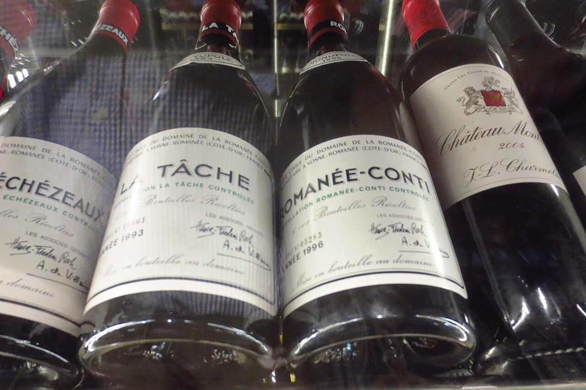

# Aubert de Villaine

Aubert de Villaine (born 1939) is a French winemaker and one of the longest-serving public faces of Domaine de la Romanée-Conti (DRC). He returned to Burgundy in 1965, became the de Villaine family's co-director at DRC in 1974, and held that role until the end of 2021. Across nearly half a century he worked through a partnership with Lalou Bize-Leroy, the arrival of the Roch family, the spread of organic and biodynamic farming, and the campaign that made the Climats of Burgundy a UNESCO World Heritage site. With his wife Pamela he also built a small domaine in Bouzeron, helping to give the often-dismissed Aligoté grape its own village appellation.

Figure: Bottles of Romanée-Conti and La Tâche. Image: Arnaud 25, CC BY-SA 3.0, via Wikimedia Commons ([source page](https://commons.wikimedia.org/wiki/File:Domaine_de_la_Roman%C3%A9-conti_02.JPG)).

## From Rennes to Vosne-Romanée

Aubert was born in Rennes on 8 February 1939, the eldest of six children. His father, Henri de Villaine, went to war after the German invasion and was taken prisoner until 1943, so the boy spent part of his childhood in a household without a father. He studied literature and law, then spent nine months in New York working for Frederick Wildman & Co, the American importer of DRC wines. He also wrote journalism there and learned how the American market and media worked.

In 1965 he returned to Burgundy and joined the family estate managed by his grandfather Edmond Gaudin de Villaine and his father Henri. His father taught him winemaking, vineyard work and sales; in 1971 the family passed the estate to him. DRC was not a domaine he founded: its history reaches back to the Middle Ages, and in 1942 it was formally constituted as a civil company owned equally by the de Villaine and Leroy families. Aubert's role was to represent one family in a shared inheritance, not to own the whole estate.

## Two families, one domaine

DRC's structure is easy to misread. It is not a single-family domaine but a civil company formed in 1942 from vineyards inherited by two families. The de Villaine line descends from Jacques-Marie Duvault-Blochet; the Leroy family bought half the shares in 1942. In 1974 Aubert and Lalou Bize-Leroy became co-directors, one representing each family. Both pushed DRC toward the top of the world's most expensive and sought-after wines, but their views on management diverged. Around 1991–1992 Lalou left the management, and her nephew Charles Roch took her place; after Charles died, Henry-Frédéric Roch succeeded him. Henry-Frédéric died in 2018, and in 2019 Perrine Fenal, representing the Leroy family, became co-director.

This history is often told as a "duel of strong personalities", but the more accurate reading is structural: two families owned the estate, so neither could govern alone. Aubert's long-term value was not that he "defeated" Lalou, but that he kept a family joint venture together for nearly fifty years and preserved its farming and style through repeated successions. At the end of 2021 he stepped down as co-director; in 2022 he moved into an advisory role, and his nephew Bertrand de Villaine took over alongside Perrine Fenal.

## Organic and biodynamic: making terroir verifiable

DRC's vineyards cover about 25 hectares, almost all of them grand cru. The core includes Romanée-Conti, a monopole of about 1.81 hectares, La Tâche, a monopole of about 6 hectares, and Richebourg, Romanée-Saint-Vivant, Grands Échézeaux, Échézeaux, Corton and Montrachet. Those names dominate auction catalogues, but Aubert preferred to talk about how the vines are farmed. DRC has practised organic farming since 1985, began trials with biodynamic methods in 2002, and converted fully in 2007. Organic and biodynamic are not mystical labels but checkable rules: no synthetic herbicides or insecticides, compost and cover crops to restore soil life, some field work timed by lunar and stellar calendars, and acceptance of lower, more variable yields.

These methods were not mainstream in the 1980s and 1990s. Many Burgundian growers relied on fertiliser and pesticides to raise yields; DRC's choice meant more risk, lower output and more labour. Aubert's logic was that the value of a grand cru lies not in volume but in expression: if the soil is compacted and its microbiology destroyed, the wine loses detail. Today DRC's organic and biodynamic practice is a reference point in Burgundy, but it was not one man's invention; the field team, workers, researchers and neighbouring growers all took part.

## Bouzeron and Aligoté

Aubert and Pamela married in 1971 and then established Domaine de Villaine (early labels read Domaine A. et P. de Villaine) in Bouzeron, in the Côte Chalonnaise. The estate began with about 8 hectares and later grew to around 30 hectares, planted with Aligoté, Pinot Noir and Chardonnay; from 2000 it has been managed by their nephew Pierre de Benoist. Bouzeron was known for Aligoté, but the grape was often treated as raw material for cheap Burgundian white wine and ignored even on good slopes. The de Villaines and local growers campaigned for a separate village appellation, and Bouzeron AOC was approved in 1998.

The significance of that campaign is easily underestimated. Aligoté is not "inferior Chardonnay": it has its own acidity, white flowers and mineral texture, works as a dry white and as a base for sparkling wine. The Bouzeron AOC gave the grape a geographical identity: if it is grown on the limestone slopes of Bouzeron and made to the rules, it can be labelled Bouzeron rather than hidden under the broad Bourgogne Aligoté label. The de Villaine domaine became a showcase for that idea.

## UNESCO: making "climats" heritage

In 2007 Burgundy created the Association des Climats du vignoble de Bourgogne, with Aubert as president. The French word climat here does not mean weather; it means a precisely bounded vineyard plot defined by soil, slope, exposure and a long history of farming. Chinese translations often render it as "climate", which suggests temperature and rainfall; a better rendering is "vineyard plot" or "terroir plot".

The association spent eight years preparing the application, mobilising scientists, local authorities, growers and volunteers. On 4 July 2015 UNESCO inscribed "The Climats, terroirs of Burgundy" on the World Heritage List. The inscription was not an advertisement for wine; it recognised that Burgundy's division of land, inheritance rules, grower knowledge and social organisation together form a distinctive cultural landscape. Aubert was the convenor and public face of the campaign, not its sole author: the association's vice-president, scientists, local government and more than 64,000 signatories all played a part.

## HdV in Napa and the transatlantic network

Another de Villaine project is HdV (Hyde de Villaine), a family venture in Carneros, Napa Valley, with the Hyde family. Pamela is a cousin of the Hydes; Larry Hyde bought Hyde Vineyard in 1979, and in 2000 the de Villaines and the Hydes founded HdV, hiring winemaker Stéphane Vivier in 2002. HdV makes Chardonnay and Pinot Noir in a "Burgundian method, Californian fruit" style: earlier picking, less new oak, more emphasis on acidity and minerality.

The project connects Aubert to the generation of Robert Mondavi and Opus One. The exchange between Burgundy and California in the 1960s and 1970s was not only commercial: varieties, clones, barrels, winemakers and tasting standards travelled in both directions. Aubert sold DRC in New York, made wine in California and managed grand cru vineyards in Burgundy; his career is itself a case study in how the Old World and the New World learned from each other.

## Retirement, succession and disputes

At the end of 2021 Aubert stepped down as DRC co-director after nearly half a century; in 2022 he became an advisor, and Bertrand de Villaine and Perrine Fenal took over. Such transitions are rare in Burgundy: many estates change planting density, picking dates, oak proportions and house style when a generation changes. DRC kept its technical line, not because the new directors lacked ideas, but because the vineyards, team and market position made abrupt change costly in auction prices, allocations and client relationships.

The disputes around Aubert cluster in three areas. First, DRC's high prices and "scarcity marketing": limited production, opaque allocations and record auction results have turned the wine into a financial asset, critics say; supporters reply that the scarcity, low yields and ageing potential of grand cru vineyards justify the prices. Second, the "faith" around organic and biodynamic farming: some treat biodynamics as a universal cure and ignore vintage, disease and field judgment; Aubert was more a cautious practitioner than a mystic. Third, whether the Climats inscription commercialised Burgundy: tourism, wine prices and land prices rose after 2015, and critics worry that small growers are being squeezed out; supporters say heritage protection at least gives land-use planning a legal foothold.

## What to see in Burgundy

In Burgundy, treat DRC as an entry point into the grand cru system, not a sightseeing stop. DRC does not offer regular tourism; visits require appointments, allocation clients or special channels. Ordinary visitors can look at vineyard boundaries in Vosne-Romanée, visit the Burgundy wine museum in Beaune, and then go to Bouzeron to see Domaine de Villaine's Aligoté. When looking at vineyards, focus not on "which plot is most expensive" but on slope, exposure, soil depth and drainage: a few dozen metres across the same hillside can change the structure of the wine completely.

Drinking DRC does not require starting with Romanée-Conti itself. Build a reference from other village and premier cru Burgundies, then taste DRC's Pinot Noir: red fruit, rose, spice, minerality and a very long finish; young vintages are tannic and closed, needing long decanting or ageing. Pinot Noir works with roast chicken, duck, mushrooms, truffle and soft cheese at 14–16°C. If you are merely curious about what a very expensive wine tastes like, a regulated tasting or auction preview is a more rational route than ordering a bottle blindly in a restaurant.

## Place in this atlas

Aubert's story connects four threads. The first is [Burgundy](ref:burgundy): Vosne-Romanée, Romanée-Conti, La Tâche and the "climat" plots. The second is [France](ref:france): AOC rules, cultural heritage and grower organisations. The third is [wine](ref:wine) farming and ageing: how [Pinot Noir](ref:pinot) expresses soil, and how organic and biodynamic methods affect fruit. The fourth is [Napa Valley](ref:napa): HdV, Carneros and the Californian version of Burgundian method.

To follow family joint ventures, compare Mouton Rothschild and Opus One. To follow how heritage listing changes a region, read Burgundy's Climats alongside the Champagne hillsides. To follow Old World winemakers in the New World, look at HdV and Robert Mondavi. Aubert was not "the owner of DRC"; he was one of the long-term guardians of a two-family inheritance.

## See also

- [Burgundy](ref:burgundy): Vosne-Romanée, grand cru vineyards and the Climats.
- [France](ref:france): AOC rules, wine regions and cultural heritage.
- [Wine](ref:wine): organic farming, biodynamics, oak and ageing.
- [Pinot Noir](ref:pinot): the core variety of DRC and Bouzeron.
- [Napa Valley](ref:napa): HdV, Carneros and California Pinot Noir.
