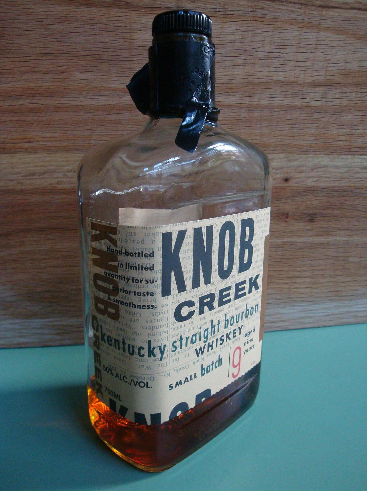

# Booker Noe

Booker Noe (1929–2004) was the sixth-generation master distiller of the Jim Beam family and the figure most associated with putting “small batch” into the mainstream bourbon vocabulary. His full name was Frederick Booker Noe II, but the industry knew him simply as Booker. Booker's was not just a premium line: it made barrel strength, no dilution and no filtration into a product identity.

Figure: A bottle of Knob Creek bourbon, one of the brands Booker Noe added to his Small Batch Collection in 1992; not a portrait of Noe. Image: LittleGun, Public domain, via Wikimedia Commons ([source page](https://commons.wikimedia.org/wiki/File:Knob_creek_bottle.jpg)).

## Family and early life

Noe was born in 1929 into the Beam family circle in Kentucky. His maternal grandfather was Jim Beam, and his mother, Margaret Beam, married into the Noe family; that kinship kept him around the distillery from childhood. He is often described as a selector whose nose was more accurate than an instrument: he walked the warehouses barrel by barrel, judging which had enough caramel, vanilla and toasted oak, and which should go into ordinary Jim Beam. In 1960 he was appointed master distiller at Beam's Boston, Kentucky plant — not the city in Massachusetts — and five years later he filled the company's millionth barrel.

## The Beam–Noe succession

Jim Beam rebuilt the Clermont plant after Prohibition and passed brewing knowledge through the family. Noe's career coincided with bourbon's slide from a postwar everyday drink to a category squeezed by vodka. He did not respond by making the whiskey lighter. Instead he went back to older methods: select specific warehouses, specific floors and specific barrels, then bottle at barrel strength. The market later called this “small batch”, but the practice began as a return to selection rather than a marketing invention.

## Signature releases

Booker's is the central work: no added water, no filtration, released in batches, with alcohol varying by barrel. Its flavour is usually heavy, with caramel, vanilla, toasted oak and spice. Noe preferred six- to eight-year barrels, judging that this range had enough wood flavour without losing the corn sweetness; every batch's barrel count and warehouse location appeared on the label, creating a traceable “anti-industrial” story. In 1992 he added Baker's, Basil Hayden's and Knob Creek to Booker's, forming the Small Batch Bourbon Collection. Baker's was the high-proof, single-barrel-leaning option; Basil Hayden's used a high-rye mash bill and a lighter body; Knob Creek used longer ageing and higher proof for a broader everyday audience.

## Method and institutions

Noe's importance lies in turning barrel selection into narrative. He tasted every barrel in the warehouse and decided which entered Booker's; he put batch number, warehouse position and year on the package and in the story, making consumers aware that bourbon was not a perfectly homogeneous industrial product. The approach was copied across the industry and became standard language for premium bourbon. In 1992 his son Fred Noe succeeded him as seventh-generation master distiller. Booker's batches usually contain several dozen barrels, aged six to eight years, often above 120 proof; because no water is added, bottles from the same batch can differ slightly. That instability became part of the appeal.

## Assessment and disputes

Supporters treat him as a product designer of the bourbon revival: at a low point for the category, he used small batches, barrel strength and higher prices to prove bourbon could be expensive. Critics note that Booker's success also depended on Jim Beam's scale, distribution and capital, and cannot be credited to one person; they also point out that “small batch” was later widely abused as a marketing label, drifting from its original meaning. Official sources disagree on the first Booker's year: some say 1987, others 1988, and this profile keeps both. After Noe died in 2004, Fred Noe continued as Jim Beam's master distiller, preserving the batch numbering and the “Booker selected the barrels” tradition, which remains one of the hardest parts of the brand to replicate. Today Booker's is one of the few mainstream bourbons still released without dilution or filtration, a product strategy that balances high price against high proof. Researchers should cite both dates rather than silently harmonise them.

## Common misreadings

First, Booker's is not a single barrel. It is usually a multi-barrel batch, simply undiluted and unfiltered. Second, “small batch” does not mean a tiny handmade workshop. Beam is a large company; the phrase refers to selection and blending scale, not corporate scale. Third, Noe was not Jim Beam's direct son. He belonged to the Beam–Noe cousin line, so the family tree needs both branches. Fourth, 1992 is not the beginning of Booker's; it is the year the collection took shape. Fifth, “barrel proof” is not identical to “poured straight from the barrel”; it means no water was added, and proof still varies from barrel to barrel.

For Booker Noe, begin with the period and the role. Then look at the documented work, and finally ask the sources behind the claim. The answers point to different choices, not to a single score.

[Bourbon Whiskey](ref:bourbon) and [Kentucky bourbon trail: Frankfort, Bardstown and Loretto](ref:bourbon-trail) are the two useful reference points for Booker Noe. [Bourbon Whiskey](ref:bourbon) sets out role; [Kentucky bourbon trail: Frankfort, Bardstown and Loretto](ref:bourbon-trail) brings in period. Read them together.

**Short definition:** Kentucky bourbon distiller (1929–2004) and sixth-generation master distiller of the Jim Beam family; he took over the Boston, Kentucky plant in 1960, filled the millionth barrel in 1965, launched Booker's in 1987/1988 and built the Small Batch Bourbon Collection in 1992.

**Key facts.**

| Item | Detail |
| --- | --- |
| In one line | Kentucky bourbon distiller (1929–2004) and sixth-generation master distiller of the Jim Beam family; he took over the Boston, Kentucky plant in 1960, filled the millionth barrel in 1965, launched Booker's in 1987/1988 an… |
| Life | 1929–2004 |
| Roles | bourbon distiller、master distiller |
| Regions | Kentucky |

**Sources and limits.** The key claims about Booker Noe are checked against the following sources: Jim Beam (Used to cross-check the Noe–Beam kinship, the 1960 position and Fred Noe's succession in 1992; no text copied), Voyageur Press (Used to check the 1980s–90s small-batch and premiumisation turn in bourbon; no text copied). Prices, batches and status change; the body is project-written and does not reproduce source text.

## Further reading

Jim Beam's English history page and its Japanese timeline disagree on the first Booker's release: the English page says 1987, the Japanese page says 1988. Other brand pages date the formal Small Batch Collection to 1992. Placed side by side, the three claims separate product launch, collection formation and market promotion. Readers should keep the original year rather than flattening the difference into a vague “1987/1988”. Today Booker's batch names often refer to Noe's friends, family, warehouses or distillery events, turning family memory into collectible labels and giving each batch a distinct identity in the secondary market.

## See also

- [Bourbon](ref:bourbon): the category he worked in all his life.
- [Kentucky](ref:kentucky): the home of the Beam and Noe plants.
- [Kentucky Bourbon Trail](ref:bourbon-trail): the regional route linking Clermont, Boston and Bardstown.
- [Distillation](ref:distillation): the technical basis for barrel-proof bourbon.
- [Beam Suntory](ref:beam): the group that owns Jim Beam today.
