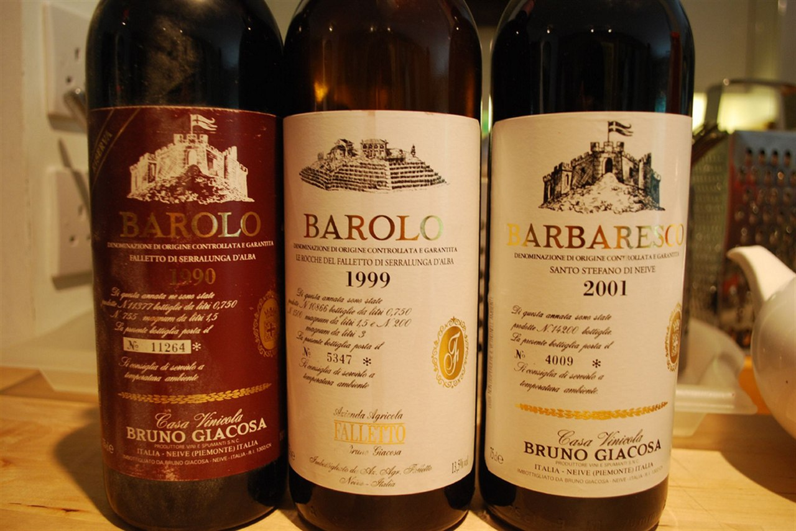

# Bruno Giacosa

Bruno Giacosa (1929–2018) was a winemaker in Neive, Piedmont, known for Barbaresco and Barolo. He was called "the genius of Neive" and is treated as one of the strictest traditionalists of the late twentieth century. His distinctiveness was not only that he made fine wine, but that he put a single vineyard's name on the label very early, and that in a vintage he judged insufficient he would rather sell the wine in bulk than bottle it.

Figure: Three bottles of Bruno Giacosa: Barolo Riserva, Barolo and Barbaresco; wine bottles, not a portrait of the winemaker. Image: YKL2006, CC BY 2.0, via Wikimedia Commons ([source page](https://commons.wikimedia.org/wiki/File:Bruno_Giacosa_3bottles.jpg)).

## From grape buyer to winemaker

Giacosa was born in Neive in 1929. His family were not peasants starting from scratch but commercianti, grape buyers and wine merchants: his grandfather Carlo and father Mario bought grapes around Barbaresco and Barolo and sold them to estates or made wine themselves. Bruno left school at fifteen, entered the family business during the Second World War, and walked the vineyards with his father, learning to judge plots, varieties and ripeness.

That gave him a map-like knowledge: which slope faced south, which soil was warmer, which village's Nebbiolo ripened earlier, which grower's fruit was cleaner. He later said he learned wine not from books but from walking vineyards and tasting grapes. In the 1960s he was seen, with Angelo Gaja and the Produttori del Barbaresco, as one of the three key figures who showed the world what Barbaresco could be.

## Single-vineyard labelling

In 1964 Giacosa made Barbaresco Santo Stefano and put the vineyard name on the label. This was uncommon in Piedmont at the time: most wines were blends of plots and villages, and labels named only the region and the producer. Writing a single vineyard into the name was a promise that the wine came from a specific place, with clearer differences between sites and vintages.

In 1967 he released Barolo Colline Rionda (Vigna Rionda) and Barbaresco Asili Riserva. These wines turned "cru" from an internal estate term into market language. The later Barolo and Barbaresco system of additional geographical mentions (Menzioni Geografiche Aggiuntive) can be seen as the institutional form of this practice; Giacosa was not the only advocate, but he was among the earliest to put the plot on the label.

## From bought grapes to owned vineyards

For the first two decades of his career Giacosa relied mainly on purchased grapes. He owned little land and built relationships with growers, selecting the best plots and fruit. In 1982 he bought Falletto in Serralunga d'Alba, about twenty-five acres; this was the step from merchant to estate owner. In 1996 he added plots in Asili and Rabajà in Barbaresco.

His wines therefore divide into two groups: estate wines labelled Azienda Agricola Falletto (di Bruno Giacosa), and wines from purchased or leased fruit labelled Casa Vinicola Bruno Giacosa. The dual structure looks clear today, but it asked consumers to understand that a producer's name and the source of the grapes are not the same thing. It also gave Giacosa flexibility: he did not have to own land before making wine, but he had to answer for the source.

## Style and vintage selection

Giacosa's style is known for elegance, fine lines and clear aroma rather than power or new oak. He used traditional large casks and fairly long maceration without over-extraction; the colour is pale, the aromas are rose, red cherry, liquorice, tar and earth, and the tannins are fine and long. He believed Nebbiolo's value lay in time, not in immediate drinkability.

His vintage selection was severe. If a year did not meet his standard, he would sell the wine in bulk rather than bottle it. Barolo 2010 was widely praised, yet his estate announced that it would not bottle the vintage because it did not reach his standard. The decision caused debate among producers, but it also made "bottled by Giacosa" a quality signal in itself.

## Later years and succession

In 2006 Giacosa suffered a stroke. He recovered but gradually reduced his daily work; his daughter Bruna Giacosa took over more of the business and management, while winemakers such as Dante Scaglione handled the technical side. In 2012 the University of Gastronomic Sciences awarded him an honorary degree for bringing the vineyards and wines of the Langhe to international attention. He died at home in Neive in January 2018 at the age of eighty-eight.

His death was treated in Italy as the end of a generation: winemakers who built judgment by walking vineyards, tasting grapes and remembering plots, rather than by laboratory data or market reports. Today's Barolo and Barbaresco estates have more technology and market tools, but the willingness to skip bottling in a good year remains the hardest part of Giacosa's example to imitate.

## Assessment and controversy

The favourable view treats him as one of the last giants of the traditional school: he showed that Barbaresco could reach the complexity of Barolo, pushed single-vineyard labelling into the market, held a quality line by refusing to bottle, and left wines that open up in layers with age.

Criticism has three lines. First, the "genius" narrative hides the team and the growers: Giacosa depended on long-term growers, winemakers and his daughter Bruna's management; he did not make every judgment alone. Second, his purchased-grape model complicates the line between "estate wine" and "merchant wine"; consumers need to read Azienda Agricola versus Casa Vinicola on the label. Third, the "rather not bottle" practice can be romanticised, but it also shifts vintage risk onto the market and buyers; not every estate can afford that choice.

## Common misreadings

The first is to call Giacosa the "founder" of Barbaresco. The region existed long before him; he was one of the key figures who brought its potential to international attention in the later twentieth century.

The second is to treat all his wines as estate wines. The labels divide into Azienda Agricola Falletto and Casa Vinicola Bruno Giacosa, the latter using purchased or leased fruit.

The third is to treat "traditional" as "no technology". He used temperature control, stainless steel and laboratory analysis; he simply did not let technology replace judgment about grapes and place.

The fourth is to treat the 2010 decision not to bottle as proof of a bad vintage. It was the estate's own standard and choice, not a verdict that Nebbiolo elsewhere could not make good wine that year.

## See also

- [Piedmont](ref:piedmont): the larger region of Neive, Barbaresco and Serralunga d'Alba.
- [Barolo](ref:barolo): Giacosa's other core line, sharing the Nebbiolo tradition with Barbaresco.
- [Nebbiolo](ref:nebbiolo): the key to his aroma, tannin and ageing potential.
- [Red wine](ref:red-wine): the category for his large-cask, long-maceration style.
- [Place and process](ref:place-process): the framework for single-vineyard labelling and the site-variety-technique relationship.

Read [Piedmont](ref:piedmont) for the role side of Bruno Giacosa, and [Nebbiolo](ref:nebbiolo) for the period side. Together they locate it.

**In brief:** Italian Piedmont winemaker (1929–2018), based in Neive, who began labelling a single Barbaresco vineyard in 1964 and held to long traditional ageing and strict vintage selection, earning the name "the genius of Neive".
