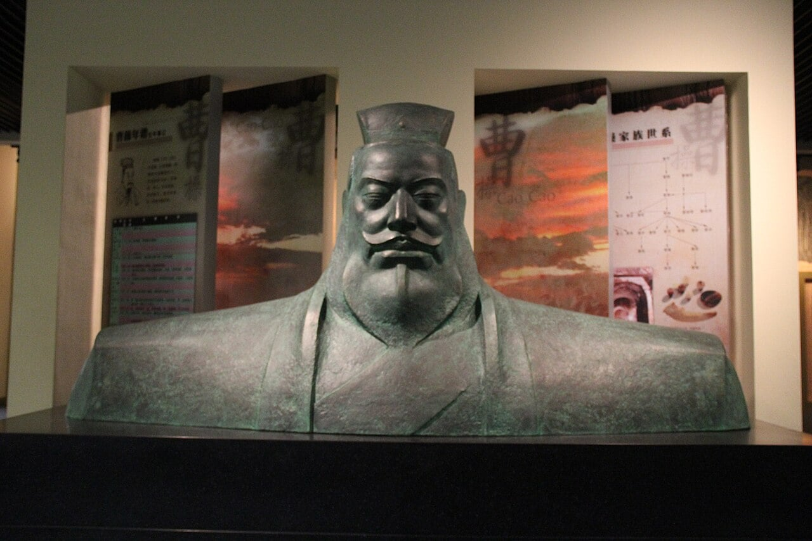

# Cao Cao

Cao Cao (155–220), styled Mengde, from Qiao county in Pei, near modern Bozhou in Anhui, was a late Han statesman, general and leading poet of the Jian'an generation. His relation to wine has three layers: in poetry wine is the entry to consolation, in government he ordered a prohibition, and in private he once submitted a brewing method to the throne.

Figure: The bronze statue of Cao Cao in Xuchang Museum, with exhibition panels on his life and family genealogy behind it. Image: Gary Todd, CC0, via [source page](https://commons.wikimedia.org/wiki/File:Statue_of_Cao_Cao.jpg).

## Life and political turning points

Cao Cao was born in 155. Around 174 he was recommended as a filial and incorrupt candidate and became commandant of the northern district of Luoyang. In 184, when the Yellow Turbans rose, he took part in suppressing them as a cavalry commandant. In 196 he brought Emperor Xian to Xuchang and from then on spoke in the name of the court. In 200 he defeated Yuan Shao at Guandu and gradually unified the north. In 208 his campaign at Red Cliffs failed, and the three-way division of the empire took shape. He died in Luoyang in 220, aged sixty-five.

These dates show a man rebuilding order; for him wine, grain and military policy were one problem: was there enough food, and would the great families obey?

## Wine and time in “Short Song”

“Short Song” opens: “Facing wine, one should sing; how long is a life? Like morning dew, the days already gone are many. The heart is stirred, and worry is hard to forget. What can dissolve worry? Only Dukang.” Wine here is the first action taken in the face of brevity.

“Dukang” is usually explained as the legendary first maker of wine and later serves as a poetic name for wine itself; it is not a modern brand. The second half of the poem turns to the search for talent. “Green is your collar, long my longing” borrows from a love poem in the Book of Songs, and “The deer bleat, eating the artemisia” borrows the banquet scene of the “Deer Call” ode. Wine is thus layered with the search for talent and with anxiety about time.

## The prohibition: grain, manners and power

The Book of the Later Han says that “when the year was hungry and war had risen, Cao submitted a memorial establishing a wine prohibition”, pointing to grain scarcity as the reason. Brewing consumes large quantities of grain, and when army rations come first, restricting brewing is a direct cost-saving choice.

Yet Cao Cao was not opposed to wine as such. He wrote a memorial presenting the “nine-fold spring wine” method to Emperor Xian, describing thirty catties of starter, five piculs of water, steeping the starter in the twelfth month, and brewing with good rice after the thaw in the first month; the process was repeated every three days until nine piculs of rice had been used. Prohibition was government; the memorial was technical interest.

## Kong Rong's objection and the textual evidence

Kong Rong publicly objected in “A Refutation of Cao Gong's Memorial Establishing a Wine Prohibition”. His argument had two parts: wine has uses in sacrifice, hospitality and medicine; and blaming the fall of dynasties on wine does not hold logically. He added a sharp analogy: if the last kings of Xia and Shang lost their states through women, should marriage also be banned?

Kong Rong was a descendant of Confucius and a leader of the famous scholars, so his objection carried public weight. He was later killed on charges connected with speech and association; the wine dispute is one thread in their deterioration, not the sole cause.

## Wine names, vessels and late Han material conditions

The dominant wine of the late Han was fermented grain wine, not today's strong baijiu. Wine was graded clear or cloudy, the clear being filtered and dearer. The biography of Xu Miao in the Records of the Three Kingdoms tells of Xu drinking in private until drunk; when asked about official business, he answered that he was “in the sage”. Drinkers called clear wine “the sage” and cloudy wine “the worthy”. The anecdote shows how people kept drinking under the ban.

“Nine-fold” refers to repeated additions and fermentations, aiming at a higher yield and a fuller taste. The “nine-fold spring wine” in Cao Cao's memorial is a concrete process, not a literary flourish. Some modern brands claim the record as their origin, but an ancient memorial and a modern product are separated by a long transmission.

## Literary reputation and dispute

Chen Shou, in the Records of the Three Kingdoms, called Cao Cao “an extraordinary man, a hero beyond his age”, affirming his political and military ability. Zhong Rong, in the Shipin, placed him in the lowest grade and wrote: “Lord Cao is ancient and plain, and has profoundly desolate lines.” The comment grants him force and sadness while faulting him for a lack of polish.

Xu Shao called him “a capable minister in a good age, a treacherous hero in a bad one”, and the novel Romance of the Three Kingdoms magnified the phrase into a stage image. The Book of the Later Han records that in 193, during the campaign against Tao Qian in Xu Province, “men and women were killed, tens of thousands of them, with no fowl or dog left, and the Si River stopped flowing”. That record remains a controversy in any assessment of his career; the literary style and the political cruelty can both be true.

## Common misreadings

First, that Cao Cao was a heavy drinker. He wrote about wine and also banned it; literature may express worry, while government must count grain. Second, that “discussing heroes over green plums” is history. That scene belongs to Romance of the Three Kingdoms. Third, that “Dukang” was a particular brand Cao Cao drank. It is the legendary wine-maker and a poetic metonym. Fourth, that late Han wine was today's strong baijiu; the main drink was a relatively low-strength fermented grain wine. Fifth, that “nine-fold spring wine” is the same product sold today under that name. The craft record and the brand story must be kept apart.

## Timeline

- 155: born.
- Around 174: recommended as filial and incorrupt; commandant of the northern district of Luoyang.
- 196: brings Emperor Xian to Xuchang.
- 200: defeats Yuan Shao at Guandu.
- 208: defeated at Red Cliffs.
- 213: made Duke of Wei.
- 216: made King of Wei.
- 220: dies in Luoyang.

**At a glance:** Late Han statesman, general and poet, 155–220; “Short Song” makes wine the entry to time and worry, while his prohibition order and Kong Rong's objection turned drinking into a political question. 

Read Cao Cao through the period and the role, then the documented work, and finally the sources behind the claim. The sequence matters.

[A concise history of Chinese alcohol: from grain fermentation to national famous wines](ref:chinese-wine-history) explains role; [Time in a cup](ref:time-in-a-cup) adds period. Put Cao Cao between them before deciding what it is.

## Further reading

- [History of Chinese wine](ref:chinese-wine-history): prohibition, liquor policy and brewing.
- [Yellow wine](ref:yellow-wine): the craft lineage of fermented grain wine.
- [Time in a cup](ref:time-in-a-cup): wine in poetry and seasonal life.
- [China](ref:china): the main geography of his activity.

Further reading: [André Simon](ref:c-extra-1).
