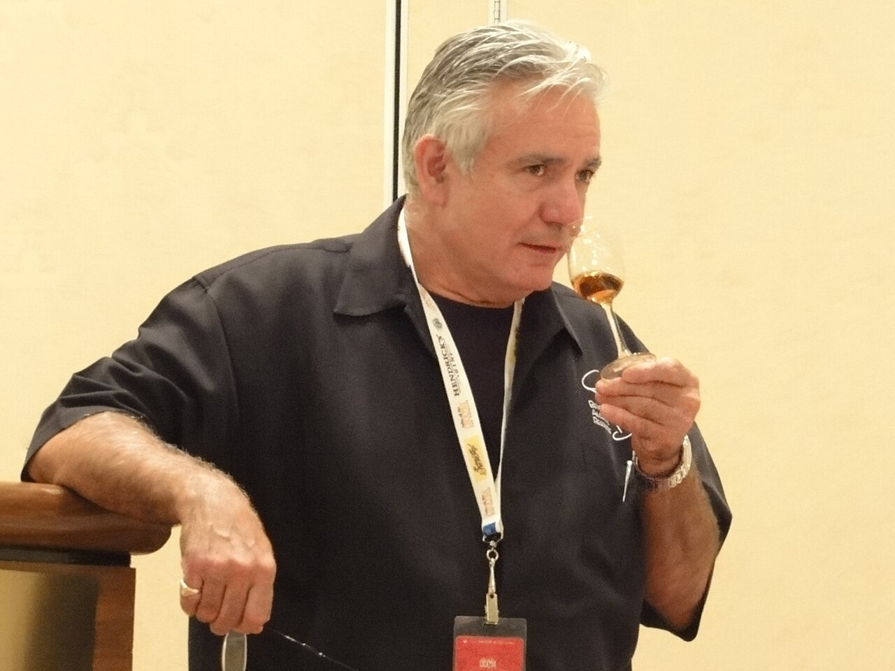

# Dale DeGroff

Dale DeGroff (born 1948) is one of the most influential bartenders of the modern United States. His work was not to invent a famous drink but to turn fresh juice, correctly handled ice and respect for classic recipes into industry standards. From the late 1980s, behind the bar at the Rainbow Room in New York, he became one of the starting points of what is now called the cocktail revival.

Figure: Dale DeGroff. Image: Editor B, CC BY 2.0, via Wikimedia Commons ([source page](https://commons.wikimedia.org/wiki/File:D%C3%A9gustation_d%27Armagnac_aux_USA.jpg)).

## Life

He was born on 21 September 1948. He worked early on as a bartender at the Hotel Bel-Air in Los Angeles and elsewhere, learning the rhythm of service and what customers wanted. In the mid-1980s he worked on a restaurant project led by Joe Baum. In 1987 he helped relaunch the Rainbow Room at Rockefeller Center in New York and ran the Rainbow Promenade bar on the 65th floor; the Rainbow Room closed in 1998.

After that he wrote and taught. The Craft of the Cocktail appeared in 2002 and The Essential Cocktail in 2008; in 2009 he received the James Beard award for Outstanding Wine and Spirits Professional, and in 2015 he entered the foundation's Who's Who. He is founding president of the Museum of the American Cocktail and a partner in the Beverage Alcohol Resource training programme.

## Relationship with alcohol

DeGroff's writing and drinking centre on treating a cocktail as cooking. He insisted on freshly squeezed citrus juice and rejected pre-made syrups and artificial flavourings that mask the ingredient; he cared about the size, hardness and melting speed of ice, because dilution changes the structure of a drink; he studied classic recipes without copying them, adjusting proportions to modern ingredients and tastes.

This method turned cocktails from a mixture of several spirits into a repeatable drink made from ingredients, temperature, time and proportion. Classics such as the [old-fashioned](ref:old-fashioned) and the [dry martini](ref:dry-martini) were reinterpreted on his menu and in his teaching: not nostalgic props, but tests of basic skill.

## The Rainbow Room: post and work

The Rainbow Room sits on the 65th floor of 30 Rockefeller Plaza and is a landmark restaurant and event venue. When it was relaunched in 1987, DeGroff was put in charge of the bar programme. He assembled a list built around classics from before and after Prohibition, asked bartenders to squeeze juice to order, measure consistently, control ice and shaking time, and made bar service match the formality of the dining room.

During his tenure the bar became a destination in its own right. Rockefeller Center's interview notes that he ran it with "a personality behind it", encouraging guests to talk to the bartender, a practice later seen as part of bartending's professionalisation. After the Rainbow Room closed in 1998, he moved into writing, teaching and consultancy.

## Contributions and verifiable standards

First, the Rainbow Room menu. The list from 1987 brought classic cocktails back into a high-end dining setting and pushed restaurant bars to take mixing seriously again.

Second, fresh juice and ice. Freshly squeezed citrus, freshly ground spice and properly handled ice later became basic requirements of craft cocktails; he did not invent these practices alone, but he systematised them and made them visible in a high-end New York setting.

Third, the Nick and Nora glass. For the retro menu he brought back an elegant glass shape named for the detective couple in the 1934 film The Thin Man; it was not his invention, but his use helped make it popular again.

Fourth, teaching and writing. The Craft of the Cocktail put recipes, technique and bar management together; The Essential Cocktail further organised classics and original drinks. Both books put the question "why do it this way" before "how much".

Fifth, industry organisations. The Museum of the American Cocktail preserves bartending history, and Beverage Alcohol Resource offers systematic training; both turn bartending from an individual craft into transferable professional knowledge.

## Industry influence

DeGroff's influence lies in standards rather than myth. He made restaurants willing to spend time and money on mixing, made bartenders willing to study the literature and practise basics, and made customers begin to care whether the juice was fresh and the ice was right. These details, small as they seem, are the material basis of the cocktail revival after the 1990s.

He also reminded the trade that a cocktail's value lies in service and space as well as the recipe. [The history of taverns](ref:taverns) shows that bars have always been social places; DeGroff raised the quality of what is drunk in them to a level worth discussing, and the wider changes in American restaurant culture after the 1980s gave that high-end bar a market.

## Reputation and controversy

The claim that one man revived the cocktail needs qualification. Smithsonian magazine dates the modern craft cocktail movement to the reopening of the Rainbow Room in 1988, but it also names Toby Cecchini at the Odeon in the same city, doing related work at the same time. The revival happened in several places; DeGroff is one of its most representative nodes, not its only cause.

"King Cocktail" is not an official title but a media and trade name. It helps a story travel, yet compresses a team, a restaurant's positioning and an era into a personal legend; any assessment should include the Rainbow Room team, Joe Baum's project and the upgrading of American restaurants in the 1980s.

## Common misreadings

First, taking King Cocktail to mean that he invented the cocktail. Cocktails were mature by the nineteenth century; he revived and standardised them.

Second, treating fresh juice as his patent. Fresh juice was common in early bars, and he brought it back to high-end settings after industrially pre-made juice became the norm.

Third, treating the Nick and Nora glass as his design. The shape comes from the 1934 film The Thin Man; he made it visible on cocktail menus again.

Fourth, crediting the Rainbow Room's success to one person. The team, the restaurant's positioning and the demands of the time all played a part.

## How to understand his method

When looking at one of his drinks, separate four variables: fresh ingredients, correct ice, controlled dilution and stable proportions. Then see how he wrote them into menus and training, and "craft" stops being expensive decoration and becomes a repeatable standard of work. For a home bartender, these four points are more useful than memorising a recipe.

**At a glance:** An American bartender born in 1948; from 1987 he ran the bar at the Rainbow Room in New York, using fresh juice, properly handled ice and restored classic recipes to drive the cocktail revival, and became known as King Cocktail. 

## Further reading

- [Old-fashioned](ref:old-fashioned): the basic structure of the classic cocktail.
- [Dry martini](ref:dry-martini): a classic that tests proportion and temperature control.
- [The history of taverns](ref:taverns): the bar as a changing social space.
- [United States](ref:usa): the setting of American restaurant and cocktail culture after the 1980s.
