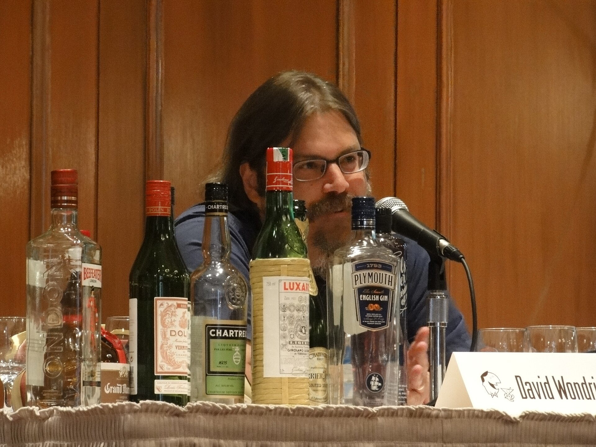

# David Wondrich

David Wondrich (born 1961) is an American cocktail historian, writer and educator. His method is closer to that of a historian than a bartender: he reads old newspapers, city directories, court records and bartenders' manuals, pulling the origins of the cocktail away from bar-room legend. He wrote Imbibe! and Punch, edited The Oxford Companion to Spirits and Cocktails, and helped found the drinks-education body Beverage Alcohol Resource. His value lies in replacing "who invented it" with "where does it first appear".

Figure: Portrait of David Wondrich. Image: Bart Everson, CC BY 2.0, via Wikimedia Commons ([source page](https://commons.wikimedia.org/wiki/File:Tales_of_the_Cocktail_-_David_Wondrich.jpg)).

## Life

Wondrich was born in 1961. He studied literature at university and took a doctorate in comparative literature. He then taught English, but his long interest in the arcana of spirits and cocktails eventually led him out of academia and into writing and drinks research.

In 2000 he published his first drinks article in Food & Wine. In 2003 Esquire published "The Lost Cocktail", and he began systematically recovering forgotten classic recipes. He became Esquire's drinks correspondent.

## Timeline

- 1961: born.
- 1990s: completed a doctorate in comparative literature and taught at university.
- 2000: published his first drinks article in Food & Wine.
- 2003: published "The Lost Cocktail" in Esquire.
- 2007: Imbibe! was published and became the first cocktail book to win a James Beard Award.
- 2010: Punch was published.
- 2015: a revised edition of Imbibe! appeared.
- 2021: co-edited The Oxford Companion to Spirits and Cocktails with Noah Rothbaum.

## Work in the drinks trade

Wondrich's relationship with the trade runs along three lines. The first is writing: as Esquire's long-time drinks correspondent and a Daily Beast columnist, he brought cocktail history to a general audience and gave bartenders citable material. The second is education: he is a founding partner of Beverage Alcohol Resource, an advanced training programme for bartenders and drinks professionals. The third is public history: he is a founding member of the Museum of the American Cocktail.

## Major works and institutions

Imbibe! (2007, revised 2015) uses Jerry Thomas as its thread to trace the formation of the American cocktail in the 19th century. It is not a simple recipe collection; it puts recipes back into the context of saloons, railways, the ice trade and city life. It was the first cocktail book to win a James Beard Award.

Punch (2010) moves the focus back to an older drink. Punch spread with East India Company trade in the 17th century and was the dominant mixed drink before the cocktail; the book shows that sugar, water, spice and citrus were not a 19th-century American invention.

The Oxford Companion to Spirits and Cocktails (2021), co-edited with Noah Rothbaum, is an A-to-Z reference covering spirits categories, brands, bartenders, cocktails and terminology. It received the American Library Association's Dartmouth Medal, a sign that it was treated as a reference work rather than a bar book.

He has also written Stomp and Swerve (2003), a history of American music, and practical books such as Esquire Drinks and Killer Cocktails; more recently he collaborated with Dean Kotz on The Comic Book History of the Cocktail.

## Historical method

Wondrich's method can be summarised as "find the earliest text first, then talk about invention". He is sceptical of stories in which a bartender invents a drink on a particular night, because such stories rarely have contemporary evidence. He prefers to establish where a recipe first appears in a manual, newspaper or yearbook, and then compare versions.

The definition of the cocktail is one example. In 1806 the American newspaper The Balance defined a cocktail as "a stimulating liquor composed of spirits of any kind, sugar, water, and bitters". This is one of the earliest known definitions. Wondrich repeatedly cites it to show that the cocktail was a defined drink in the early 19th century, not a 20th-century invention. He also reminds readers that the etymology is unsettled and that folk explanations such as the French coquetier, an egg cup, lack contemporary evidence.

## Influence

First, he changed how cocktail history is written. Older books put recipes first and history at the margins; Wondrich brought archives, footnotes and version comparison in, making "where did this drink come from" a discussable question.

Second, he supported the revival of the classic cocktail. The craft cocktail movement of the 2000s needed a usable lineage, and his research supplied citable lists and recipes.

Third, he influenced education. BAR's courses and his books helped turn cocktails from a craft into a subject with history, theory and tasting method.

Fourth, he brought punch back to the bar, a revival clearly connected to the publication of Punch.

## Assessment and disputes

Imbibe Magazine calls him "one of the world's foremost authorities on the history of the cocktail" and one of the founders of the modern craft cocktail movement. The assessment comes from an industry magazine, but it reflects real influence: bartenders use his books as reference works and researchers cite his articles.

There are two disputes. The first is whether the cocktail is purely American. Wondrich places its formation in the early 19th-century United States and emphasises the 1806 definition and Jerry Thomas's 1862 manual; other researchers stress earlier British, Caribbean and punch traditions. The safer statement is that the cocktail as a fixed format of spirits, sugar, water and bitters was named and systematised in America, while mixed drinking is much older. The second is the popular claim that Jerry Thomas invented the cocktail. Wondrich does not support that heroic view; his Thomas is a man who collected, spread and professionalised existing recipes, not one who started from nothing.

## Common misreadings

First, that Wondrich is a bartender. He has consulted and taught for bars, but his main identity is historian and writer; his authority comes from archives and writing, not from a famous bar.

Second, that Imbibe! is a recipe book. It contains recipes, but its core is historical narrative and biographical reconstruction.

Third, that Wondrich wrote The Oxford Companion alone. It was co-edited with Noah Rothbaum and involved many contributors.

Fourth, that Wondrich "discovered" the 1806 cocktail definition. He was not the first to cite it, but he made it a standard starting point for cocktail history.

Fifth, that the etymology of "cocktail" is settled. It is not; Wondrich separates documented definitions from undocumented anecdotes.

## See also

- [Gin](ref:gin): one of the most common cocktail bases.
- [Dry Martini](ref:dry-martini): the classic cocktail par excellence.
- [Manhattan](ref:manhattan): the basic whisky-cocktail structure.
- [Old Fashioned](ref:old-fashioned): spirits, sugar, water and bitters in their original form.
- [Cocktail basics](ref:cocktail-basics): tools, ratios and classic recipes.
- [United States](ref:usa): the main setting of cocktail history.

David Wondrich is best read by starting with the period and the role, moving to the documented work, and ending with the sources behind the claim.

Start with [Gin](ref:gin) for role, then read [Manhattan](ref:manhattan) for period. Seeing both keeps David Wondrich from being confused with a neighbouring idea.
