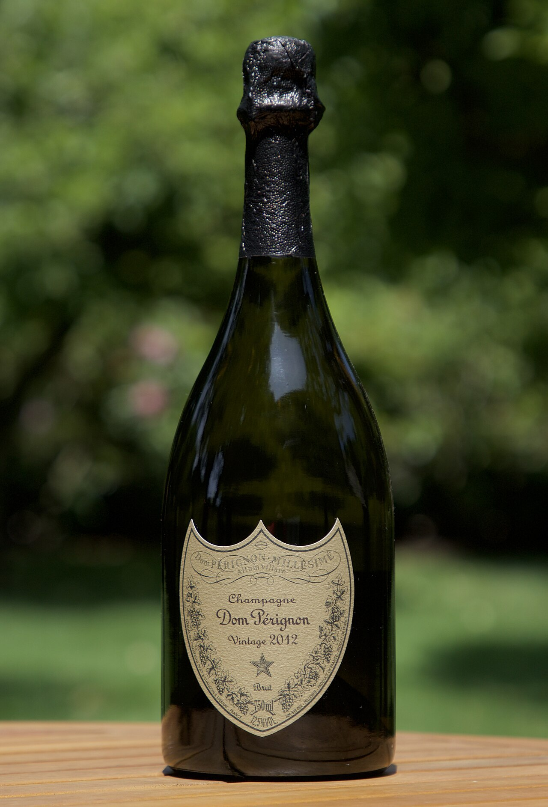

# Dom Pérignon

Dom Pérignon (1638-1714) was a Benedictine monk at the abbey of Hautvillers in the Champagne region of France. Today the name refers first to a prestige champagne and only second to a historical person; more than a century of advertising and legend lies between the two. Separating the person from the brand is the first step.

Figure: Dom Pérignon. Photograph: Dom Pérignon Champagne 2012. Credit: Hayden Soloviev, CC BY 4.0, via Wikimedia Commons ([source](https://commons.wikimedia.org/w/index.php?curid=168283495)).

## Life

- Born in 1638 in Sainte-Menehould in Champagne, with the baptismal name Pierre Pérignon; 1638 is the conventional year.
- From 1668 he served at the abbey of Hautvillers as procureur, responsible for estates, income, tithes and the cellar, a post that combined economic administration with winemaking.
- For nearly half a century he managed the abbey's vineyards and cellars until his death.
- He died at Hautvillers in 1714; some French sources give 1715, and the exact date is not settled.
- In 1921 Moët & Chandon made the first vintage under his name, released in 1936, and the name became a brand.

## His actual role in the wine trade

Hautvillers was founded in the seventh century, in the Marne valley near Épernay. The abbey owned vineyards, collected tithes and sold its own wine. As cellarer, Dom Pérignon did not "invent a wine"; he decided which plots went into which lot, when to pick, how to press and how the accounts were settled. Those choices shaped style, but they were management, not laboratory invention.

In the seventeenth century Champagne was primarily a still-wine region, selling to Paris, Flanders and England. The climate was cool, wine sometimes underwent a second fermentation in bottle, glass was weak, and exploding bottles were common; fizz was often treated as instability or a fault.

## Representative work: blending, clarification and cellar practice

Three kinds of work can reasonably be attributed to him. The first is blending: mixing juice from different plots and years for a more stable, finer wine, which became one of the core methods of champagne ([blending](ref:blend)). The second is clarification and pressing: reducing the colour and roughness from skins so the white wine was cleaner. The third is cellar management: temperature, containers, hygiene and inventory records.

A distinction is needed between attribution and legend. Stronger glass, cork stoppers and blending to a fixed house style were all developing in seventeenth-century Europe; some were later credited to him without contemporary evidence. One often overlooked date is 1662, when the English physician Christopher Merret presented a paper to the Royal Society describing the addition of sugar to provoke a second fermentation, before Dom Pérignon's time there.

## How the "invention" legend was formed

The claim that Dom Pérignon invented champagne was used widely by champagne houses in the nineteenth century. In the late nineteenth century, as champagne became a national symbol of France, the legend served that narrative.

The most quoted line, "Come quickly, I am drinking the stars", has no reliable early source and is generally treated as later advertising copy. Legend also says he was blind in old age; that too lacks contemporary evidence. Taking advertising lines and anecdotes as the words of a seventeenth-century monk is the most common misreading.

The chemistry of bubbles was not explained until the nineteenth century, and people in his time did not understand how carbon dioxide was produced, so the "invention" claim also fails technically. More accurately, he took part in improving the region's winemaking, while champagne was shaped by the region, by time and by many unnamed workers.

## How the name became a brand

In 1921 Moët & Chandon launched a prestige vintage champagne under his name ([Dom Pérignon champagne](ref:dom-perignon-wine)); the first wines were released in 1936. The brand borrowed the monk's name and the legend of the father of champagne.

What is sold as Dom Pérignon today is a [sparkling wine](ref:sparkling) from Champagne in [France](ref:france). It is made only in declared vintages, and its style is decided by vintage, blend and time on the lees: the year sets the conditions, the blend sets the structure, and long lees ageing brings notes of biscuit, nuts and cream. In 1936 Champagne obtained its appellation d'origine contrôlée (AOC), writing its boundaries and production rules into law.

## Assessment and disputes

Historical writing usually treats him as a capable cellarer and blender: a man who could keep accounts and turn wine from different sources into a consistent, saleable product. That skill does not make a legend.

The dispute centres on invention. The champagne trade long presented him as the inventor, while The Oxford Companion to Wine points out that the key conditions - strong bottles, reliable corks and the knowledge of a second fermentation from added sugar - developed in England and elsewhere in Europe and cannot be credited to one man. Researchers also note that the fuller accounts of his life appeared late and that the abbey archives were dispersed in the French Revolution, so specific claims should be left open.

For the modern brand, the monk's legend became a stable luxury label whose price includes a substantial brand premium.

## Common misreadings

First, equating the brand with the person. The brand is a twentieth-century commercial product; the person is a seventeenth-century monk.

Second, taking legend as evidence. No reliable primary source supports "he invented champagne", and there is no evidence that he was the first to use cork for sparkling wine.

Third, treating champagne as one man's work. Sparkling wine resulted from regional technical accumulation involving glass, stoppers, cellars and transport.

Fourth, taking "drinking the stars" as a quotation. It looks like advertising rather than seventeenth-century French.

Fifth, treating the year of death as beyond dispute. Both 1714 and 1715 appear in the records.

## How to look at Dom Pérignon today

Dom Pérignon is best approached through the period and the role, then the documented work, and then the sources behind the claim. One check alone will not settle it.

Treating it as a modern product with a historical name is more accurate than a monk's secret recipe.

## See also

- [Sparkling wine](ref:sparkling): where the bubbles come from and how champagne differs from other sparkling wines.
- [Blending](ref:blend): why wines from different plots are put together.
- [France](ref:france): champagne's place in the French wine map.
- [Dom Pérignon champagne](ref:dom-perignon-wine): the modern vintage champagne named after the monk.

Setting [Sparkling wine](ref:sparkling)'s role beside [France](ref:france)'s period makes the boundary between them visible.

**Key facts.**

| Item | Detail |
| --- | --- |
| In one line | A French Benedictine monk, 1638 to 1714, who long managed the cellars of the abbey of Hautvillers in Champagne. Later ages called him the father of champagne, but the claim that he invented it is largely a nineteenth-cen… |
| Life | 1638–1714 |
| Roles | Benedictine monk、cellarer |
| Regions | France |
