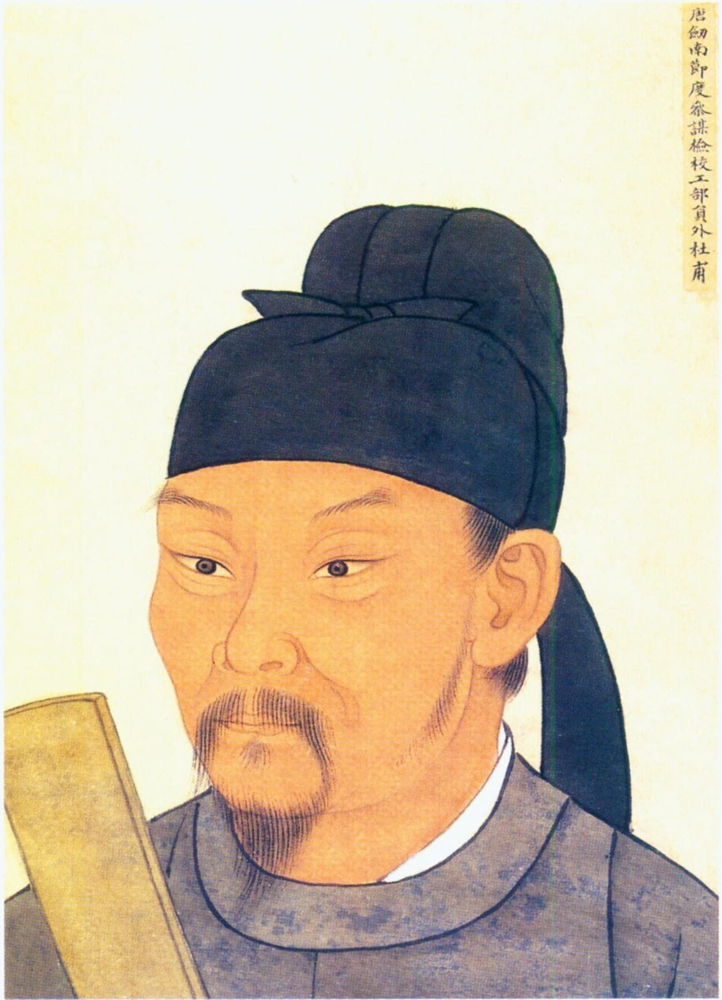

# Du Fu

Du Fu (712–770), styled Zimei and self-named Shaoling Yelao, came from a family whose ancestral home was Duling near the capital; he was born in Gongxian, Henan. Later readers called his work a “history in verse”. Wine appears in it very often, yet it is seldom written as simple pleasure; reading it means noticing when he lifts the cup and when he sets it down.

Figure: Du Fu. Image: Unknown author Unknown author, Public domain, via Wikimedia Commons ([source page](https://commons.wikimedia.org/wiki/File:Dufu.jpg)).

## Life

Du Fu came from a family with a literary tradition; his grandfather Du Shenyan was an early Tang poet. In his youth he travelled through the regions of Wu and Yue and of Qi and Zhao. Around 746 he went to Chang'an to seek office and remained there in hardship for nearly ten years, receiving only a minor post in 755. When the An Lushan rebellion broke out he fled with his family and was briefly captured. In 757 he escaped to Fengxiang and was appointed Left Reminder; in 758 he was demoted to a staff post in Huazhou.

In 759 he abandoned office and entered Shu, and the following year he built a thatched cottage by the Huanhua Stream in Chengdu. He left Chengdu in 765, reached Kuizhou in 766, and in 768 sailed out through the Three Gorges, drifting down the Yangtze into Hunan. He died on a boat on the Xiang River in 770. About 1,400 poems survive; his regulated verse is especially disciplined.

## Milestones

- 712: born in Gongxian, Henan.
- Around 746: goes to Chang'an to seek office and lives there in hardship for years.
- 755: the An Lushan rebellion begins.
- 757: escapes to Fengxiang and is appointed Left Reminder.
- 759: leaves office and enters Shu.
- 760: builds the thatched cottage in Chengdu.
- 763: hears that government forces have recovered Henan and Hebei.
- 766: reaches Kuizhou; in 767 he writes “Climbing High” on the Double Ninth.
- 770: dies on a boat on the Xiang River.

## Wine in Du Fu's poetry

Du Fu wrote no treatise on wine; wine enters his poems through concrete life. A friend visits and he cannot offer good wine; living away from home he drinks alone under the moon; illness brings a doctor's order to stop; news that the army has recovered lost territory makes him sing and drink. Wine serves four purposes: hosting, farewell, solitude and celebration, and each occasion carries a specific situation.

“Meeting with Wei the Eighth, a Retired Scholar” describes a reunion: “you say that meeting is hard, and in one lift we drain ten cups; ten cups do not make me drunk, for I am moved by your old kindness.” Ten cups without drunkenness is not a sign of weak wine but of strong feeling; capacity becomes a measure of friendship. “Remembering Li Bai on a Spring Day” closes with “when shall we share a cup of wine and again discuss writing in fine detail?”, placing shared drinking beside literary conversation.

“Hearing that the Government Army Has Recovered Henan and Hebei” contains the line “by day I sing aloud and must drink freely, with spring as my companion I can go home”. This is one of Du Fu's rare passages of open joy, yet the free drinking still serves the return home: wine is the outlet of an emotion, not the emotion itself.

## Wine in the major works

“Song of the Eight Immortals of the Wine Cup” is Du Fu's famous portrait of other drinkers. He Zhizhang “rides as if in a boat, and when his eyes swim falls asleep at the bottom of a well”; Li Bai “with one dou of wine writes a hundred poems and sleeps in a Chang'an wineshop; when the emperor calls he will not board the boat, saying he is an immortal in wine”. The dou is a unit of volume and also a rhetorical exaggeration; the poem is a set of character sketches, not a record of capacity. The wineshop line also shows that the Tang capital already had a developed trade in selling drink.

“Guests Arrive” describes a friend's visit: “the market is far, so the dishes have no second flavour; the house is poor, so the cup holds only old unfiltered wine.” The food is plain because the market is distant; the wine is what the household already had, not a fine vintage bought for the occasion. This is not elegant self-deprecation but an economic fact: the quality of the wine is tied directly to the wealth of the household.

“Climbing High” was written at Kuizhou on the Double Ninth: “hardship and regret thicken the frost on my temples; poor and ill, I have just stopped the cup of cloudy wine.” In old age and sickness the doctor ordered him to stop, so the cup becomes the wine he cannot drink. In the same poet's hands wine can be evidence of celebration or a marker of physical decline.

## Wine and the liquor trade in Tang China

What people drank in Tang times was fermented grain wine, chiefly rice or millet wine. By degree of filtration it was divided into “clear wine” and “cloudy wine”; cloudy wine was not inferior or adulterated, only less clarified and often still carrying lees. Alcohol strength was generally low, and the wine was often warmed before drinking. Whether distilled spirits already existed in the Tang is still debated, but they were certainly not the dominant drink of Du Fu's world.

Chang'an already had a division of labour in the wine trade. There were wine shops in the eastern and western markets and in the lanes between wards, and sellers were registered as wine households. In 764, six years before Du Fu's death, the court ordered that each prefecture should fix the number of wine-selling households and tax them monthly (Old Book of Tang, “Treatise on Food and Money”). Wine was by then an industry requiring registration and taxation, not merely a refined pleasure in a scholar's cup.

## Reputation and disputes

Du Fu was not widely famous in his lifetime; from the mid-Tang onward he was gradually elevated to “sage of poetry”. A famous twentieth-century dispute came from Guo Moruo's Li Bai and Du Fu (1971), which praised Li Bai at Du Fu's expense and argued that some of Du Fu's poems reveal landed-class tastes. The book provoked much rebuttal and is better read today as a polemic with a clear political standpoint than as a settled verdict.

A more concrete limitation is documentary. The wine in Du Fu's poems is seen from the drinker's angle; prices, wine households and brewing methods appear only in fragments. Anyone using his poems to reconstruct the Tang liquor trade must read them alongside institutional sources such as the “Treatise on Food and Money” in the Old Book of Tang, and must not treat verse as an industry archive.

## Common misreadings

The most common mistake is to make Du Fu a poet who did not drink. He wrote many drinking scenes; he simply refused to romanticise them.

“Cloudy wine” is often read as inferior or fake liquor. In Tang usage it means grain wine not fully clarified, a question of filtration.

Some readers take the quantities in “Eight Immortals” as historical measurements. The poem is a set of character sketches concerned with personality rather than capacity.

“I have just stopped the cup of cloudy wine” is often explained as a total vow of abstinence. The next words are “hardship and regret thicken the frost on my temples”; stopping is the result of illness and circumstance, not a moral choice.

As for “one dou of wine, a hundred poems”, that is Du Fu observing Li Bai, not describing himself.

## Quotations and sources

“The house is poor, so the cup holds only old unfiltered wine” comes from “Guests Arrive”; “poor and ill, I have just stopped the cup of cloudy wine” from “Climbing High”; “one dou of wine, a hundred poems, sleeping in a Chang'an wineshop” from “Song of the Eight Immortals of the Wine Cup”; “by day I sing aloud and must drink freely” from “Hearing that the Government Army Has Recovered Henan and Hebei”; “in one lift we drain ten cups” from “Meeting with Wei the Eighth, a Retired Scholar”. When quoting, name the poem and the author, and do not confuse a figure in the poem with the poet himself.

## See also

- [History of Chinese wine](ref:chinese-wine-history): wine households, wine taxes and brewing over the long term.
- [Time in a cup](ref:time-in-a-cup): how wine entered seasonal and literary writing.
- [Yellow wine](ref:yellow-wine): the craft lineage of fermented grain wine.
- [China](ref:china): the geography covered by Du Fu's travels.

Further reading: [André Simon](ref:c-extra-1).

Du Fu is best approached through the period and the role, then the documented work, and then the sources behind the claim. One check alone will not settle it.