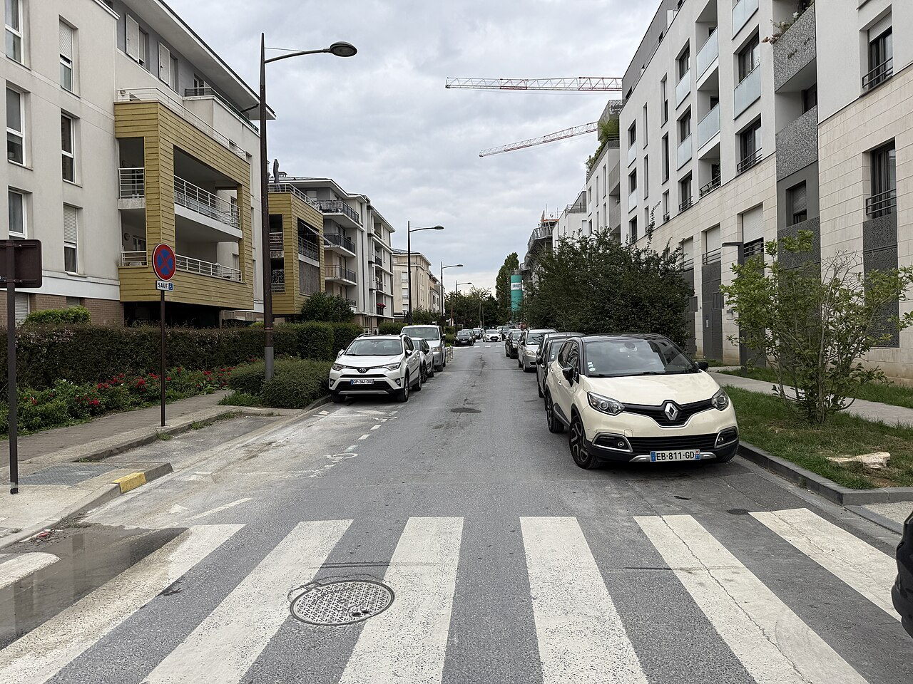

# Émile Peynaud

Émile Peynaud (1912-2004) was a Bordeaux oenologist and university professor, and the key figure in bringing the laboratory into traditional wineries. Before him many Bordeaux estates relied on experience and habit; after him, temperature control, yeast management, fermentation monitoring and systematic tasting became routine.

Figure: Émile Peynaud. Photograph: Rue Émile Peynaud - Bussy-Saint-Georges (FR77) - 2025-07-31 - 1. Credit: Chabe01, CC BY-SA 4.0, via Wikimedia Commons ([source](https://commons.wikimedia.org/w/index.php?curid=171303216)).

## Life

- Born in 1912 in Madiran, in south-west France; the family was poor, he was working with wine by fourteen, and after his father died he joined the Calvet wine merchant's laboratory in Bordeaux.
- Studied chemistry and oenology in Bordeaux under Jean Ribereau-Gayon and completed his doctorate in 1946.
- Taught at the University of Bordeaux, where he became professor of oenology, and advised estates in Bordeaux and abroad.
- Published Le Gout du Vin in 1983, a systematic account of tasting and balance; the English edition, The Taste of Wine, appeared in 1987.
- Retired from teaching in 1990 at the age of seventy-eight.
- Died on 18 July 2004 at Talence, near Bordeaux, aged ninety-two, after several years of Parkinson's disease.

## His actual role in the wine trade

He had three roles: university teacher, laboratory researcher and estate consultant. They were not parallel titles but a chain. In the laboratory he measured ripeness, acidity, sugar and yeast condition; in the classroom he taught the method; in the cellar he turned those measurements into picking dates, fermentation temperatures and sequences of work.

The chain ended in concrete practice. He argued for assessing risk before fermentation, monitoring temperature and density during it, and managing malolactic fermentation afterwards. He stressed cellar cleanliness, disinfection of equipment and rational use of sulphur dioxide. He also advised on equipment, bringing temperature-controlled tanks and analytical methods into cellars that had run on habit. Among his students was Michel Rolland, later a celebrated consultant, and that lineage helped his method spread faster after the 1980s.

## Le Gout du Vin: tasting written as method

Le Gout du Vin is his best-known book. It does not stop at lists of aroma words but breaks tasting into trainable steps: look at colour and clarity; smell for intensity and family of aroma; in the mouth separate attack, mid-palate and finish; then judge whether acidity, tannin, alcohol and length are in balance.

The value of the framework is that it can be passed on. A winemaker can say clearly what a wine lacks, and a student can approach professional judgment through comparison and notes. Tasting stops being a mysterious personal experience and becomes a craft that can be discussed and corrected.

The book also makes a choice. It values "clean" and "balanced" and has little tolerance for faults, a stance that shaped a generation's standards and later became the starting point of argument.

## Temperature control and malolactic fermentation

Two technical contributions are most often attached to him.

The first is temperature-controlled fermentation. Too high a temperature loses fruit and speeds oxidation; too low slows fermentation and leaves residual sugar. Holding the must in a suitable range gives predictable aroma and structure. This sounds like common sense now, but in mid-twentieth-century Bordeaux many cellars simply followed the weather.

The second is malolactic [fermentation](ref:fermentation) after the alcoholic one. Lactic acid bacteria convert sharp malic acid into softer lactic acid, lowering [acidity](ref:acidity), rounding the texture and improving microbiological stability. Peynaud did not discover the process, but he studied its mechanism, explained its benefits and risks, and urged estates to manage it deliberately rather than let it happen at random.

Both point the same way: turn what used to depend on luck into something observable, judgeable and repeatable.

## Hygiene, observation and preventive winemaking

Before Peynaud, many estates worked by remedy: wait for the wine to go wrong, then fix it. He argued for prevention: judge ripeness and health before the grapes enter the cellar, clean equipment before fermentation starts, record temperature and density during it, and intervene before a problem appears.

The effect on [red-wine](ref:red-wine) production was especially visible. Estates could reliably make wine that was clean, ripe and structurally complete, and vintage variation became less dramatic. Supporters call this progress; critics worry that the other side of reliability is similarity.

## Assessment and disputes

His influence can be checked at the level of the trade: temperature-controlled stainless steel tanks, selected yeasts, deliberate inoculation for malolactic fermentation, hygiene protocols and tasting sheets are now standard equipment in modern wineries. The spread of consultancy and of flying winemakers carried his method to Chile, Argentina, Australia and the United States.

The dispute centres on standardisation. Critics use the term "Peynaudisation" for the way Bordeaux wines of the 1970s and 1980s became cleaner, riper and more alike, arguing that too much reliance on analysis and uniform procedure weakens the differences of [Bordeaux](ref:bordeaux) sites. The 2004 documentary Mondovino took consultants and standardised winemaking as its target, and Peynaud's methodological legacy was drawn into that argument. A second counter-model came from the natural wine movement: Jules Chauvet in Beaujolais, arguing for little sulphur, indigenous yeasts and minimal intervention, was a direct counterweight to the laboratory-led line.

There is also a textual limit. The tasting vocabulary of Le Gout du Vin is calibrated on wines of the French appellation system; using it to describe other regions requires local points of reference.

## Common misreadings

First, saying he "invented" malolactic fermentation. The process already existed; he researched, explained and promoted its controlled use.

Second, equating modern winemaking with "adding things". His arguments were more about hygiene, temperature and observation than about additives.

Third, treating the consultant system as his personal invention. He was one of the forerunners, and the consultancy industry grew large only later.

Fourth, treating "scientific winemaking" as "no terroir". He did not deny site differences; he asked for checkable methods to express them.

Fifth, treating "clean" as "characterless". Hygiene is a floor, not a style; character still depends on ripeness, yield, extraction and ageing.

## See also

- [Fermentation](ref:fermentation): the conversion of sugar to alcohol and the role of malolactic fermentation.
- [Acidity](ref:acidity): a key measure affecting freshness and ageing potential.
- [Red wine](ref:red-wine): the basic craft of Bordeaux reds.
- [Bordeaux](ref:bordeaux): the region where modern winemaking consultancy is most concentrated.

The comparison with [Fermentation](ref:fermentation) and [Bordeaux](ref:bordeaux) runs through role and period. Each answers a different question.

**Key facts.**

| Item | Detail |
| --- | --- |
| In one line | A Bordeaux oenologist, 1912 to 2004, born in Madiran and died in Talence. As professor of oenology at the University of Bordeaux he promoted temperature-controlled fermentation, managed malolactic fermentation, cellar hy… |
| Life | 1912–2004 |
| Roles | oenologist、professor、wine consultant |
| Regions | France、Bordeaux |

**Sources and limits.** The key claims about Émile Peynaud are checked against the following sources: Encyclopaedia Britannica (Used to check birth and death places, the doctorate, the Bordeaux chair and his changes to winemaking), by Émile Peynaud; English translation published by Macdonald in 1987, later reissued by Wiley (Used to check his views on tasting and winemaking), Oxford University Press; edited by Jancis Robinson and 10 sources in total. Prices, batches and status change; the body is project-written and does not reproduce source text.
