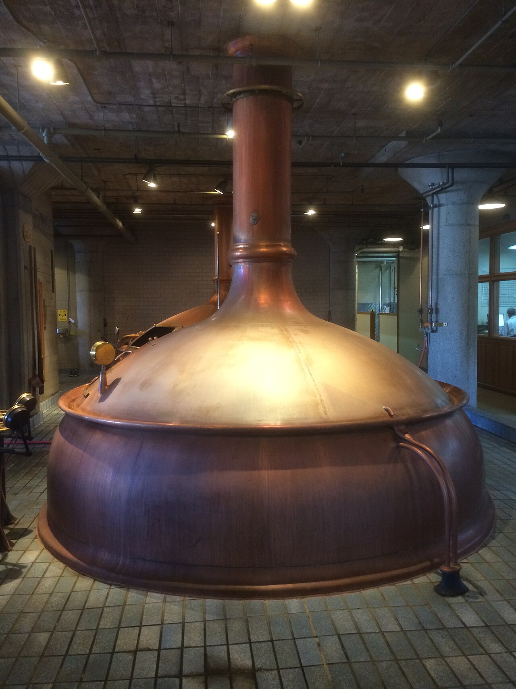

# Fritz Maytag

Fritz Maytag (born 1937) was not a conventional brewing apprentice. He came from the Maytag washing-machine family of Iowa, studied literature at Stanford, and saw in a glass of old San Francisco steam beer a craft world that was about to disappear. In 1965 he bought the failing Steam Beer brewery, later Anchor Brewing, and turned himself into a founding figure of American craft beer.

Figure: A copper kettle at Anchor Brewing in San Francisco; brewery equipment, not a portrait of Fritz Maytag. Image: Picardin, CC BY 4.0, via Wikimedia Commons ([source page](https://commons.wikimedia.org/wiki/File:Anchor_Brewing_Company_copper_kettle.jpg)).

## Family and early life

Maytag was born in Newton, Iowa, in 1937, into a family known for washing machines and blue cheese. In San Francisco he encountered Anchor's steam beer and realised that its open fermentation, top-fermenting yeast and wider temperature band produced something entirely different from the pale lagers then dominating America. In 1965 he bought control of the brewery and taught himself brewing, working through cleaning, mashing and bottling by hand. When he took over, only a handful of employees remained, the equipment was old and the recipe was inconsistent. His first task was preservation: keep the yeast alive, keep the steam-beer fermentation method, and only then talk about growth.

## From steam beer to Anchor

“Steam beer” is a nineteenth-century San Francisco style: before mechanical refrigeration, brewers used shallow open vessels, warmer fermentation and wooden barrels to make beer. Anchor was one of the last surviving examples. Maytag did not turn it into a museum. He recalibrated the recipe, stabilised the yeast, improved sanitation and bottling, and made Steam Beer a repeatable product rather than a local relic.

## Signature releases

Anchor Steam Beer is his central work: amber, finely carbonated, with caramel and herbal hop notes, suitable both for drinking and for the table. Anchor also revived porter, barleywine and pale ale at a time when such European styles were rare in America. In 1968 Maytag began using whole-cone Northern Brewer hops; in 1973 he experimented with Cascade, pushing hop aroma to the front of American beer. The annual Christmas Ale combined a secret recipe with a holiday narrative and became a San Francisco ritual.

## Method and institutions

Maytag's practice proved three things: small scale could be profitable; traditional methods were not backward but a source of difference; and a brewery could become part of a city's culture. The Smithsonian records Anchor as the first American microbrewery after Prohibition and holds his yeast tanks, hop scoop, microscope and work clothes. In the 1970s and 1980s, people who wanted to start small breweries used him as a template: find old equipment, learn the craft, sell locally. Anchor began bottling under its own name in 1971, and in the 1980s the Christmas Ale turned a secret annual formula into a civic ritual. These moves were later borrowed across the craft sector.

## Assessment and disputes

Supporters call him the “father of American craft beer” and credit him with preserving craft diversity during the most monotonous years of the industry. Critics note that his starting point included obvious class advantages: family capital, a Stanford education and networks that allowed him to sustain years of unprofitable experimentation. To attribute the entire movement to one person also hides the funding, regulation and distribution problems later brewers faced. In 2010 he sold Anchor to Sapporo; the brewery closed in 2023 and was reopened by new owners in 2024, a reminder that brands and craft traditions do not survive on a single founder alone. Maytag later concentrated on the family cheese business and philanthropy, but his claim that a small brewery could define a standard remained one of the movement's most quoted starting points.

## Common misreadings

First, Anchor was not founded from scratch by Maytag. He bought an existing brewery with a history, then preserved and rebuilt it. Second, steam beer is not beer with injected steam. The term refers to a historical process and style. Third, 1965 is not the formal start of the craft movement. It is a turning point later named by historians. Fourth, “craft” is not a scale label; Anchor eventually produced at substantial volume, and the core issues are ownership, process and flavour intent.

**Short definition:** American brewer and Anchor Brewing owner (born 1937); in 1965 he bought the failing Steam Beer brewery in San Francisco, rebuilt Anchor Steam with open fermentation, whole-cone hops and small-batch production, and became a founding figure of the post-Prohibition American craft-beer movement.

Start with the period and the role. From there, consider the documented work, then the sources behind the claim. That is how a practical judgment about Fritz Maytag is built.

Put [Beer](ref:beer)'s role next to [Lager](ref:lager)'s period; the difference marks the boundary.

Dates, roles and attributions are often revised, so the cited sources remain the practical check for any specific claim.

Maytag revived the Anchor Brewing Company in 1965 and helped spark the American craft-beer movement.

**Key facts.**

| Item | Detail |
| --- | --- |
| In one line | American brewer and Anchor Brewing owner (born 1937); in 1965 he bought the failing Steam Beer brewery in San Francisco, rebuilt Anchor Steam with open fermentation, whole-cone hops and small-batch production, and became… |
| Life | 1937–? |
| Roles | brewer、brewery owner、entrepreneur |
| Regions | united-states |

**Sources and limits.** The key claims about Fritz Maytag are checked against the following sources: Smithsonian Institution, Smithsonian National Museum of American History, Gastronomica and 5 sources in total. Prices, batches and status change; the body is project-written and does not reproduce source text.

For Fritz Maytag, this profile was last checked in 2026; prices, batches and availability change, so confirm them against the sources below.

Maytag's brewing career began against the backdrop of 1960s San Francisco.

## Further reading

The Smithsonian oral history and collection records offer two angles: the interview describes how Maytag taught himself and how he judged hops and yeast; the object record places Anchor in American brewing technology, marking the 1965 purchase, Northern Brewer in 1968 and Cascade in 1973. The Gastronomica article fills in the 1971 bottling, the 2010 sale and the social context of the craft movement. Read together, they come closer to the historical scene than a brand website alone. Technically, Anchor Steam depends not only on top-fermenting yeast but also on open fermentation, a wide temperature band and secondary fermentation in the package; those conditions produce a clean, slightly bready body rather than a simple mixture of lager and ale. Maytag also insisted on whole-cone hops and fresh yeast instead of concentrated extracts, choices considered expensive and unnecessary at the time but later central to craft language.

## See also

- [Beer](ref:beer): the category at the base of his work.
- [Craft beer](ref:craft): the framework in which he is usually placed.
- [Lager](ref:lager): the reference point for understanding steam beer's difference from mainstream American lager.
- [Fermentation](ref:fermentation): the technical entry to open fermentation and top-fermenting yeast.
- [Brewers Association](ref:brewers): the trade body that defines craft brewing today.
