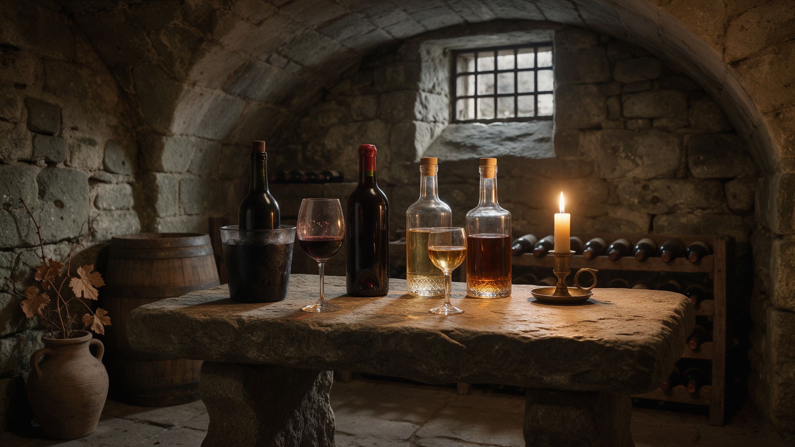

# Gary Regan

Gary Regan (1951–2019), known in the trade as Gaz Regan, was a British-born American bartender, author and teacher. His contribution was not one particular drink but the question of how to explain cocktails clearly: he sorted recipes into families with rules, so that bartenders could reason, vary and teach rather than memorise. He wrote books, ran courses, made bitters and recorded bar life for decades.

Figure: Gary Regan. Project-generated or category illustration used for bar and drinks context; not a photograph of the subject.

## Life and first career

Regan was born in 1951 in Rochdale, Lancashire. His parents ran the Prince Rupert pub in Bolton, and he worked there before he was old enough to drink legally; he later trained as a chef at Courtfield Catering College in Blackpool. At twenty-two he moved to the United States and began bartending at an Irish bar on Manhattan's Upper East Side.

In the 1970s he managed the North Star Pub in New York's South Street Seaport for four years. He later said that it was there he learned “the power of storytelling and the entertainment value of the liquor and bar businesses”. He died of complications from cancer at Newburgh Hospital, New York, on 15 November 2019, aged sixty-eight.

## From bartending to writing

In the early 1990s Regan began writing a drinks column for Food Arts. He went on to write for Wine Enthusiast, Cheers and Malt Advocate, and created “The Cocktailian” column in the San Francisco Chronicle. Before the internet, it was an important trade channel.

He wrote eighteen books on drink, bartending and cocktails. The first was The Bartender's Bible in 1991. With Mardee Haidin Regan he co-wrote The Book of Bourbon and Other Fine American Whiskey, The Bourbon Companion, New Classic Cocktails and The Martini Companion. He also wrote The Negroni: A Gaz Regan Notion and the annual 101 Best New Cocktails.

## The cocktail families of The Joy of Mixology

The Joy of Mixology, published in 2003 and revised in 2018, is the book for which he is best remembered. Its core is not the number of recipes but classification: the old-fashioned family built from spirit, sugar and bitters; the sour family built from spirit, citrus and sugar; and extensions such as highballs, Collinses and fizzes. Each family has a basic ratio and rules for variation.

The value of the system is that it can be reasoned from. If a bartender knows which family a drink belongs to, he can predict what will happen when the base spirit, the citrus or the syrup changes. It turns apprenticeship into a discussable language. Precisely because it is a teaching grammar rather than a historical taxonomy, the families should not be read as inviolable law.

## Orange bitters and a product

Many classic recipes call for orange bitters, but in the 1990s bartenders often could not find a usable product. Regan therefore developed Regan's Orange Bitters No. 6, giving his recipes a stable, repeatable ingredient. The bitters later entered the standard stock of many bars and became a concrete product of the classical cocktail revival.

The return of orange bitters was not his alone: supply and taste also changed. But his role was specific. He turned a line in old recipes into a product that could be made and distributed.

## Teaching and Cocktails in the Country

In 2003 Regan developed tongue cancer. After treatment he began wearing eyeliner under one eye in public, a gesture to remind bartenders that eye contact with guests matters. He moved to Cornwall-on-Hudson, New York, and ran a two-day course, Cocktails in the Country, that combined mixing, hospitality and bar management.

At a time when craft-cocktail education was still rare, the course trained a number of bartenders who later became well known, including Jim Meehan. Regan also spoke of “mindful bartending”, the idea that a bartender can sense and steer the energy of a bar. In 2012 he received a Lifetime Achievement Award from Tales of the Cocktail; in 2018 he launched the Worldwide Bartender Database, an online directory for bartenders and spirits producers.

## Industry influence

Regan's influence lies in language. He gave the trade a vocabulary of families that could be discussed, modified and examined; as bartending moved from apprenticeship toward courses, competitions and media, that vocabulary lowered the cost of communication. For a beginner it means understanding why a drink is built as it is without memorising hundreds of recipes; for a bar owner it gives staff training a shared reference point. The [old-fashioned](ref:old-fashioned) and [whisky](ref:whisky) are templates in his system rather than isolated recipes.

His British background gave his writing a transatlantic view: he knew the [British](ref:united-kingdom) emphasis on the occasion of a drink and also understood the pace and performance of [American](ref:usa) bars. When he wrote about [taverns](ref:taverns) and bar life, his focus was often less on the recipe than on how a person sits down, speaks and is received.

## Reputation and dispute

Wine Enthusiast's tribute quotes the cocktail historian David Wondrich: Regan “combined flash and cheek and energy with great technical skill”, and he was “always far more interested in the life of a bar than in the minutiae of his drink mixing”. The remark is both praise and limitation: his books are practical trade writing, not archival history, and his recipes were often adjusted for teaching, so a quotation should be checked against the original source.

A second distinction concerns the family system. It is a teaching tool, not a historical taxonomy; modern cocktails often cross families, and low-alcohol or alcohol-free drinks do not fit neatly. Treating The Joy of Mixology as a recipe encyclopedia misses its method; treating it as an unchangeable classic contradicts its own teaching spirit.

## Common misreadings

First, taking Gaz Regan for another person. It was his familiar nickname. Second, taking The Joy of Mixology for a recipe encyclopedia. It is closer to a method and a structural explanation, with recipes as examples. Third, crediting the return of orange bitters to him alone. He pushed it, but supply chains, bars and changing customer tastes all played a part. Fourth, treating the family classification as an inviolable rule. It is a tool, and modern cocktails often cross families. Fifth, taking his books as academic history. They are trade writing; recipes should be checked against original bar manuals or archives.

## Timeline

- 1951: born in Rochdale, England.
- Around 1973: moves to the United States and begins bartending in New York.
- 1991: The Bartender's Bible is published.
- 2003: The Joy of Mixology is published; he develops tongue cancer.
- 2012: receives a Lifetime Achievement Award from Tales of the Cocktail.
- 2015: The Negroni is published by Ten Speed Press.
- 2018: revised edition of The Joy of Mixology; launches the Worldwide Bartender Database.
- 2019: dies on 15 November.

Gary Regan is best approached through the period and the role, then the documented work, and then the sources behind the claim. One check alone will not settle it.

Start with [Old Fashioned](ref:old-fashioned) for role, then read [United States](ref:usa) for period. Seeing both keeps Gary Regan from being confused with a neighbouring idea.

## Further reading

- [Old-fashioned](ref:old-fashioned): the basic structure of the old-fashioned family.
- [Whisky](ref:whisky): one of the bases he used repeatedly.
- [The history of taverns](ref:taverns): the bar as a professional space.
- [United States](ref:usa): where he mainly worked and wrote.
- [United Kingdom](ref:united-kingdom): his birthplace and early bar experience.
