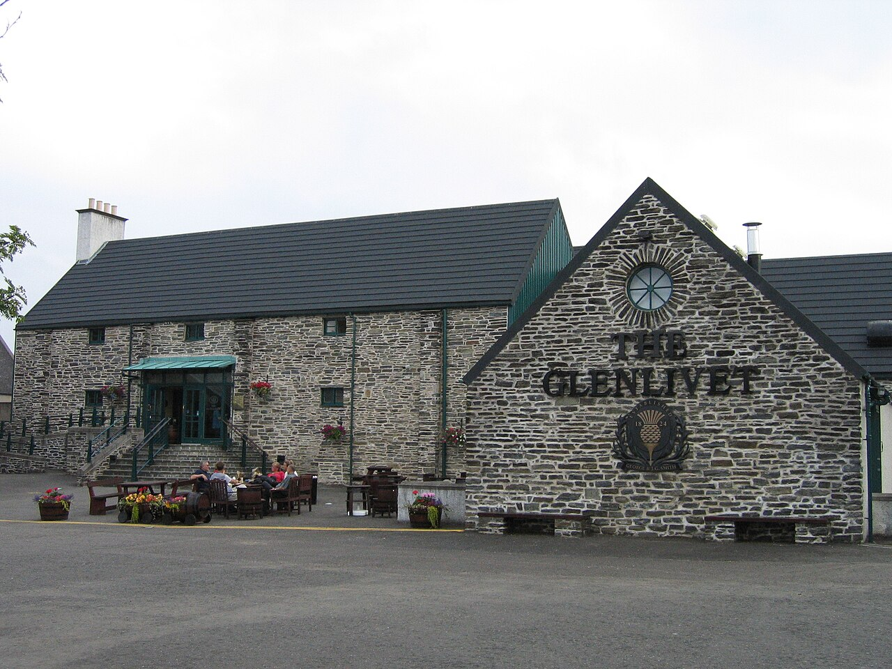

# George Smith

George Smith (died 1871) was a distiller in the Livet valley of Speyside and the starting point of The Glenlivet brand. His story contains a recurring image: a man who had just obtained a legal licence, carrying a pair of flintlock pistols while guarding his distillery in a valley full of illicit producers. The image may be polished, but it captures the conflict of Scotch whisky legalisation in the 1820s.

Figure: The Glenlivet distillery; a distillery scene, not a portrait of George Smith. Image: Kkonstan, CC BY 3.0, via Wikimedia Commons ([source page](https://commons.wikimedia.org/wiki/File:The_Glenlivet_distillery.jpg)).

## Early life and the illicit trade

Little is known about Smith's early life. He was born in the Livet valley and learned distilling in an environment where illicit production was normal: the valley was remote, water was abundant and excise officers were hard to reach. In the late eighteenth and early nineteenth centuries, illicit distilling was part of the local economy in the Highlands and Speyside: farmers distilled surplus barley and moved the spirit through established channels to the Lowlands and England. In August 1822 King George IV visited Scotland and asked for Glenlivet whisky; the story says what he tasted was still untaxed. The royal endorsement pushed the valley's name beyond Scotland.

## 1824: the first licence

In 1823 Parliament passed a new Excise Act that lowered the cost of legal distilling. In 1824 Smith rode to Elgin for a licence and became the first legal distiller in the Glenlivet parish. The decision angered neighbouring illicit producers, who threatened to burn the plant. Smith did not retreat: he carried flintlock pistols and expanded the distillery. The “courage” in today's brand story refers to this early legalisation conflict.

## Signature style

The Glenlivet is usually described as floral, fruity, soft and balanced: no peat-smoked malt, a clean body, and clear notes of apple, pear, citrus and vanilla. That style is closely tied to Speyside's identity. Smith's whisky was based on pot stills, malted barley and local water; later branding made “single malt” the core category, but the nineteenth-century plant was first an agricultural processing site, not a brand experience centre.

## Method and institutions

Smith's influence has two layers. The first is the legalisation model: he showed that a distiller could take a licence, pay tax, expand capacity and survive within an illicit tradition, gradually pushing rivals out of the market. By the late 1830s the plant produced more than 200 gallons a week; Andrew Usher & Sons of Edinburgh became sales agent and took the whisky to larger markets. The second is place-name branding: Glenlivet turned from a valley name into a whisky name and was borrowed by many other distillers. In 1852 Charles Dickens recommended “rare old Glenlivet” in a letter, a sign that it had reached British cultural celebrity tables. In 1884 Smith's son John Gordon Smith used legal action to secure exclusive use of “THE GLENLIVET”, drawing a formal boundary between brand and district.

## Assessment and disputes

Supporters see Smith as the representative of Scotch whisky's move from a smuggling economy to a legal industry: he seized the 1823 tax reform and turned a local name into an exportable commodity. Critics note that legalisation was not simple progress: it came with the exclusion of illicit distillers, control over land and water, and the brand's appropriation of a place name. Smith's biography is also thin, with many details coming from later brand storytelling, so archives and legend need to be separated. Technically, the soft springs of the Livet valley, local barley and unpeated malting shaped The Glenlivet's clean, floral, fruity base; that style later became typical of Speyside single malt rather than a “brand flavour” designed in Smith's time. The 1824 licence was not permanent protection: he still paid annual tax, accepted measurement and faced output limits, and the plant's survival depended on balancing compliance costs against market prices.

## Common misreadings

First, Smith was not the sole founder of The Glenlivet in the modern corporate sense. He built the plant, but later incorporation, trademarks and global distribution were the work of generations. Second, 1824 is not the start of whisky legalisation. The 1823 Excise Act was the institutional turning point; 1824 was his personal licence. Third, Glenlivet was not originally an exclusive distillery name. It was a valley and parish name before it became a brand. Fourth, the flintlock story is not necessarily pure invention; it may be polished, but the violence of early legalisation has a historical basis.

**In brief:** Distiller in the Livet valley of Speyside (died 1871) who obtained an Elgin licence in 1824 and became the first legal distiller in the Glenlivet parish; he built the plant amid threats from illicit distillers and laid the foundation for The Glenlivet single malt.

To read George Smith, start with the period and the role, then the documented work, then the sources behind the claim; no single check settles it.

[Single Malt Scotch Whisky](ref:single-malt)'s role and [The Glenlivet Distillery](ref:glenlivet)'s period form a useful pair: the contrast shows where one ends and the other begins.

**Key facts.**

| Item | Detail |
| --- | --- |
| In one line | Distiller in the Livet valley of Speyside (died 1871) who obtained an Elgin licence in 1824 and became the first legal distiller in the Glenlivet parish; he built the plant amid threats from illicit distillers and laid t… |
| Life | ?–1871 |
| Roles | Scotch whisky distiller、distillery founder |
| Regions | United Kingdom、Speyside |

**Sources and limits.** The key claims about George Smith are checked against the following sources: The Glenlivet (Used to check the 1822, 1824, 1839, 1852, 1871 and 1884 timeline; no text copied), Cassell Illustrated, Oxford University Press (Used to check Speyside, the single-malt definition and nineteenth-century distillation; no entry copied). Prices, batches and status change; the body is project-written and does not reproduce source text.

## Further reading

The Glenlivet's official history links the 1824 licence, threats from illicit distillers and the 1884 trademark into a brand narrative; the FAQ and “Our Story” pages add the 1822 royal visit, the 1839 sales agency and the 1871 succession. General Scotch whisky histories place the 1823 Excise Act in a wider legalisation wave. Read together, they show that Smith's “first” was first in the parish, not the only first in Scotland, and that the brand's “courage” has been polished by later retelling. In technical terms, the soft springs, local barley and unpeated malting of the Livet valley shaped The Glenlivet's clean, floral, fruity base; that style later became typical of Speyside single malt, not a deliberately designed brand flavour. The 1824 licence was also not a permanent shield: annual tax, measurement and output limits meant survival depended on balancing compliance costs against market prices. After Smith died in 1871, his son John Gordon Smith took over; the brand passed through later mergers and owners, but the name remained tied to Livet water, unpeated malt and soft fruit.

## See also

- [Single malt Scotch](ref:single-malt): The Glenlivet's core category.
- [Speyside](ref:speyside): the region of Smith's plant.
- [Glenlivet distillery](ref:glenlivet): the site that dates from 1824.
- [Speyside malt trail](ref:speyside-trail): the travel framework linking Dufftown, Craigellachie and Ballindalloch.
- [Scotch whisky](ref:scotch): the wider category and its pot-still craft.
