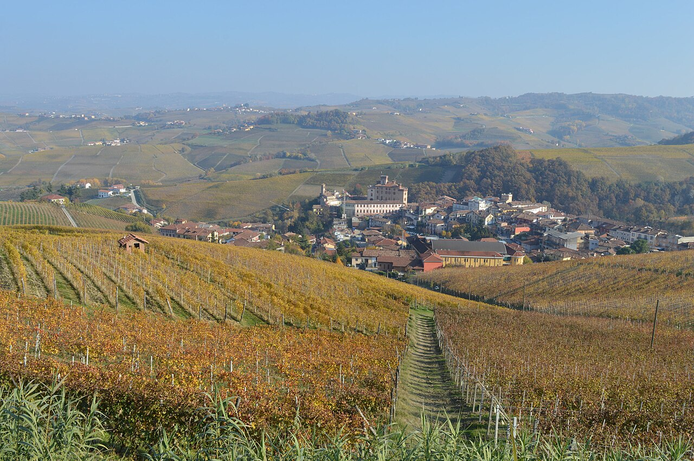

# Giacomo Conterno

Giacomo Conterno was a leading figure of the traditionalist school of Barolo in Piedmont, Italy, and the founder of the estate that carries his name. His family had several generations of vine-growing and wine-trade experience around Monforte d'Alba. In 1908 his father Giovanni opened a tavern in the village of San Giuseppe, making wine from local grapes for the business. After returning from the First World War, Giacomo decided to do something then rare: bottle Barolo with a label, rather than sell it in bulk.

Figure: The village of Barolo and its Nebbiolo vineyards; a regional scene, not a portrait of Giacomo Conterno. Image: Bruno Sulis, CC0, via Wikimedia Commons ([source page](https://commons.wikimedia.org/wiki/File:Barolo_Village_(163795471).jpeg)).

## From tavern to bottled wine

Early twentieth-century Barolo was often sold in large casks or demijohns, and buyers drank it young. Giacomo thought the opposite: Barolo should be able to last for decades, and could even be "undrinkable" at bottling, opening up only after twenty or thirty years. Secondary sources differ on whether his first Riserva was 1912 or 1920; 1924 is recorded by some as the first commercial bottling labelled Monfortino.

Monfortino took its name from his home town, Monforte d'Alba. It was not a "stronger" version of ordinary Barolo but a wine designed from the start for long ageing: longer maceration, large Slavonian oak, extended barrel ageing, and further evolution in bottle. It became one of the most collected Barolos in Italy and a reference point for the traditionalist school.

## Family succession and two paths

Giovanni died in 1934, and Giacomo took over the tavern and estate. His sons Giovanni and Aldo formally took charge in 1961; Giovanni had been making the wine since 1959, while Aldo was drawn to a "modern" path of shorter maceration and smaller oak. In 1969 the brothers split: Aldo founded Poderi Aldo Conterno, and Giovanni stayed at Giacomo Conterno and continued the traditional practice.

The split became a symbol of the later twentieth-century "traditional versus modern" debate in Barolo. The traditionalists emphasised long maceration, large casks and long ageing, letting Nebbiolo's tannin and acidity integrate slowly. The modernists used shorter maceration, small barriques and earlier release, seeking a softer, more approachable style. Conterno stood on the traditional side, but "traditional" was not frozen: Giovanni also adjusted fermentation temperatures and barrel time in the 1970s in response to markets and vintages.

## Cascina Francia and Monfortino

In 1974 Giovanni bought Cascina Francia in Serralunga d'Alba, ending a long period of bought grapes. The roughly fourteen-hectare southwest-facing slope became the estate's own fruit; 1978 was the first vintage from it. Before that, both Monfortino and ordinary Barolo came from purchased grapes, so the claim that "Monfortino was always a single vineyard" is inaccurate. Only after Cascina Francia did the estate have a stable own site.

Monfortino is made only in strong years and ages for a long time in large oak rather than small barriques. That does not mean "no oak influence"; it means slower oxygen exchange and less sweetness from the wood. The wine is pale in colour, with rose, tar, cherry, leather and earth; the tannin is powerful but fine, the acidity high, and the wine is built for long keeping. To drinkers unused to Nebbiolo it can seem closed when young; to collectors that is precisely its value.

## The estate continues

In the 1960s Italian labelling rules began to tighten, defining Barolo's zone, minimum ageing and minimum alcohol. Conterno did not accept every rule as a definition of quality, but he still made wine to his own standard: a simple label was acceptable, a wine that could not age was not.

Giovanni died in 2004, and Roberto Conterno took over. Roberto had worked with his father since 1988 and later acquired Cerretta (2008) and Arione (2015), expanding the estate's own vineyards. He kept the traditional skeleton but became more precise in vineyard management, fermentation control and hygiene. The Barolo, Barbera and Langhe Nebbiolo remain dominated by long maceration and large casks, and Monfortino is made only in selected years.

On Giacomo's own death, secondary sources give both 1961 and 1971; this page therefore avoids a specific year and says only that the sons formally took over in 1961 and the brothers split in 1969. Such biographical details are often skipped in estate histories, yet they matter for understanding who did what and when.

## Assessment and controversy

The favourable view treats Conterno as a bastion of Barolo traditionalism: his wines do not chase short-term drinkability but emphasise structure, acidity and longevity; Monfortino and Cascina Francia became references for later traditionalists; Roberto's succession showed that a family style could continue rather than become mere nostalgia.

Criticism has three lines. First, "tradition" is often romanticised: long maceration and large casks do not automatically make good wine, and vintage, ripeness and hygiene matter just as much. Conterno's success came from strict selection, not simply "old methods". Second, Monfortino's scarcity and auction price turn "tradition" into status consumption; the drinking experience and the market price need to be kept apart. Third, the traditional-versus-modern binary oversimplifies Barolo: many estates adjusted between the two, and Conterno itself changed technically.

## Common misreadings

The first is to treat Giacomo Conterno as the current winemaker. The estate is now run by Roberto Conterno; Giacomo was the founder, and Giovanni was the bridging generation.

The second is to treat Monfortino as "always a single vineyard". Before Cascina Francia the estate bought grapes for decades; the single-vineyard story belongs to the period after the late 1970s.

The third is to treat "large cask" as "no oak". Large oak still allows oxygen exchange and wood influence, just more slowly and less obviously than small barrels.

The fourth is to treat "traditional" as "never changing". The Conterno family adjusted fermentation, vineyards and equipment; tradition is a direction of method, not a frozen recipe.

## See also

- [Barolo](ref:barolo): the core region of the estate and Monfortino.
- [Piedmont](ref:piedmont): the larger region of Monforte d'Alba and Serralunga d'Alba.
- [Nebbiolo](ref:nebbiolo): the only red variety of Barolo and the backbone of Monfortino.
- [Red wine](ref:red-wine): the category that explains long maceration, large casks and long ageing.
- [Place and process](ref:place-process): the wider framework for site, variety and technique.

**Short definition:** Traditionalist Barolo producer in Monforte d'Alba, Piedmont, who founded the estate that bears his name and established Monfortino through long maceration and large Slavonian oak, making Barolo built for long ageing.

**Key facts.**

| Item | Detail |
| --- | --- |
| In one line | Traditionalist Barolo producer in Monforte d'Alba, Piedmont, who founded the estate that bears his name and established Monfortino through long maceration and large Slavonian oak, making Barolo built for long ageing. |
| Roles | winemaker、estate founder、tavern keeper |
| Regions | Italy、Piedmont、Barolo |

**Sources and limits.** The key claims about Giacomo Conterno are checked against the following sources: Giacomo Conterno, The Rare Wine Co., SommSelect and 5 sources in total. Prices, batches and status change; the body is project-written and does not reproduce source text.
