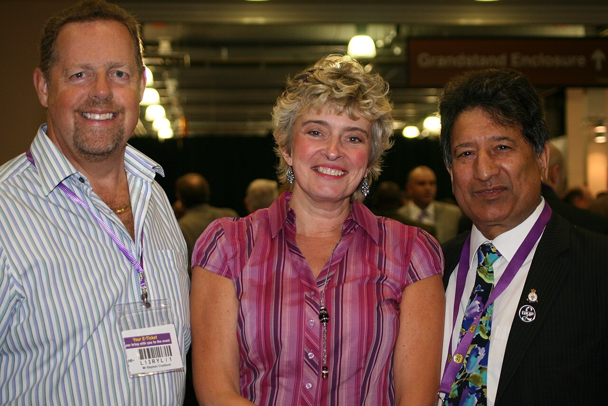

# Harry Craddock

Harry Craddock (1876-1963) was an Anglo-American bartender and one of the best-known bar authors of the 20th century. His name is tied to the American Bar of the Savoy Hotel in London: he took charge there in 1925 and published The Savoy Cocktail Book in 1930, gathering the recipes, ratios and bar discipline that had crossed the Atlantic during Prohibition into a book a reader could carry away. The dry martini, the White Lady and the manhattan all have early versions in that book or in its lineage.

Figure: Harry Craddock. Photograph: Steve Craddock Caroline Stephens & Harry Bhuta (15236917799). Credit: Derek Bennett, CC BY 2.0, via Wikimedia Commons ([source](https://commons.wikimedia.org/w/index.php?curid=85019345)).

## Life

Craddock was born in 1876 in Stroud, Gloucestershire, England; his full name was Harry Lawson Craddock. He left Britain young and worked for years in American hotels and bars, learning their recipes and habits.

When national Prohibition took effect in the United States in 1920, he returned to London and joined the American Bar at the Savoy. He worked there first as a bartender and in 1925 succeeded Ada Coleman as head bartender. For more than a decade he served royalty, actors and politicians. In 1938 he moved to the Dorchester, later worked at Brown's, and retired in 1947. He died in London in 1963.

## Timeline

- 1876: born in Stroud, Gloucestershire, England.
- 1920: returned to London because of American Prohibition and joined the American Bar at the Savoy.
- 1925: succeeded Ada Coleman as head bartender of the American Bar.
- 1930: The Savoy Cocktail Book was published in London by Constable.
- 1930s: helped found the United Kingdom Bartenders' Guild.
- 1938: moved to the Dorchester.
- 1947: retired.
- 1963: died in London.

## Work in the drinks trade

Craddock's relationship with the trade was first that of a bar manager. The American Bar served hotel guests, theatre audiences and international travellers, and had to deliver a stable product at speed. His job was to turn those demands into recipes staff could execute.

Second, he carried bartending knowledge across the Atlantic. American bars led in ice, shaking and recipe writing; Prohibition pushed a generation of bartenders to London, Paris and Havana. Craddock had worked in the United States and then returned, joining the two practices. Many recipes in The Savoy Cocktail Book therefore have an American bar skeleton and a British hotel presentation.

Third, he helped organise the profession. In the 1930s he and William J. Tarling were among the founders of the United Kingdom Bartenders' Guild, giving bartenders training, certification and shared standards.

## Major works and institutions

The Savoy Cocktail Book was published in London by Constable in 1930, illustrated by Gilbert Rumbold, and contains more than 750 recipes. It is not arranged like a modern menu by base spirit but by drink family: cocktails, Rickeys, Daisies, Slings, Shrubs, Smashes, Fizzes, Juleps, Cobblers and Fixes, preserving the classification habits of 19th-century bartenders' manuals.

Its value has three layers. The first is the recipes: it records what British and American bars actually did around Prohibition, including early versions of the dry martini, the manhattan and the old-fashioned. The second is proportion and language: it uses old units such as "dash", "glass" and "wineglass", letting a modern reader see how recipe writing changed. The third is visual: Rumbold's Art Deco illustrations make the book not only a manual but a design object of the 1930s.

At the institutional level, the book established a tradition of the hotel bar publishing its own book, fixing recipes and service in print.

## Bartending method

Craddock's method bears the marks of a hotel bar: speed, consistency and presentation. He is often quoted through rules such as "shake a martini, stir a daiquiri", but those lines circulate online in many versions and their exact wording and source should be treated with caution.

What is more reliable is the set of choices visible in the book: shake what should be shaken and stir what should be stirred; use fresh citrus rather than bottled juice; chill the glass before pouring. These principles look ordinary now, but in a 1930s hotel bar they were how "good" became "the same every time".

## Influence

First, he made the American Bar a landmark of cocktail history. Visitors to London still put it on a short list of bars to see.

Second, he preserved Prohibition-era recipes. American bars were forced underground or abroad in the 1920s, and many recipes survived through bars in London, Paris and Havana; The Savoy Cocktail Book is the most influential single record of them.

Third, he pushed bartending toward professional organisation. The guild gave bartenders training, certification and a forum for exchanging practice.

## Assessment and disputes

The Savoy's own website calls him a godfather-like figure of the American Bar and credits him with the White Lady; Bar Magazine, reviewing a biography, calls The Savoy Cocktail Book a classic. These judgments carry a brand narrative but match the text he left behind.

There are three disputes. First, the year he became head bartender: the Savoy says 1925, while some other sources say 1926; the difference may lie between taking the role and receiving the formal title. Second, the White Lady: the Savoy credits the recipe to Craddock, but earlier versions under the same or a similar name exist, so the invention should not be stated too firmly. Third, the dry martini: his book contains an early recipe, but he did not invent the drink; mistaking "printed in his book" for "invented by him" is a common confusion.

## Common misreadings

First, that Craddock invented the dry martini. He did not; the book records recipes already in circulation, and the martini's lineage is older and more complicated than the book.

Second, that Craddock was American. He was born in England, worked in the United States and returned to London; calling him an American bartender loses his British hotel background.

Third, that The Savoy Cocktail Book is only a recipe collection. It is also a design object of the 1930s, a hotel service manual and a document in the professionalisation of bartending.

Fourth, that every drink in the book was his own creation. The book is a compilation, containing his adjustments alongside many recipes taken from colleagues and older manuals.

Fifth, that the deathbed notes about never shaking a martini are established fact; they lack contemporary archival support.

## See also

- [Dry Martini](ref:dry-martini): one of the classics most often quoted from the book.
- [Manhattan](ref:manhattan): the basic structure of a whisky cocktail.
- [Sazerac](ref:sazerac): a New Orleans classic that shows how early manuals wrote recipes.
- [Old Fashioned](ref:old-fashioned): spirits, sugar, water and bitters in their original form.
- [Cocktail basics](ref:cocktail-basics): tools, ratios and classic recipes.
- [Gin](ref:gin): the base of the White Lady and the dry martini.

Begin with the period and the role, move on to the documented work, and finish with the sources behind the claim. That order keeps the reading of Harry Craddock practical.